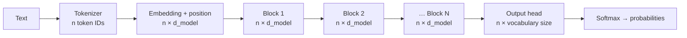
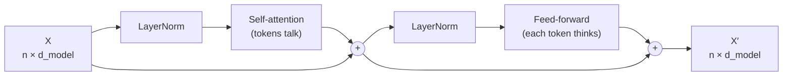

# Section 1 — What a Transformer Is

> **In one line:** a Transformer is a neural network that turns a sequence of tokens into a sequence of context-aware vectors by letting every token look directly at every other token, all at the same time.

---

## 1. Learning objectives

By the end of this section you should be able to:

1. **Explain** what problem the Transformer was designed to solve and why recurrent networks (RNNs) struggled with it.
2. **Describe** the end-to-end pipeline of a Transformer: tokens → embeddings → stacked blocks → output.
3. **Name** the two sub-layers inside every Transformer block and say, in one sentence each, what they do.
4. **Trace** the shape of the data as it flows through the model for a small example.
5. **Compare** the Transformer with an RNN on parallelism, path length between words, and cost.

---

## 2. Prerequisites

You should be comfortable with:

- **Python and NumPy**: arrays and `.shape`.
- **Matrix multiplication**: if $A$ is $m \times k$ and $B$ is $k \times p$, then $AB$ is $m \times p$.
- **What a neural network layer does**: multiply by a weight matrix, add a bias, apply a non-linearity.
- **Gradient descent**: weights are adjusted step by step to reduce a loss.

**Quick refresher: a "vector representation".** Neural networks can't read words. Each word (or piece of a word) is replaced by a list of numbers called a **vector**, e.g. `[0.2, -1.3, 0.7, 0.05]`. Similar words end up with similar vectors. Everything in this course is about transforming such vectors into more useful ones.

No earlier sections are needed; this is the starting point.

---

## 3. Motivation: why do we need something new?

Read this sentence:

> *Riya poured water into the glass until **it** was full.*

What does **it** refer to? You instantly know it's *the glass*, not *Riya* and not *the water*. To work that out you had to connect "it" with a word five positions earlier, and use "full" (which comes *after* "it") as a clue.

Language is full of these long-range connections. A model that understands text must be able to:

1. **Link words that are far apart.**
2. **Use context from both sides** of a word (or at least everything before it).
3. **Do this quickly** on very long texts, because modern models train on trillions of words.

### How RNNs handled it, and where they hit a wall

Before 2017 the standard tool was the **recurrent neural network (RNN)**, usually in its LSTM or GRU form. An RNN reads one token at a time and keeps a running summary called the **hidden state**:

$$h_t = f(h_{t-1},\; x_t)$$

In words: the new summary $h_t$ is computed from the previous summary $h_{t-1}$ and the current token $x_t$.

This design has three problems:

| Problem | Why it happens |
|---|---|
| **Slow training** | Step $t$ can't start until step $t-1$ is finished, so a 1,000-token sentence needs 1,000 steps one after another, and GPUs sit mostly idle. |
| **Forgetting** | Information about word 1 must survive being squeezed through every hidden state up to word 1,000. In practice it fades (the *vanishing gradient* problem). |
| **Long paths** | The signal between two words $k$ positions apart has to pass through $k$ steps, which makes long-range links hard to learn. |

Researchers had already added an **attention mechanism** on top of RNNs (Bahdanau et al., 2014) so the model could "look back" at earlier words directly. The big idea of the Transformer paper was:

> **Keep the attention, throw away the recurrence.**

---

## 4. Intuition first: the classroom discussion

Imagine a class of students, each holding one word of the sentence on a card.

- **The RNN classroom:** the first student whispers a summary to the second, who adds their word and whispers to the third, and so on. By the end of the line the message is long, slow to deliver and garbled, like a game of telephone.
- **The Transformer classroom:** everyone stands in a circle and can **talk to everyone else at once**. The student holding "it" asks the room, "Who here is a container that can be full?" The student holding "glass" answers loudly, the others quietly. "It" updates its understanding: *I mean the glass.* Every student does this at the same time, in parallel.

That room-wide question-and-answer is **self-attention**. After one round, each student has a better, context-aware understanding of their word. Repeat the discussion several times (several **layers**) and the understanding deepens.

**Where the analogy breaks:** real students listen to the words in order. The Transformer, by default, has *no sense of order at all*: shuffle the students and it gives the same answers. We fix this by stamping each card with its position number (**positional information**, Section 7).

---

## 5. The formal idea

### 5.1 Key terms

- **Token**: the basic unit of text the model works with: a word, part of a word, or punctuation mark. (Section 2.)
- **Embedding**: the vector that represents a token. Its length is called the **model width**, written $d_{model}$.
- **Sequence length** $n$: the number of tokens in the input.
- **Transformer block** (also called a **layer**): one round of "discussion" plus "individual thinking". A model stacks $N$ identical blocks.
- **Self-attention**: the operation that lets each token gather information from all other tokens. (Sections 3–6.)
- **Feed-forward network (FFN)**: a small two-layer neural network applied to each token *separately*. (Section 8.)

### 5.2 The input as a matrix

We stack the $n$ token vectors as rows of a matrix:

$$X \in \mathbb{R}^{n \times d_{model}}$$

In words: $X$ has one row per token, and each row is that token's $d_{model}$-long vector.

### 5.3 What one block does

Each block takes $X$ in and returns a matrix **of the same shape** out:

$$X' = \text{Block}(X), \qquad X, X' \in \mathbb{R}^{n \times d_{model}}$$

Inside, there are two sub-layers, each wrapped with a **residual connection** (add the input back) and **layer normalization** (rescale the numbers to a stable range):

$$
\begin{aligned}
A &= X + \text{SelfAttention}(\text{LN}(X)) \\
X' &= A + \text{FFN}(\text{LN}(A))
\end{aligned}
$$

In words:
1. **Self-attention**: tokens exchange information ("talk to each other"), and the result is added to what each token already knew.
2. **Feed-forward network**: each token processes what it has just learned on its own ("think individually"), and again the result is added on.

(This is the *pre-norm* arrangement used by most modern models. The 2017 paper normalized *after* adding; Section 8 compares the two.)

Because the output shape equals the input shape, we can stack as many blocks as we like:

$$X^{(N)} = \text{Block}_N(\cdots \text{Block}_2(\text{Block}_1(X^{(0)})))$$

### 5.4 The full pipeline

1. **Tokenize** the text into $n$ token IDs (integers).
2. **Embed** each ID into a $d_{model}$-long vector and **add position information**, giving $X^{(0)}$ with shape $n \times d_{model}$.
3. **Pass through $N$ blocks**, giving $X^{(N)}$ with the same shape.
4. **Output head**: a final linear layer turns each row into a score for every word in the vocabulary, shape $n \times \text{vocabulary size}$. A **softmax** turns the scores into probabilities.

### 5.5 Three flavours (preview of Section 11)

The original 2017 model had two halves:
- An **encoder**, which reads the input sentence and builds understanding.
- A **decoder**, which writes the output sentence one token at a time, looking at the encoder's result.

Since then, many models keep only one half:

| Flavour | Example models | Good at |
|---|---|---|
| Encoder-only | BERT | Understanding: classification, search |
| Decoder-only | GPT, Claude, LLaMA | Generating text: chat, code |
| Encoder–decoder | Original Transformer, T5 | Turning one text into another: translation |

---

## 6. Worked example: tracing shapes

Let's follow a tiny, made-up model through the pipeline.

**Setup**
- Input text: *"glass is full"*
- Tokens (assume one token per word): `["glass", "is", "full"]`, so $n = 3$.
- Model width $d_{model} = 4$.
- Vocabulary size = 10 (a toy vocabulary).
- Number of blocks $N = 2$.

**Step 1: Tokenize.** Suppose our vocabulary maps `glass → 7`, `is → 2`, `full → 5`.

$$\text{ids} = [7,\; 2,\; 5] \qquad \text{shape } (3,)$$

**Step 2: Embed.** The embedding table has shape $10 \times 4$ (one row per vocabulary word). We pick rows 7, 2 and 5:

$$
X^{(0)} =
\begin{bmatrix}
0.10 & 0.50 & -0.20 & 0.30 \\
0.40 & 0.00 & 0.10 & -0.10 \\
-0.30 & 0.20 & 0.60 & 0.00
\end{bmatrix}
\qquad \text{shape } 3 \times 4
$$

(The numbers are made up for illustration; position information is added here too.)

**Step 3: Block 1.** Self-attention mixes information *across rows*, so row 1 (glass) now carries a little of rows 2 and 3. The FFN then transforms each row on its own. Shape in = $3 \times 4$, shape out = $3 \times 4$.

**Step 4: Block 2.** Same again: $3 \times 4 \rightarrow 3 \times 4$.

**Step 5: Output head.** Multiply by a weight matrix of shape $4 \times 10$:

$$(3 \times 4) \cdot (4 \times 10) = 3 \times 10$$

Each of the 3 rows now holds 10 scores, one per vocabulary word. After softmax, each row is a probability distribution that sums to 1.

**Shape summary**

| Stage | Shape |
|---|---|
| Token IDs | $3$ |
| Embeddings $X^{(0)}$ | $3 \times 4$ |
| After block 1 | $3 \times 4$ |
| After block 2 | $3 \times 4$ |
| Output scores | $3 \times 10$ |

**Key observation:** the "width" stays at $d_{model}$ through every block. Only the very first step (IDs → vectors) and the very last step (vectors → vocabulary scores) change it.

### A second mini-calculation: RNN vs Transformer path length

For $n = 3$ tokens, how many steps does information need to travel from token 1 to token 3?

- **RNN:** token 1 → hidden state 1 → hidden state 2 → hidden state 3. That's **2 steps** (in general $n-1$).
- **Transformer:** token 3 attends to token 1 directly, so **1 step**, whatever $n$ is.

For a 1,000-token document that's 999 steps versus 1 step.

---

## 7. Diagram

Inside one block:

The arrows that skip around each sub-layer are the **residual connections**.

---

## 8. In practice

### Real model sizes

| Model | Year | Type | Blocks $N$ | $d_{model}$ | Heads $h$ | Parameters |
|---|---|---|---|---|---|---|
| Original Transformer (base) | 2017 | Encoder–decoder | 6 + 6 | 512 | 8 | ≈ 65 M |
| BERT-base | 2018 | Encoder-only | 12 | 768 | 12 | ≈ 110 M |
| GPT-2 (small) | 2019 | Decoder-only | 12 | 768 | 12 | ≈ 124 M |
| LLaMA-2 7B | 2023 | Decoder-only | 32 | 4096 | 32 | ≈ 7 B |

Notice the pattern: bigger models mostly get **wider** (larger $d_{model}$) and **deeper** (more blocks). The block design itself barely changes.

### Where Transformers are used today
- **Language:** chatbots, translation, summarization, code completion.
- **Vision:** Vision Transformers split images into patches and treat each patch as a token (Section 15).
- **Speech:** e.g. Whisper turns audio frames into tokens.
- **Science:** e.g. protein-structure models such as AlphaFold 2 use attention-based blocks.

### The one big cost
Self-attention compares every token with every other token, so the work grows with $n^2$. Going from 1,000 to 10,000 tokens makes the attention step about **100× more expensive**. Much of modern research (Section 14) is about reducing this cost.

---

## 9. Common mistakes and misconceptions

- **"A Transformer reads the sentence left to right like a person."** Not by default. It processes all tokens at once and has no built-in notion of order. Order comes only from the position information we add.
- **"Transformer = GPT."** GPT is *one* kind of Transformer (decoder-only). BERT (encoder-only) and T5 (encoder–decoder) are Transformers too.
- **"Attention is the whole model."** Attention only moves information *between* tokens. Most of the parameters, roughly two-thirds in typical models, sit in the feed-forward networks, which process each token on its own.
- **"Each block changes the vector size."** No. Every block maps $n \times d_{model}$ to $n \times d_{model}$, which is exactly why blocks can be stacked.
- **"Transformers have no weaknesses compared with RNNs."** Their attention cost grows with $n^2$ while an RNN's grows with $n$. For very long sequences that matters, which is why RNN-like ideas (e.g. state-space models) are being revisited.

---

## 10. Summary

- The Transformer (Vaswani et al., 2017) replaced step-by-step recurrence with **self-attention**, letting every token look at every other token directly.
- This gives **parallel training** (fast on GPUs) and a **one-step path** between any two tokens (good for long-range meaning).
- The pipeline is: **tokenize → embed + position → $N$ identical blocks → output head → softmax**.
- Each block = **self-attention** (tokens talk) + **feed-forward network** (each token thinks), each with a residual connection and layer normalization.
- Blocks keep the shape $n \times d_{model}$, so they stack cleanly. Bigger models are mainly wider and deeper.
- The main cost: attention work grows with $n^2$.

---

## 11. Check your understanding

1. An RNN and a Transformer each process a 500-token document. Roughly how many *sequential* steps does each need to process the tokens, and why does this matter for training on GPUs?
2. A Transformer block receives an input of shape $20 \times 512$. What is the shape of its output? Why must it be this shape?
3. If we shuffle the order of the input tokens and give a Transformer **no** position information, what happens to its output?

Answers

1. The RNN needs about **500 sequential steps**, because each hidden state depends on the previous one. The Transformer processes all 500 tokens **in one parallel step per layer**. GPUs are built for large parallel computations, so the Transformer uses them far more efficiently and trains much faster.
2. **$20 \times 512$.** Every block maps $n \times d_{model}$ to $n \times d_{model}$. The residual connection adds the input to the sub-layer output, which only works if both have the same shape, and keeping the shape fixed is what lets us stack blocks.
3. The output rows get **shuffled in the same way**, but each token's output vector is otherwise identical. Without position information, self-attention can't tell word order apart, so "dog bites man" and "man bites dog" would look the same.

---

## 12. Further reading

1. Vaswani, A. et al. (2017). **"Attention Is All You Need."** *Advances in Neural Information Processing Systems 30 (NeurIPS 2017).* arXiv:1706.03762. The original Transformer paper. Read Sections 1–3 now; the rest will make sense after Section 6 of this course.
2. Bahdanau, D., Cho, K., & Bengio, Y. (2014). **"Neural Machine Translation by Jointly Learning to Align and Translate."** arXiv:1409.0473. The paper that introduced attention on top of RNNs; useful for seeing where the idea came from.
3. Jurafsky, D., & Martin, J. H. **_Speech and Language Processing_** (3rd edition draft), the chapter on Transformers and large language models. A clear textbook treatment at undergraduate level, freely available online from Stanford.
4. Alammar, J. **"The Illustrated Transformer"** (blog post, 2018). A highly visual walkthrough, good for building intuition alongside these notes.
