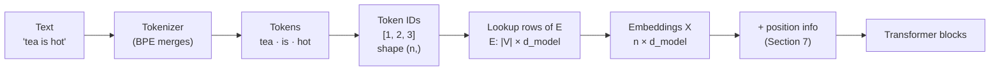

# Section 2 — Tokens & Embeddings

> **In one line:** before a Transformer can do anything, text must be cut into **tokens**, each token turned into an integer **ID**, and each ID turned into a learned vector called an **embedding**. This section is about those three steps.

---

## 1. Learning objectives

By the end of this section you should be able to:

1. **Explain** why models use sub-word tokens instead of whole words or single characters.
2. **Run** the Byte-Pair Encoding (BPE) algorithm by hand on a small corpus, and use the learned merges to tokenize a new word.
3. **Show** that an embedding lookup is the same as multiplying a one-hot vector by the embedding matrix.
4. **Compute** the cosine similarity between two embedding vectors and interpret the result.
5. **Calculate** the size of an embedding table for a real model.

---

## 2. Prerequisites

- **Section 1**: the pipeline *tokenize → embed → blocks → output*, and the symbols $n$ (number of tokens) and $d_{model}$ (vector width).
- **Dot product**: $a \cdot b = \sum_i a_i b_i$. For $a = [1, 2]$ and $b = [3, 4]$: $1\cdot3 + 2\cdot4 = 11$.
- **Vector length (norm)**: $\lVert a \rVert = \sqrt{\sum_i a_i^2}$. For $a = [3, 4]$: $\sqrt{9 + 16} = 5$.

**Quick refresher: one-hot vectors.** A **one-hot vector** has a single 1 and zeros everywhere else. With 5 possible items, item number 3 (counting from 0) is `[0, 0, 0, 1, 0]`. It's the simplest way to say "this one, and nothing else" as numbers.

---

## 3. Motivation: computers only understand numbers

A neural network multiplies and adds numbers. It can't multiply the word "tea". So we need a reliable way to turn any text, in any language, including typos, emoji and code, into numbers.

The obvious idea is "give every word a number". It runs into trouble fast:

| Approach | Example: "unhappiness" | Problem |
|---|---|---|
| **Word-level** | `["unhappiness"]` | The vocabulary must hold every word in every form: *happy, happier, happiest, unhappy, unhappiness…* Any word not in the list (a new name, a typo like "teh") becomes an **unknown** token and its meaning is lost. |
| **Character-level** | `["u","n","h","a","p","p","i","n","e","s","s"]` | Only about 100 symbols needed and nothing is ever unknown. But sequences become ~4× longer, and attention cost grows with $n^2$ (Section 1), so that's roughly 16× more work. Single letters also carry almost no meaning. |
| **Sub-word** | `["un", "happi", "ness"]` | The middle ground. Common words stay whole, rare words split into meaningful pieces, and nothing is ever unknown. **This is what every modern LLM uses.** |

Sub-word tokenization reuses pieces. A model that has learned "un-" (not), "-ness" (state of being) and "happi" can make sense of "unhappiness" even if it saw that exact word rarely.

---

## 4. Intuition first

### Tokens: LEGO bricks for text

Think of a tokenizer's vocabulary as a box of LEGO bricks. There are small bricks (single letters), medium bricks (common chunks like "ing", "pre", "tion") and big special bricks (very common whole words like "the"). To build any word, use the **biggest bricks that fit**. Frequent words are one big brick; a rare word like "neaten" is built from several smaller ones.

### Embeddings: a map of meaning

Now give every brick a location on a map. Bricks with similar meanings sit close together: "tea" near "coffee", both far from "brick". The location is just a list of coordinates, and that list *is* the embedding vector.

**Where the analogy breaks:**
- A real map has 2 dimensions; real embeddings have hundreds or thousands ($d_{model}$ = 768, 4096, …).
- On a real map the axes mean "north" and "east". Embedding axes have **no human-chosen meaning**. The model learns whatever directions are useful, and they're usually not interpretable one at a time.

---

## 5. The formal idea

### 5.1 Key terms

- **Tokenizer**: the fixed procedure that splits text into tokens and maps them to IDs. It's built *before* the model is trained and never changes afterwards.
- **Vocabulary**: the list of all tokens the tokenizer can produce. Its size is the **vocabulary size**, written $|\mathcal{V}|$ in this section so it isn't confused with the value matrix $V$ later.
- **Token ID**: a token's position in the vocabulary, an integer from $0$ to $|\mathcal{V}| - 1$.
- **Embedding matrix** $E$: a learned table with one row per token, shape $|\mathcal{V}| \times d_{model}$.
- **Embedding**: one row of $E$, the vector that represents a token.

### 5.2 Byte-Pair Encoding (BPE): how the vocabulary is learned

BPE builds the vocabulary from a training corpus by repeatedly gluing together the most common neighbouring pair:

1. Start with every word split into **single characters**. The initial vocabulary is the set of characters.
2. Count every **adjacent pair** of tokens across the corpus, weighting each word by how often it occurs.
3. **Merge** the most frequent pair into one new token, add it to the vocabulary, and record the merge rule.
4. Repeat steps 2–3 until the vocabulary reaches the target size (e.g. 32,000 or 50,000 tokens).

**To tokenize new text**, split it into characters and apply the recorded merges **in the order they were learned**.

### 5.3 From token IDs to vectors: the embedding lookup

Let token $i$ have the one-hot vector $o_i$ (length $|\mathcal{V}|$, with a 1 at position $i$). Its embedding is

$$x_i = o_i^{\top} E = E[i, :]$$

In words: multiplying a one-hot vector by $E$ picks out exactly row $i$. In practice libraries skip the multiplication and simply **index** row $i$, which is much faster and gives the same result.

For a sequence of token IDs $(t_1, \dots, t_n)$ we stack the rows:

$$X = \begin{bmatrix} E[t_1, :] \\ \vdots \\ E[t_n, :] \end{bmatrix} \in \mathbb{R}^{n \times d_{model}}$$

This is the matrix $X$ from Section 1 (before position information is added).

### 5.4 Embeddings are learned

$E$ starts as **small random numbers**. During training, gradients flow back into the rows of the tokens that appeared in each batch, nudging them so the model's predictions improve. Tokens used in similar contexts receive similar nudges, so they end up with **similar vectors**. Nobody tells the model that "tea" and "coffee" are related; it discovers this because they appear in similar sentences ("a hot cup of ___").

### 5.5 Measuring similarity: cosine similarity

$$\cos(a, b) = \frac{a \cdot b}{\lVert a \rVert \, \lVert b \rVert}$$

In words: the dot product divided by both lengths. It measures the **angle** between two vectors and ignores their lengths:

| Value | Angle | Meaning |
|---|---|---|
| $1$ | 0° | Same direction: very similar |
| $0$ | 90° | Unrelated |
| $-1$ | 180° | Opposite directions |

### 5.6 Two practical details

- **Special tokens.** Vocabularies include tokens that aren't text, such as `<bos>` (beginning of sequence), `<eos>` (end), `<pad>` (filler to make sequences the same length), and BERT's `[CLS]`, `[SEP]` and `[MASK]`. They get embeddings like any other token.
- **Weight tying.** The output head (Section 1) maps vectors back to vocabulary scores with a $d_{model} \times |\mathcal{V}|$ matrix. Many models simply reuse $E^{\top}$ for this, which saves $|\mathcal{V}| \cdot d_{model}$ parameters.

---

## 6. Worked examples

### 6.1 BPE by hand

**Corpus** (word: how many times it appears): `tea` × 4, `ten` × 3, `tent` × 2, `neat` × 1.

**Start**: split into characters. Vocabulary = `{t, e, a, n}`.

| Word | Tokens | Count |
|---|---|---|
| tea | t · e · a | 4 |
| ten | t · e · n | 3 |
| tent | t · e · n · t | 2 |
| neat | n · e · a · t | 1 |

**Round 1: count the pairs.**
- `t e`: 4 (tea) + 3 (ten) + 2 (tent) = **9**
- `e a`: 4 (tea) + 1 (neat) = 5
- `e n`: 3 (ten) + 2 (tent) = 5
- `n t`: 2 (tent) = 2
- `n e`: 1, `a t`: 1

Most frequent: `t e` (9), so **merge 1: t + e → te**.

**Round 2.** Words are now `te·a`, `te·n`, `te·n·t`, `n·e·a·t`.
Pairs: `te n` = 3 + 2 = **5**, `te a` = 4, `n t` = 2, `n e` = `e a` = `a t` = 1.
**Merge 2: te + n → ten**.

**Round 3.** Words: `te·a`, `ten`, `ten·t`, `n·e·a·t`.
Pairs: `te a` = **4**, `ten t` = 2, others 1.
**Merge 3: te + a → tea**.

**Round 4.** Words: `tea`, `ten`, `ten·t`, `n·e·a·t`.
Pairs: `ten t` = **2**, others 1.
**Merge 4: ten + t → tent**.

**Result.** Vocabulary = `{t, e, a, n, te, ten, tea, tent}` (8 tokens), with the merge rules in order:
1. t + e
2. te + n
3. te + a
4. ten + t

Notice that `neat` was too rare to earn its own token; it's still four characters.

**Tokenizing new words** (apply the merges in order):

| New word | After merging | Tokens |
|---|---|---|
| tent | t·e·n·t → te·n·t → ten·t → tent | `["tent"]` |
| teat | t·e·a·t → te·a·t → tea·t | `["tea", "t"]` |
| neaten | n·e·a·t·e·n → n·e·a·te·n → n·e·a·ten | `["n", "e", "a", "ten"]` |

"neaten" never appeared in the corpus, yet it was tokenized with no unknown token. That is the main strength of sub-word tokenization.

### 6.2 Embedding lookup = one-hot × matrix

A toy vocabulary of 5 tokens with $d_{model} = 3$:

| ID | Token | Row of $E$ |
|---|---|---|
| 0 | `<pad>` | [ 0.00, 0.00, 0.00] |
| 1 | tea | [ 0.90, 0.10, 0.30] |
| 2 | is | [−0.20, 0.40, 0.10] |
| 3 | hot | [ 0.30, −0.50, 0.80] |
| 4 | cold | [ 0.20, −0.60, −0.70] |

**Look up "hot" (ID 3).** One-hot: $o_3 = [0, 0, 0, 1, 0]$.

First entry of $o_3^{\top} E$:
$$0(0.00) + 0(0.90) + 0(-0.20) + 1(0.30) + 0(0.20) = 0.30$$

Doing the same for the other two columns gives $[0.30, -0.50, 0.80]$, exactly row 3. Every zero in the one-hot vector wipes out a row, and the single 1 keeps row 3.

**Whole sentence "tea is hot"**: IDs $[1, 2, 3]$, so

$$X = \begin{bmatrix} 0.90 & 0.10 & 0.30 \\ -0.20 & 0.40 & 0.10 \\ 0.30 & -0.50 & 0.80 \end{bmatrix} \qquad \text{shape } 3 \times 3 \;(n \times d_{model})$$

### 6.3 Cosine similarity by hand

Three 3-dimensional embeddings (toy values):

- tea = [0.9, 0.1, 0.3]
- coffee = [0.8, 0.2, 0.4]
- brick = [0.1, 0.9, −0.2]

**tea vs coffee**
- Dot product: $0.9(0.8) + 0.1(0.2) + 0.3(0.4) = 0.72 + 0.02 + 0.12 = 0.86$
- Lengths: $\lVert\text{tea}\rVert = \sqrt{0.81 + 0.01 + 0.09} = \sqrt{0.91} = 0.954$ and $\lVert\text{coffee}\rVert = \sqrt{0.64 + 0.04 + 0.16} = \sqrt{0.84} = 0.917$
- Cosine: $0.86 / (0.954 \times 0.917) = 0.86 / 0.874 = \mathbf{0.98}$, very similar.

**tea vs brick**
- Dot product: $0.9(0.1) + 0.1(0.9) + 0.3(-0.2) = 0.09 + 0.09 - 0.06 = 0.12$
- $\lVert\text{brick}\rVert = \sqrt{0.01 + 0.81 + 0.04} = \sqrt{0.86} = 0.927$
- Cosine: $0.12 / (0.954 \times 0.927) = 0.12 / 0.885 = \mathbf{0.14}$, nearly unrelated.

### 6.4 How big is an embedding table?

Parameters = vocabulary size × $d_{model}$.

- **GPT-2 (small):** $50{,}257 \times 768 = 38{,}597{,}376 \approx 38.6$ M parameters, about **31%** of its ≈124 M total. At 4 bytes per number (FP32) that's ≈154 MB.
- **LLaMA-2 7B:** $32{,}000 \times 4{,}096 = 131{,}072{,}000 \approx 131$ M parameters, under 2% of 7 B.

Small models spend a surprisingly large share of their parameters on the embedding table.

---

## 7. Diagram

---

## 8. In practice

### Real tokenizers

| Model | Tokenizer | Vocabulary size |
|---|---|---|
| BERT-base | WordPiece | 30,522 |
| GPT-2 | Byte-level BPE | 50,257 |
| LLaMA-2 | SentencePiece (BPE) | 32,000 |
| LLaMA-3 | Byte-level BPE (tiktoken-based) | 128,256 |

- **WordPiece** is a close cousin of BPE: it picks merges that most increase the likelihood of the training data, and marks word-internal pieces with `##` (e.g. `play`, `##ing`).
- **SentencePiece** works directly on raw text, treating spaces as a normal symbol (shown as `▁`). This suits languages without spaces, like Japanese or Chinese.
- **Byte-level BPE** starts from the 256 possible bytes instead of characters, so *any* input (emoji, any script, binary junk) can be tokenized with no unknown tokens at all.

### Rules of thumb (English text)
- 1 token ≈ 4 characters ≈ ¾ of a word, so 1,000 tokens ≈ 750 words.
- Other languages, code and numbers usually need **more tokens per word**. That makes them more expensive and uses up the context window faster.

### Typical embedding widths
$d_{model}$ = 768 (BERT-base, GPT-2 small), 4,096 (LLaMA-2 7B), 8,192 (LLaMA-2 70B).

---

## 9. Common mistakes and misconceptions

- **"A token is a word."** Often it's part of a word, a single character, a space plus a word (`" the"`), or punctuation. "Tokens" and "words" are different units, which is why API prices and context limits are counted in tokens.
- **"Token ID 500 is similar to token ID 501."** IDs are just positions in a list and carry no meaning. All meaning lives in the embedding vectors.
- **"The embedding table is a fixed dictionary someone wrote."** It's learned from data by gradient descent, exactly like the other weights.
- **"A bigger vocabulary is always better."** Bigger vocabularies give shorter sequences but a bigger embedding table, and many rare tokens that are seldom trained. It's a trade-off, which is why sizes cluster around 30k–130k.
- **"LLMs read letters."** They read tokens. That's why tasks like "how many r's are in *strawberry*?" or reversing a word can be surprisingly hard: the model may never see the individual letters.

---

## 10. Summary

- Text → **tokens** → **IDs** → **embeddings**, giving the matrix $X$ of shape $n \times d_{model}$.
- **Sub-word tokenization** sits between word-level (huge vocabulary, unknown words) and character-level (long sequences): common words stay whole, rare words split into pieces, nothing is unknown.
- **BPE** learns the vocabulary by repeatedly merging the most frequent adjacent pair, and tokenizes new text by replaying those merges in order.
- An **embedding lookup** picks row $i$ of the matrix $E$, which is the same as one-hot × $E$.
- Embeddings are **learned**; similar usage leads to similar vectors, measured with **cosine similarity**.
- The embedding table has vocabulary size × $d_{model}$ parameters, a large share of a small model.

---

## 11. Check your understanding

1. Using the four merges learned in 6.1, tokenize the word **"tenet"**.
2. A model has a vocabulary of 32,000 tokens and $d_{model} = 512$. How many parameters are in its embedding table? If the output head uses weight tying, how many extra parameters does the output head's weight matrix add?
3. Two embeddings have cosine similarity $-0.95$. What does that tell you about the angle between them? Does it mean the two words have "opposite meanings"?

Answers

1. Start: t·e·n·e·t. Merge 1 (t+e): te·n·e·t. Merge 2 (te+n): ten·e·t. Merge 3 (te+a): nothing to merge. Merge 4 (ten+t): nothing, because "ten" is followed by "e", not "t". Result: **`["ten", "e", "t"]`**.
2. $32{,}000 \times 512 = \mathbf{16{,}384{,}000}$ (≈16.4 M) parameters. With weight tying the output head reuses $E^{\top}$, so its weight matrix adds **0** extra parameters.
3. The vectors point in **nearly opposite directions** (about 162°). That doesn't reliably mean "opposite meanings": words like *hot* and *cold* often appear in the same contexts and so tend to have fairly **similar** embeddings. Embedding directions reflect how words are used, not dictionary definitions.

---

## 12. Further reading

1. Sennrich, R., Haddow, B., & Birch, A. (2016). **"Neural Machine Translation of Rare Words with Subword Units."** *ACL 2016.* arXiv:1508.07909. The paper that brought BPE to NLP.
2. Kudo, T., & Richardson, J. (2018). **"SentencePiece: A simple and language independent subword tokenizer and detokenizer for Neural Text Processing."** arXiv:1808.06226.
3. Mikolov, T. et al. (2013). **"Efficient Estimation of Word Representations in Vector Space."** arXiv:1301.3781. word2vec, the classic demonstration that learned word vectors capture meaning.
4. Jurafsky, D., & Martin, J. H. **_Speech and Language Processing_** (3rd edition draft), the chapter on vector semantics and embeddings.
