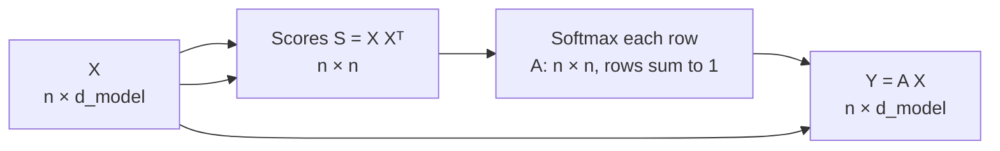
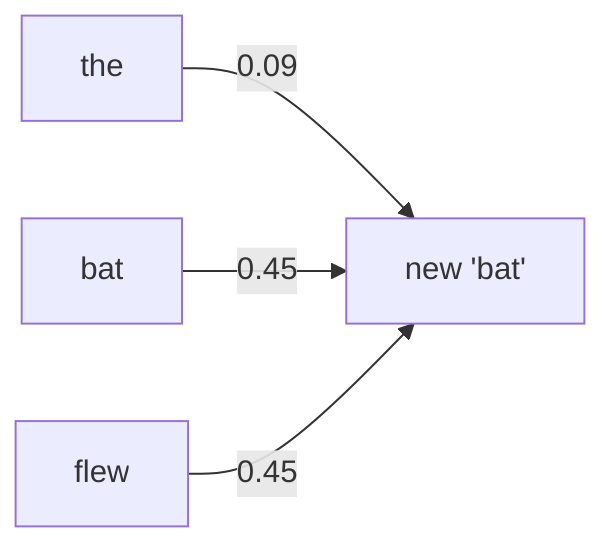

# Section 3 — Self-Attention: the Intuition

> **In one line:** self-attention gives every token a new vector that is a **weighted average of all the tokens' vectors**, where the weights say how relevant each token is. This is how "bat" comes to mean *animal* in one sentence and *cricket bat* in another.

---

## 1. Learning objectives

By the end of this section you should be able to:

1. **Explain** why a token's embedding alone isn't enough, and why its meaning must depend on context.
2. **Describe** self-attention as three steps: *score → normalize (softmax) → weighted average*.
3. **Compute** a simple self-attention output by hand for a 3-token sentence.
4. **Identify** the key properties of self-attention: global, input-dependent, parallel, order-blind and $O(n^2)$.
5. **Explain** the weakness of the naive version (each token mostly attends to itself), which motivates queries, keys and values in Section 4.

---

## 2. Prerequisites

- **Section 2**: each token becomes an embedding vector, and the sentence becomes a matrix $X$ ($n \times d_{model}$). The dot product measures how aligned two vectors are.
- **Weighted average**: $\sum_j w_j v_j$ with weights $w_j \ge 0$ that add up to 1. Example: with weights 0.75 and 0.25, the average of 10 and 20 is $0.75(10) + 0.25(20) = 12.5$.

**Quick refresher: the softmax function.** Softmax turns any list of numbers ("scores") into positive weights that sum to 1:

$$\text{softmax}(s)_j = \frac{e^{s_j}}{\sum_k e^{s_k}}$$

Example: scores $[2, 0, 0]$ → $e^2 = 7.39$, $e^0 = 1$, $e^0 = 1$, total $9.39$ → weights $[0.79, 0.11, 0.11]$. The largest score gets the largest weight, but every item keeps a little.

---

## 3. Motivation: the same word, different meanings

Compare:

> *The **bat** flew out of the cave.*
> *The **bat** hit the ball for six.*

The tokenizer gives "bat" the **same ID**, and the embedding table gives it the **same vector**, in both sentences. But the meaning is completely different: an animal versus a piece of cricket equipment.

So after the embedding step, every token's vector is **context-free**. The model needs a way to update each vector using the other words around it:

- "bat" next to "flew" and "cave" → shift toward *animal*.
- "bat" next to "hit" and "ball" → shift toward *sports equipment*.

This happens everywhere in language: pronouns ("it", "she"), words with several meanings ("bank", "light", "match"), and words whose role depends on grammar ("run" as a noun or a verb). **Self-attention is the mechanism that mixes context into each token's vector.**

---

## 4. Intuition first: asking the room for help

Each token is a student in a group discussion (as in Section 1). The student holding "bat" is unsure what their word means, so they:

1. **Score**: check how relevant each other student's word is to them. ("flew" feels very relevant; "the" barely matters.)
2. **Normalize**: decide how to split their attention, 100% in total, across everyone, giving more to relevant words.
3. **Blend**: form a new understanding by mixing everyone's information in those proportions.

After this, "bat" is no longer the bare dictionary word. It's "bat, *as used in this sentence*". Every student does the same thing at the same time.

**Where the analogy breaks:**
- Real students decide relevance using knowledge and reasoning. Self-attention uses a simple, learned **similarity score** (a dot product), and nothing more.
- A student wouldn't usually listen mostly to themselves. In the naive version below, tokens often do (Section 6.3). Fixing that is exactly why Section 4 introduces queries, keys and values.

---

## 5. The formal idea

### 5.1 The three steps

For token $i$ in a sentence with vectors $x_1, \dots, x_n$:

**Step 1, score** every token $j$ by similarity (dot product):

$$s_{ij} = x_i \cdot x_j$$

**Step 2, normalize** the scores into weights with softmax:

$$a_{ij} = \frac{e^{s_{ij}}}{\sum_{k=1}^{n} e^{s_{ik}}} \qquad \text{so } a_{ij} \ge 0 \text{ and } \sum_j a_{ij} = 1$$

**Step 3, blend**: the new vector is the weighted average:

$$y_i = \sum_{j=1}^{n} a_{ij}\, x_j$$

In words: *token $i$'s new vector is made of all the token vectors, mixed in proportion to how similar each one is to token $i$.*

The weights $a_{ij}$ are called **attention weights**. "Token $i$ attends to token $j$ with weight $a_{ij}$."

### 5.2 Matrix form: all tokens at once

Stacking every token as a row of $X$ ($n \times d_{model}$):

$$S = X X^{\top} \quad (n \times n), \qquad A = \text{softmax}_{\text{rows}}(S) \quad (n \times n), \qquad Y = A X \quad (n \times d_{model})$$

- Row $i$ of $S$ holds token $i$'s scores against every token.
- Row $i$ of $A$ holds token $i$'s attention weights, and **each row sums to 1**.
- Row $i$ of $Y$ is token $i$'s new, context-aware vector. **$Y$ has the same shape as $X$.**

This is **three matrix multiplications and a softmax**, with no loops over time steps, so the whole sentence is processed in parallel.

### 5.3 This is a simplified version

Real Transformers make two changes, covered next:
- **Section 4:** instead of comparing $x_i$ with $x_j$ directly, the model first projects each token into a **query**, a **key** and a **value** using learned matrices.
- **Section 5:** the scores are divided by $\sqrt{d_k}$ before the softmax to keep them in a sensible range.

The three-step skeleton (*score → softmax → weighted average*) stays the same.

### 5.4 Key properties

| Property | What it means |
|---|---|
| **Global** | Every token can draw from every other token in a single step, however far apart. |
| **Input-dependent** | The weights are *computed* from the current sentence, not stored. A different sentence gives different weights. |
| **Parallel** | All $n$ outputs come from a few matrix multiplications at once. |
| **Order-blind** | Shuffling the tokens just shuffles the outputs; each token's own output is unchanged. (Section 7 adds positions.) |
| **Quadratic cost** | $S$ has $n \times n$ entries, so time and memory grow with $n^2$. |

### 5.5 Two variants you will meet

- **Bidirectional self-attention**: every token may attend to every token, before and after it. Used in encoders such as BERT.
- **Causal (masked) self-attention**: token $i$ may attend only to tokens $1, \dots, i$, never the future. Used in GPT-style decoders that generate text left to right (Section 10).
- **Cross-attention** (different, but related): tokens of one sequence attend to tokens of *another* sequence, e.g. a translation decoder attending to the source sentence.

---

## 6. Worked example: "bat" in two sentences

To make the result easy to see, we use **toy 2-D embeddings whose two axes we chose to mean** *animal-ness* and *sport-ness*. (Real embedding axes have no such labels; this is only for teaching.)

| Token | Vector |
|---|---|
| the | [0.2, 0.2] (weak, generic) |
| bat | [1, 1] (ambiguous: equally animal and sport) |
| flew | [2, 0] (strongly animal) |
| hit | [0, 2] (strongly sport) |

### 6.1 Sentence A: "the bat flew"

**Step 1, scores for "bat"** (dot product with every token):
- bat · the = $1(0.2) + 1(0.2) = 0.4$
- bat · bat = $1(1) + 1(1) = 2$
- bat · flew = $1(2) + 1(0) = 2$

**Step 2, softmax**: $e^{0.4} = 1.49$, $e^{2} = 7.39$, $e^{2} = 7.39$, total $= 16.27$.

| attends to | the | bat | flew |
|---|---|---|---|
| weight | 1.49 / 16.27 = **0.09** | 7.39 / 16.27 = **0.45** | 7.39 / 16.27 = **0.45** |

"the" gets almost no attention; "bat" and "flew" share the rest.

**Step 3, weighted average:**

$$y_{\text{bat}} = 0.09\,[0.2, 0.2] + 0.45\,[1, 1] + 0.45\,[2, 0] = [1.38,\; 0.47]$$

"bat" started at $[1, 1]$ and is now $[1.38, 0.47]$: it has **moved toward the animal axis**.

### 6.2 Sentence B: "the bat hit"

The scores are identical (bat · hit $= 1(0) + 1(2) = 2$), so the weights are the same: $0.09, 0.45, 0.45$. But the vectors being averaged are different:

$$y_{\text{bat}} = 0.09\,[0.2, 0.2] + 0.45\,[1, 1] + 0.45\,[0, 2] = [0.47,\; 1.38]$$

Now "bat" has **moved toward the sport axis**. The same word, with the same starting vector, ends up with a different meaning purely because of its neighbours.

### 6.3 The whole sentence at once, and a problem

For sentence A, the full score matrix $S = XX^{\top}$ and attention matrix $A$ (rows = the token doing the attending):

| $S$ | the | bat | flew |
|---|---|---|---|
| **the** | 0.08 | 0.40 | 0.40 |
| **bat** | 0.40 | 2.00 | 2.00 |
| **flew** | 0.40 | 2.00 | 4.00 |

| $A$ (row softmax) | the | bat | flew | row sum |
|---|---|---|---|---|
| **the** | 0.27 | 0.37 | 0.37 | 1 |
| **bat** | 0.09 | 0.45 | 0.45 | 1 |
| **flew** | 0.02 | 0.12 | **0.86** | 1 |

Look at the "flew" row: it puts **86% of its attention on itself**. That's because a vector's dot product with itself is its squared length, $\lVert x \rVert^2$, which is usually the largest score. In this naive version, long vectors mostly "listen to themselves" and learn little from context.

**The fix (Section 4):** compare a token's *question* (query) with other tokens' *labels* (keys), computed by separate learned matrices. Then "what I'm looking for" no longer has to equal "what I am", and a token can attend strongly to others.

---

## 7. Diagram

One token's view:

---

## 8. In practice

### What real attention heads learn
Studies of trained models find heads with recognisable jobs:
- **Previous-token heads**: mostly attend to the token just before.
- **Syntax heads**: e.g. a verb attending to its subject, or a noun to its article.
- **Coreference heads**: pronouns attending to the noun they refer to ("it" → "glass").
- **Delimiter heads**: attend to punctuation or special tokens like `[SEP]` when they have "nothing better to do".
- **Induction heads**: if "A B … A" appears, attend to what followed the earlier "A" and predict "B". Researchers believe these drive much of **in-context learning**.

### Scale
- Each layer of a model has many attention heads (e.g. 12 in BERT-base, 32 in LLaMA-2 7B; Section 6) and many layers, so a token's vector is updated by attention dozens of times.
- For a 2,000-token input, one head in one layer computes $2{,}000^2 = 4{,}000{,}000$ scores. This $n^2$ cost is why long contexts are expensive (Section 14).

---

## 9. Common mistakes and misconceptions

- **"Attention weights are learned parameters stored in the model."** No. The weights $a_{ij}$ are **computed fresh for every input**. What is learned are the projection matrices (Section 4) that produce the scores.
- **"Attention only looks at nearby words."** It looks at **all** tokens. Any preference for nearby words has to be learned or come from position information.
- **"Attention weights can be negative, so a token can subtract another's meaning."** Softmax outputs are always **between 0 and 1** and sum to 1. The new vector is always a weighted *average* (a mixture).
- **"High attention weight means the model's decision was caused by that word."** Not necessarily. Attention weights are one internal signal among many, and research shows they are not a reliable explanation of model decisions on their own.
- **"Self-attention understands word order."** On its own it doesn't. "dog bites man" and "man bites dog" give each word the same output vector. Order comes from positional information (Section 7).

---

## 10. Summary

- Embeddings are **context-free**; self-attention makes them **context-aware**.
- Self-attention = **score** (dot products) → **softmax** (weights that sum to 1) → **weighted average** of vectors.
- Matrix form: $S = XX^{\top}$, $A = \text{softmax}_{\text{rows}}(S)$, $Y = AX$. The output has the same shape as the input.
- It is **global**, **input-dependent**, **parallel**, **order-blind**, and costs $O(n^2)$.
- The naive version tends to make tokens attend to **themselves**; queries, keys and values (Section 4) fix this.

---

## 11. Check your understanding

1. A token's scores against three tokens are $[2, 0, 0]$. Compute its attention weights. If all three scores were equal, what would the output vector be?
2. Using the vectors in Section 6, compute the new vector for "bat" in the sentence **"the bat flew"** if "the" were removed, i.e. the sentence is just "bat flew".
3. Why does the "flew" row in 6.3 give itself 0.86 of its attention? Suggest in one sentence what a model would need in order to make "flew" attend more to "bat".

Answers

1. $e^2 = 7.39$, $e^0 = 1$, $e^0 = 1$, total $9.39$, so the weights are **$[0.79, 0.11, 0.11]$**. If all scores are equal, every weight is $1/3$ and the output is the **plain average** of the three vectors.
2. Scores for bat: bat·bat $= 2$, bat·flew $= 2$, so the weights are $[0.5, 0.5]$. Output $= 0.5[1, 1] + 0.5[2, 0] = \mathbf{[1.5, 0.5]}$. It moves even further toward *animal*, because the weak "the" no longer takes a share.
3. Its score with itself is $\lVert\text{flew}\rVert^2 = 4$, the largest in its row, because a vector is always well aligned with itself. The model needs **separate learned "question" and "label" vectors** (queries and keys), so that what "flew" looks for can differ from what "flew" is.

---

## 12. Further reading

1. Vaswani, A. et al. (2017). **"Attention Is All You Need."** *NeurIPS 2017.* arXiv:1706.03762. Section 3.2 introduces the attention used in Transformers.
2. Bahdanau, D., Cho, K., & Bengio, Y. (2014). **"Neural Machine Translation by Jointly Learning to Align and Translate."** arXiv:1409.0473. The original "soft alignment" idea behind attention.
3. Clark, K., Khandelwal, U., Levy, O., & Manning, C. D. (2019). **"What Does BERT Look At? An Analysis of BERT's Attention."** arXiv:1906.04341. Finds heads for syntax, coreference and delimiters.
4. Jain, S., & Wallace, B. C. (2019). **"Attention is not Explanation."** *NAACL 2019.* arXiv:1902.10186. Why attention weights should be read with care.
5. Olsson, C. et al. (2022). **"In-context Learning and Induction Heads."** Anthropic, Transformer Circuits Thread. On the heads behind in-context learning.
