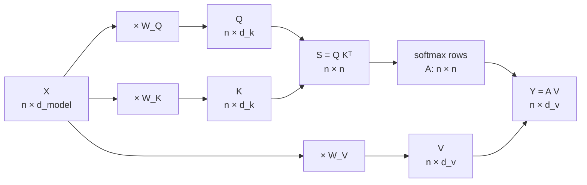

# Section 4 — Queries, Keys & Values

> **In one line:** instead of comparing tokens directly, each token is projected into three different vectors (a **query**: what it is looking for, a **key**: how it can be found, and a **value**: what it hands over), using three learned weight matrices.

---

## 1. Learning objectives

By the end of this section you should be able to:

1. **Explain** why naive self-attention (Section 3) needs separate queries, keys and values.
2. **Compute** $Q$, $K$ and $V$ from an input matrix $X$ and three weight matrices.
3. **State** the shape of every matrix involved, for any $n$, $d_{model}$ and $d_k$.
4. **Show** that with $W_Q \ne W_K$ attention scores become asymmetric ($s_{ij} \ne s_{ji}$), and explain why that is useful.
5. **Count** the parameters in the Q/K/V projections for a real model.

---

## 2. Prerequisites

- **Section 3**: self-attention as *score → softmax → weighted average*, and its weakness: in the naive version, "flew" put 86% of its attention on itself.
- **Matrix shapes**: $(m \times k)(k \times p) = (m \times p)$. A $1 \times 2$ row vector times a $2 \times 2$ matrix is another $1 \times 2$ row vector.

**Quick refresher: a linear projection.** Multiplying a vector by a matrix, $x W$, is called a **linear projection**. It can rotate, stretch, shrink or mix the vector's entries, and it can change the vector's length (number of entries). Example: $[1, 2] \begin{bmatrix} 0 & 1 \\ 1 & 0 \end{bmatrix} = [2, 1]$ swaps the two entries.

---

## 3. Motivation: one vector can't play three roles

In Section 3 each token's single vector $x_i$ did **three jobs at once**:

1. As the thing **asking** "who is relevant to me?" ($x_i$ on the left of $x_i \cdot x_j$)
2. As the thing **being matched** by others ($x_j$ on the right of $x_i \cdot x_j$)
3. As the **content** that gets mixed into the output ($x_j$ in $\sum_j a_{ij} x_j$)

Using one vector for all three causes two problems:

- **Self-obsession.** A vector always matches itself well ($x_i \cdot x_i = \lVert x_i\rVert^2$), so tokens over-attend to themselves. We saw "flew" give itself 86%.
- **Forced symmetry.** $x_i \cdot x_j = x_j \cdot x_i$, so if "it" finds "glass" relevant, "glass" must find "it" *equally* relevant. Language isn't like that: a pronoun badly needs its noun, but the noun usually doesn't need the pronoun.

The fix is simple: give each role its **own learned projection**.

---

## 4. Intuition first: a job portal

Think of a job-search website.

- A **recruiter** types a search: *"Python developer, 3 years, Hyderabad"*. That is the **query**: what they are looking for.
- Every candidate has a **profile headline**: *"Backend engineer · Python · Django"*. That is the **key**: a short summary designed to be *matched*.
- When the recruiter opens a profile, they get the **full CV**: projects, skills, experience. That is the **value**: the actual content handed over.

The portal ranks candidates by how well the **query matches each key**, then the recruiter reads the **values** of the best matches, paying more attention to higher-ranked ones.

Three important points:
- What you *search for* is different from what *you are*. A recruiter isn't a Python developer.
- A headline (key) is short and built for matching; the CV (value) is the rich content. They're related but not the same.
- In **self**-attention every token plays **both sides**: it is a recruiter (with a query) *and* a candidate (with a key and a value).

**Where the analogy breaks:** nobody writes these queries, keys and values by hand. All three are produced by learned matrices, and the model discovers during training what is useful to search for and to advertise.

---

## 5. The formal idea

### 5.1 Three projections

Each token's vector $x_i$ (a row of $X$) is multiplied by three **learned** weight matrices:

$$q_i = x_i W_Q, \qquad k_i = x_i W_K, \qquad v_i = x_i W_V$$

For the whole sentence at once:

$$Q = X W_Q, \qquad K = X W_K, \qquad V = X W_V$$

- **Query** $q_i$: "what token $i$ is looking for".
- **Key** $k_j$: "what token $j$ offers to be matched against".
- **Value** $v_j$: "the information token $j$ passes on if attended to".

### 5.2 Attention with Q, K, V

The three steps from Section 3 stay the same, but each step now uses the right vector:

$$s_{ij} = q_i \cdot k_j \qquad a_{ij} = \text{softmax}_j(s_{ij}) \qquad y_i = \sum_j a_{ij}\, v_j$$

In matrix form:

$$S = Q K^{\top}, \qquad A = \text{softmax}_{\text{rows}}(S), \qquad Y = A V$$

In words: *match each query against every key, turn the matches into weights, and use the weights to mix the values.*

(Section 5 adds one more detail: dividing $S$ by $\sqrt{d_k}$. We leave it out here to keep the numbers simple.)

### 5.3 Shapes

| Matrix | Shape | Notes |
|---|---|---|
| $X$ | $n \times d_{model}$ | one row per token |
| $W_Q$, $W_K$ | $d_{model} \times d_k$ | learned, **shared by every position** |
| $W_V$ | $d_{model} \times d_v$ | learned |
| $Q$, $K$ | $n \times d_k$ | queries and keys must have the **same width** so their dot product exists |
| $V$ | $n \times d_v$ | |
| $S$, $A$ | $n \times n$ | one score per (query, key) pair |
| $Y$ | $n \times d_v$ | |

Usually $d_k = d_v$, and they are **smaller** than $d_{model}$ because the model runs several attention "heads" side by side (Section 6). For example, BERT-base has $d_{model} = 768$ and 12 heads, so $d_k = 768 / 12 = 64$.

### 5.4 Why this fixes both problems

- **No forced self-attention.** Token $i$'s self-score is now $q_i \cdot k_i = (x_i W_Q) \cdot (x_i W_K)$. Because $W_Q$ and $W_K$ differ, this is no longer the squared length of anything, and it can easily be small.
- **Asymmetry.** $s_{ij} = x_i W_Q W_K^{\top} x_j^{\top}$, while $s_{ji} = x_j W_Q W_K^{\top} x_i^{\top}$. These are equal only if $W_Q W_K^{\top}$ happens to be symmetric, so in general token $i$ can find $j$ relevant without $j$ finding $i$ relevant.
- **Separate content.** Values are a third projection, so what a token *advertises* (its key) can differ from what it *delivers* (its value).

### 5.5 What is learned and what is computed

| Learned once during training (parameters) | Computed fresh for every input |
|---|---|
| $W_Q$, $W_K$, $W_V$ | $Q$, $K$, $V$, $S$, $A$, $Y$ |

The **same** $W_Q$ is applied to every token at every position. That's why the layer works for any sentence length $n$.

---

## 6. Worked examples

### 6.1 Fixing "flew" from Section 3

We reuse the toy 2-D vectors from Section 3 ($d_{model} = 2$) and keep $d_k = d_v = 2$:

$$X = \begin{bmatrix} 0.2 & 0.2 \\ 1 & 1 \\ 2 & 0 \end{bmatrix} \begin{matrix} \leftarrow \text{the} \\ \leftarrow \text{bat} \\ \leftarrow \text{flew} \end{matrix}$$

We choose these weight matrices (in a real model they are learned):

$$W_Q = \begin{bmatrix} 0 & 1 \\ 1 & 0 \end{bmatrix}, \qquad W_K = \begin{bmatrix} 1 & 0 \\ 0 & 1 \end{bmatrix}, \qquad W_V = \begin{bmatrix} 1 & 0 \\ 1 & 1 \end{bmatrix}$$

$W_Q$ **swaps** the two axes. Its meaning in our toy world: an action word (strong on the animal axis) goes *looking for* something on the other axis, such as an ambiguous noun like "bat".

**Step 1: project.** Each row of $X$ times each matrix:

| Token | $x$ | $q = xW_Q$ | $k = xW_K$ | $v = xW_V = [x_1 + x_2,\; x_2]$ |
|---|---|---|---|---|
| the | [0.2, 0.2] | [0.2, 0.2] | [0.2, 0.2] | [0.4, 0.2] |
| bat | [1, 1] | [1, 1] | [1, 1] | [2, 1] |
| flew | [2, 0] | **[0, 2]** | [2, 0] | [2, 0] |

The key change: flew's **query** is $[0, 2]$, very different from flew's **key** $[2, 0]$.

**Step 2: scores for "flew"** (its query against every key):
- $q_{\text{flew}} \cdot k_{\text{the}} = 0(0.2) + 2(0.2) = 0.4$
- $q_{\text{flew}} \cdot k_{\text{bat}} = 0(1) + 2(1) = 2$
- $q_{\text{flew}} \cdot k_{\text{flew}} = 0(2) + 2(0) = \mathbf{0}$

**Step 3: softmax.** $e^{0.4} = 1.49$, $e^{2} = 7.39$, $e^{0} = 1$, total $= 9.88$:

| "flew" attends to | the | bat | flew |
|---|---|---|---|
| Naive (Section 3) | 0.02 | 0.12 | **0.86** |
| With Q/K (now) | 0.15 | **0.75** | 0.10 |

"flew" now spends 75% of its attention on "bat", the word it actually needs, and only 10% on itself.

**Step 4: mix the values.**

$$y_{\text{flew}} = 0.15\,[0.4, 0.2] + 0.75\,[2, 1] + 0.10\,[2, 0] = [1.76,\; 0.78]$$

(Using unrounded weights: $0.151, 0.748, 0.101$.)

**The full matrices** for all three tokens:

| $S = QK^{\top}$ | the | bat | flew |
|---|---|---|---|
| **the** | 0.08 | 0.40 | 0.40 |
| **bat** | 0.40 | 2.00 | 2.00 |
| **flew** | 0.40 | 2.00 | **0.00** |

| $A$ | the | bat | flew |
|---|---|---|---|
| **the** | 0.27 | 0.37 | 0.37 |
| **bat** | 0.09 | 0.45 | 0.45 |
| **flew** | 0.15 | **0.75** | 0.10 |

| $Y = AV$ | dim 1 | dim 2 |
|---|---|---|
| **the** | 1.57 | 0.42 |
| **bat** | 1.85 | 0.47 |
| **flew** | 1.76 | 0.78 |

> **Note:** in this particular example $S$ still happens to be symmetric (e.g. $s_{\text{the,flew}} = s_{\text{flew,the}} = 0.4$), because $W_Q W_K^{\top} = W_Q$ is itself a symmetric matrix. This example fixes the *self-attention* problem; the next one shows *asymmetry*.

### 6.2 Asymmetry in two lines

Take two tokens $a = [1, 0]$ and $b = [0, 1]$, with $W_K = I$ (identity) and $W_Q = \begin{bmatrix} 0 & 1 \\ 0 & 0 \end{bmatrix}$.

- $q_a = [1, 0] W_Q = [0, 1]$ and $q_b = [0, 1] W_Q = [0, 0]$
- $s_{ab} = q_a \cdot k_b = [0, 1] \cdot [0, 1] = \mathbf{1}$, so $a$ is looking for $b$.
- $s_{ba} = q_b \cdot k_a = [0, 0] \cdot [1, 0] = \mathbf{0}$, so $b$ is not looking for $a$.

Like a pronoun and its noun: "it" searches for "glass", but "glass" isn't searching for "it". With a single shared vector (Section 3), this is impossible.

### 6.3 Shapes in a real model

**BERT-base**, one attention head, a 128-token input: $n = 128$, $d_{model} = 768$, $d_k = d_v = 64$.

| Matrix | Shape |
|---|---|
| $X$ | $128 \times 768$ |
| $W_Q$, $W_K$, $W_V$ | $768 \times 64$ each |
| $Q$, $K$, $V$ | $128 \times 64$ each |
| $S$, $A$ | $128 \times 128$ |
| $Y$ | $128 \times 64$ |

**Parameters per head**: $3 \times 768 \times 64 = 147{,}456$. Across all 12 heads that's $3 \times 768 \times 768 = 1{,}769{,}472$ per layer (biases ignored). For **LLaMA-2 7B** ($d_{model} = 4096$): $3 \times 4096^2 = 50{,}331{,}648$ per layer.

---

## 7. Diagram

---

## 8. In practice

- **One big matrix.** Implementations often store $W_Q$, $W_K$ and $W_V$ side by side as one $d_{model} \times 3d_k$ matrix (one multiplication on the GPU, then split the result into three).
- **Biases.** The original Transformer and BERT add a bias vector ($xW_Q + b_Q$). Many modern LLMs (e.g. the LLaMA family) leave the biases out.
- **Many heads.** A layer has $h$ sets of $(W_Q, W_K, W_V)$, one per head, each with $d_k = d_{model}/h$ (Section 6).
- **Sharing keys and values.** To save memory at inference time, some models let several query heads share one set of keys and values: multi-query attention (MQA) and grouped-query attention (GQA), Sections 6 and 14.
- **Cross-attention.** In an encoder–decoder model, $Q$ comes from the decoder's tokens while $K$ and $V$ come from the encoder's output (Section 10). The formulas are identical; only the source of $X$ differs.

---

## 9. Common mistakes and misconceptions

- **"Q, K and V come from three different inputs."** In *self*-attention all three are projections of the **same** $X$. Only in cross-attention do $Q$ and $K, V$ come from different sequences.
- **"Keys and values are the same thing."** They come from the same tokens, but through **different** matrices. Keys decide *where* to look; values decide *what* is copied.
- **"Each token has its own $W_Q$."** No. One $W_Q$ (per head, per layer) is shared by all tokens and all positions.
- **"The attention weights are the values."** The weights are $A$ (how much to take); the values are $V$ (what is taken). The output is $AV$.
- **"$d_k$ must equal $d_{model}$."** It can be any size; queries and keys just need to match each other. In practice $d_k = d_{model}/h$.

---

## 10. Summary

- Each token gets three learned projections: **query** (what I look for), **key** (how I'm found), **value** (what I hand over).
- $Q = XW_Q$, $K = XW_K$, $V = XW_V$; then $S = QK^{\top}$, $A = \text{softmax}_{\text{rows}}(S)$, $Y = AV$.
- Separate projections remove forced self-attention and allow **asymmetric** relevance ($s_{ij} \ne s_{ji}$).
- The weights $W_Q, W_K, W_V$ are **learned and shared** across positions; $Q, K, V, A$ are **computed per input**.
- Shapes: $Q, K$ are $n \times d_k$, $V$ is $n \times d_v$, $A$ is $n \times n$. Parameters per layer: $3 \cdot d_{model} \cdot d_k \cdot h$ (= $3d_{model}^2$ when $d_k = d_{model}/h$).

---

## 11. Check your understanding

1. A layer has $n = 10$ tokens, $d_{model} = 512$ and $d_k = d_v = 64$. Give the shapes of $W_Q$, $Q$, $S$ and $Y$.
2. With $X$, $W_K$ and $W_V$ as in Section 6.1 but $W_Q = W_K = I$ (the identity), what are the attention weights of "flew"? Which section's result do you get back?
3. If $W_Q = W_K$, is the score matrix $S$ symmetric? What does that mean for "it" and "glass"?

Answers

1. $W_Q$: $512 \times 64$. $Q$: $10 \times 64$. $S$: $10 \times 10$. $Y$: $10 \times 64$.
2. With $W_Q = W_K = I$ we get $Q = K = X$, so the scores are exactly Section 3's: $[0.4, 2, 4]$, giving weights **$[0.02, 0.12, 0.86]$**. It's the naive self-attention again; "flew" attends mostly to itself. (The output differs from Section 3 because $V = XW_V \neq X$, but the weights are identical.)
3. **Yes.** $S = XW W^{\top} X^{\top}$, and $W W^{\top}$ is symmetric, so $s_{ij} = s_{ji}$. "it" and "glass" would then be forced to find each other *equally* relevant, which is the forced-symmetry problem again.

---

## 12. Further reading

1. Vaswani, A. et al. (2017). **"Attention Is All You Need."** *NeurIPS 2017.* arXiv:1706.03762. Section 3.2.1 defines attention with queries, keys and values.
2. Rush, A. (2018). **"The Annotated Transformer."** Harvard NLP. The original paper with line-by-line PyTorch code; see the attention function.
3. Alammar, J. **"The Illustrated Transformer"** (blog post, 2018). The section on self-attention in detail shows Q, K, V vectors visually.
4. Jurafsky, D., & Martin, J. H. **_Speech and Language Processing_** (3rd edition draft), the chapter on Transformers: the query/key/value formulation of self-attention.
