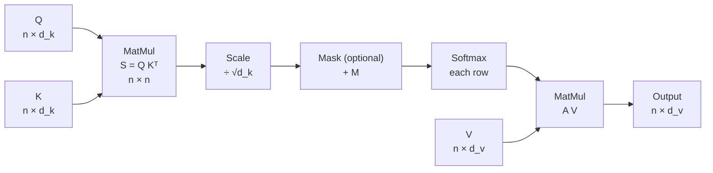

# Section 5 — Scaled Dot-Product Attention

> **In one line:** the attention used in every Transformer is $\text{softmax}\!\left(\frac{QK^{\top}}{\sqrt{d_k}} + M\right) V$. This section explains the two pieces we haven't met yet: **dividing by $\sqrt{d_k}$** (to stop softmax from "freezing") and the **mask** $M$ (to forbid certain connections).

---

## 1. Learning objectives

By the end of this section you should be able to:

1. **Write** the full scaled dot-product attention formula and say what each symbol is.
2. **Explain**, using variance, why scores must be divided by $\sqrt{d_k}$, and what goes wrong if they aren't.
3. **Apply** a causal mask and a padding mask by hand, and explain why masked scores are set to $-\infty$.
4. **Compute** scaled, masked attention for a small example, step by step.
5. **Implement** attention in a few lines of NumPy, including the numerically stable softmax.

---

## 2. Prerequisites

- **Section 4**: $Q = XW_Q$, $K = XW_K$, $V = XW_V$; $S = QK^{\top}$, $A = \text{softmax}_{\text{rows}}(S)$, $Y = AV$.
- **Variance**: if a quantity has variance $\sigma^2$, its typical size (standard deviation) is $\sigma$. Two facts:
  - For independent quantities, **variances add**: $\text{Var}(a + b) = \text{Var}(a) + \text{Var}(b)$.
  - If $q$ and $k$ are independent with mean 0 and variance 1, then $\text{Var}(q \cdot k) = 1$ for their product.

**Quick refresher: what $-\infty$ does in softmax.** Since $e^{-\infty} = 0$, a score of $-\infty$ gets weight exactly 0, and the other weights still sum to 1. Example: scores $[1, -\infty, 1]$ → $e^1, 0, e^1$ → weights $[0.5, 0, 0.5]$.

---

## 3. Motivation: two problems left over

Section 4's attention, $\text{softmax}(QK^{\top})V$, works for our 2-D toy example. Real models break it in two ways.

**Problem 1: big vectors make softmax freeze.** Real heads use $d_k = 64$ or $128$. A dot product adds up $d_k$ products, so with more dimensions the scores get bigger: typically around $\pm 8$ for $d_k = 64$, and $\pm 23$ for $d_k = 512$. Softmax of such large numbers puts almost all the weight on one token, and its **gradient becomes nearly zero**, so the model stops learning.

**Problem 2: some connections must be forbidden.**
- A text *generator* must not peek at future words during training. If it could see the word it's supposed to predict, it would just copy it.
- Padding tokens (fillers added to make sequences in a batch the same length) carry no information and must be ignored.

The fixes: **divide the scores by $\sqrt{d_k}$**, and **add a mask** $M$ before the softmax.

---

## 4. Intuition first

### Scaling: turning down the volume

Imagine asking a room of people to vote by shouting. In a small room, the loudest voice wins by a little. In a stadium of 60,000, the combined noise is so loud that one section completely drowns out everyone else. Attention with large $d_k$ is the stadium: sums of many products produce huge scores, and softmax hands everything to the loudest one.

Dividing by $\sqrt{d_k}$ is a **volume knob** that brings the typical score back to a normal size, so softmax can still express "mostly this one, but some of that one too".

### Masking: blindfolds

A mask is a set of blindfolds put on before the vote. A **causal mask** blindfolds each token to every token *after* it, like an exam where you may only look at questions you have already answered. A **padding mask** blindfolds everyone to the filler tokens.

**Where the analogy breaks:** a blindfold sounds like "less information". Masking doesn't remove any token from the computation; it only sets certain *weights* to exactly zero. The masked tokens still compute their own outputs (their own rows).

---

## 5. The formal idea

### 5.1 The full formula

$$\boxed{\;\text{Attention}(Q, K, V) = \text{softmax}\!\left(\frac{QK^{\top}}{\sqrt{d_k}} + M\right) V\;}$$

| Symbol | Shape | Meaning |
|---|---|---|
| $Q$, $K$ | $n \times d_k$ | queries and keys (Section 4) |
| $V$ | $n \times d_v$ | values |
| $\sqrt{d_k}$ | scalar | the scaling factor; $d_k$ is the key/query width |
| $M$ | $n \times n$ | mask: $0$ where attention is allowed, $-\infty$ where it is forbidden |
| output | $n \times d_v$ | one new vector per token |

### 5.2 The five steps

1. **Scores:** $S = QK^{\top}$
2. **Scale:** $S' = S / \sqrt{d_k}$
3. **Mask:** $S'' = S' + M$
4. **Softmax** each row: $A = \text{softmax}_{\text{rows}}(S'')$
5. **Mix the values:** $Y = AV$

### 5.3 Why exactly $\sqrt{d_k}$?

Assume each entry of a query $q$ and a key $k$ is independent, with mean 0 and variance 1 (roughly true at initialization). Then

$$q \cdot k = \sum_{i=1}^{d_k} q_i k_i$$

is a sum of $d_k$ independent terms, each with variance 1. Variances add, so

$$\text{Var}(q \cdot k) = d_k, \qquad \text{typical size} = \sqrt{d_k}.$$

Dividing by $\sqrt{d_k}$ gives

$$\text{Var}\!\left(\frac{q \cdot k}{\sqrt{d_k}}\right) = \frac{d_k}{d_k} = 1.$$

In words: **whatever $d_k$ is, the scaled scores have a typical size of about 1.** Dividing by $d_k$ would over-shrink them as $d_k$ grows, and not dividing lets them grow without limit; $\sqrt{d_k}$ is the amount that exactly cancels the growth.

### 5.4 Why large scores stop learning

For a two-way softmax with weights $p$ and $1 - p$, the derivative of $p$ with respect to its score is $p(1 - p)$.

| Scores | Weights | Gradient $p(1-p)$ |
|---|---|---|
| $[8, 0]$ (unscaled, $d_k = 64$) | $[0.9997, 0.0003]$ | $\mathbf{0.0003}$ |
| $[1, 0]$ (same, ÷ 8 = $\sqrt{64}$) | $[0.73, 0.27]$ | $\mathbf{0.197}$ |

The unscaled version has a gradient about **590 times smaller**, so training barely moves the weights. This is called **softmax saturation**.

### 5.5 Masks

$M$ is added to the scores, entry by entry. Two common kinds, shown for 3 tokens:

**Causal (look-ahead) mask**: token $i$ may attend to positions $j \le i$ only:

$$M_{\text{causal}} = \begin{bmatrix} 0 & -\infty & -\infty \\ 0 & 0 & -\infty \\ 0 & 0 & 0 \end{bmatrix}$$

**Padding mask**: if token 3 is padding, nobody may attend to it (column 3 blocked):

$$M_{\text{pad}} = \begin{bmatrix} 0 & 0 & -\infty \\ 0 & 0 & -\infty \\ 0 & 0 & -\infty \end{bmatrix}$$

Masks can be combined by adding them (any $-\infty$ wins).

**Why $-\infty$ and not 0?** A score of 0 still gets weight $e^0 = 1$, which is often a *large* weight. Only $-\infty$ guarantees weight exactly 0 **and** keeps every row summing to 1. (Setting weights to 0 *after* the softmax would break the "sums to 1" property.) In code, a very large negative number such as $-10^9$ is often used instead.

### 5.6 Numerically stable softmax

$e^{1000}$ overflows a computer's floating-point numbers. Softmax gives the same answer if you subtract any constant from every score in a row, so implementations subtract the row maximum first:

$$\text{softmax}(s)_j = \frac{e^{s_j - \max(s)}}{\sum_k e^{s_k - \max(s)}}$$

Now the largest exponent is $e^0 = 1$ and nothing overflows.

---

## 6. Worked examples

We continue with Section 4's matrices ($d_k = 2$, so $\sqrt{d_k} = \sqrt{2} \approx 1.414$):

| Token | $q$ | $k$ | $v$ |
|---|---|---|---|
| the | [0.2, 0.2] | [0.2, 0.2] | [0.4, 0.2] |
| bat | [1, 1] | [1, 1] | [2, 1] |
| flew | [0, 2] | [2, 0] | [2, 0] |

### 6.1 Scaling, step by step (no mask)

**Step 1: scores** $S = QK^{\top}$ (from Section 4):

| $S$ | the | bat | flew |
|---|---|---|---|
| **the** | 0.08 | 0.40 | 0.40 |
| **bat** | 0.40 | 2.00 | 2.00 |
| **flew** | 0.40 | 2.00 | 0.00 |

**Step 2: scale** by $1/\sqrt{2}$:

| $S / \sqrt{2}$ | the | bat | flew |
|---|---|---|---|
| **the** | 0.06 | 0.28 | 0.28 |
| **bat** | 0.28 | 1.41 | 1.41 |
| **flew** | 0.28 | 1.41 | 0.00 |

**Step 3: softmax the "flew" row**: $e^{0.28} = 1.33$, $e^{1.41} = 4.11$, $e^{0} = 1$, total $6.44$ → weights $[0.21, 0.64, 0.16]$ (rounded).

**All rows:**

| $A$ | the | bat | flew |
|---|---|---|---|
| **the** | 0.29 | 0.36 | 0.36 |
| **bat** | 0.14 | 0.43 | 0.43 |
| **flew** | 0.21 | 0.64 | 0.16 |

**Step 4: output** $Y = AV$:

| $Y$ | dim 1 | dim 2 |
|---|---|---|
| **the** | 1.54 | 0.41 |
| **bat** | 1.78 | 0.46 |
| **flew** | 1.67 | 0.68 |

**Compare with Section 4 (unscaled):** "flew" went from $[0.15, 0.75, 0.10]$ to $[0.21, 0.64, 0.16]$. Scaling made the distribution **softer**. Here $d_k = 2$, so the effect is mild; with $d_k = 64$ it's the difference between learning and not learning (Section 6.3).

### 6.2 Adding a causal mask

Same scaled scores, plus $M_{\text{causal}}$:

| $S/\sqrt{2} + M$ | the | bat | flew |
|---|---|---|---|
| **the** | 0.06 | $-\infty$ | $-\infty$ |
| **bat** | 0.28 | 1.41 | $-\infty$ |
| **flew** | 0.28 | 1.41 | 0.00 |

- **the** row: only one allowed entry → weights $[1, 0, 0]$. "the" can only see itself.
- **bat** row: $e^{0.28} = 1.33$, $e^{1.41} = 4.11$, total $5.44$ → $[0.24, 0.76, 0]$.
- **flew** row: nothing masked → $[0.21, 0.64, 0.16]$, as before.

| $A_{\text{causal}}$ | the | bat | flew |
|---|---|---|---|
| **the** | **1.00** | 0 | 0 |
| **bat** | 0.24 | 0.76 | 0 |
| **flew** | 0.21 | 0.64 | 0.16 |

The matrix is now **lower-triangular**: everything above the diagonal is zero. The output for "the" is simply its own value, $y_{\text{the}} = v_{\text{the}} = [0.4, 0.2]$.

**Why this matters for training:** in "the bat flew", the model can now be trained to predict "bat" from position 1 and "flew" from position 2 **at the same time, in one pass**. No position can see the answer it is meant to predict.

### 6.3 Why scaling matters at real sizes

Draw random queries and keys with independent standard-normal entries, 4,000 pairs for each $d_k$ (simulation, seed 0):

| $d_k$ | variance of $q \cdot k$ | typical size (std) | after ÷ $\sqrt{d_k}$ |
|---|---|---|---|
| 4 | 3.9 | 1.99 | 0.99 |
| 64 | 62.2 | 7.89 | 0.99 |
| 512 | 508.1 | 22.54 | 1.00 |

The variance tracks $d_k$ closely, as the formula in 5.3 predicts, and scaling brings the typical size back to about 1 every time.

---

## 7. Diagram



---

## 8. In practice

### A complete implementation (NumPy)

```python
import numpy as np

def attention(Q, K, V, mask=None):
    """Scaled dot-product attention.
    Q, K: (n, d_k)   V: (n, d_v)   mask: (n, n) booleans, True = allowed
    Returns the output (n, d_v) and the weights (n, n)."""
    d_k = Q.shape[-1]
    S = Q @ K.T / np.sqrt(d_k)                 # steps 1-2: scores, scaled
    if mask is not None:
        S = np.where(mask, S, -np.inf)         # step 3: blocked -> -inf
    S = S - S.max(axis=-1, keepdims=True)      # stable softmax
    A = np.exp(S)
    A = A / A.sum(axis=-1, keepdims=True)      # step 4: rows sum to 1
    return A @ V, A                            # step 5

causal = np.tril(np.ones((3, 3), dtype=bool))  # lower-triangular = causal mask
```

### In real libraries
- **PyTorch** has a built-in `torch.nn.functional.scaled_dot_product_attention(q, k, v, attn_mask=None, is_causal=False)`. It applies exactly this formula and automatically picks a fast kernel when one is available.
- **FlashAttention** computes the *same* result without ever storing the full $n \times n$ matrix, by working in small tiles that fit in the GPU's fast on-chip memory. It is much faster and uses memory proportional to $n$ instead of $n^2$ (Section 14).

### Cost
For one head: computing $QK^{\top}$ takes about $n^2 d_k$ multiply-adds, and $AV$ another $n^2 d_v$. Storing $A$ needs $n^2$ numbers: for $n = 1{,}000$ tokens at 2 bytes each, that's 2 MB per head per layer, and it grows 4× every time $n$ doubles.

---

## 9. Common mistakes and misconceptions

- **"We divide by $d_k$."** No: by $\sqrt{d_k}$, the standard deviation of the dot product, not its variance.
- **"Scaling changes which token gets the most attention."** It doesn't. Dividing every score by the same positive number keeps their order, so the top token stays on top. It only changes **how sharp** the distribution is.
- **"Masking means setting attention weights to 0 after the softmax."** If you zero weights after the softmax, the row no longer sums to 1. The mask is applied **before** the softmax, as $-\infty$ on the scores.
- **"Masked tokens are removed from the computation."** They still have their own rows and outputs. They just can't be *attended to* by the tokens that are blocked from them.
- **"Encoders like BERT use the causal mask."** Encoders are bidirectional and use only padding masks. The causal mask belongs to decoders that generate text (GPT, LLaMA, Claude).

---

## 10. Summary

- **Scaled dot-product attention:** $\text{softmax}\!\left(\frac{QK^{\top}}{\sqrt{d_k}} + M\right)V$, in five steps: scores → scale → mask → softmax → mix values.
- $q \cdot k$ has variance $\approx d_k$; dividing by $\sqrt{d_k}$ brings scores back to a typical size of about 1 and prevents **softmax saturation** (vanishing gradients).
- Scaling never changes which token ranks first; it controls how **sharp** the weights are.
- A **mask** adds $-\infty$ to forbidden scores: **causal** masks hide the future (decoders), **padding** masks hide filler tokens.
- Implementations use a **stable softmax** (subtract the row max) and fast kernels like **FlashAttention**.

---

## 11. Check your understanding

1. A head has $d_k = 256$. A query's raw scores against three keys are $[32, 16, 0]$. Compute the scaled scores and the attention weights.
2. In a 4-token sentence with a causal mask, how many of the 16 entries of $A$ are forced to be 0? Which token can attend to the most tokens?
3. A student masks by setting forbidden **scores** to 0 instead of $-\infty$. Using the "bat" row of 6.2 (scaled scores $[0.28, 1.41, 1.41]$, with "flew" forbidden), show what goes wrong.

<details>
<summary>Answers</summary>

1. $\sqrt{256} = 16$, so the scaled scores are $[2, 1, 0]$. $e^2 = 7.39$, $e^1 = 2.72$, $e^0 = 1$, total $11.11$, giving weights **$[0.67, 0.24, 0.09]$**. (Without scaling, $[32, 16, 0]$ would give essentially $[1.00, 0.00, 0.00]$.)
2. Everything above the diagonal: $\frac{4 \times 3}{2} = \mathbf{6}$ entries. The **last** token can attend to all 4 positions.
3. Scores become $[0.28, 1.41, 0]$, so "flew" still gets $e^0 / (1.33 + 4.11 + 1) = 1/6.44 \approx$ **0.16** of the attention, and the "future" leaks through. With $-\infty$ it gets exactly 0 and the weights are $[0.24, 0.76, 0]$.
</details>

---

## 12. Further reading

1. Vaswani, A. et al. (2017). **"Attention Is All You Need."** *NeurIPS 2017.* arXiv:1706.03762. Section 3.2.1 and its footnote give the variance argument for $\sqrt{d_k}$.
2. Dao, T. et al. (2022). **"FlashAttention: Fast and Memory-Efficient Exact Attention with IO-Awareness."** arXiv:2205.14135. How the same formula is computed without storing the $n \times n$ matrix.
3. PyTorch documentation, **`torch.nn.functional.scaled_dot_product_attention`**. The library version, including `attn_mask` and `is_causal`.
4. Goodfellow, I., Bengio, Y., & Courville, A. (2016). **_Deep Learning_**, MIT Press. Chapter 4 (numerical computation: overflow and the stable softmax) and Chapter 6 (softmax units and saturation).
