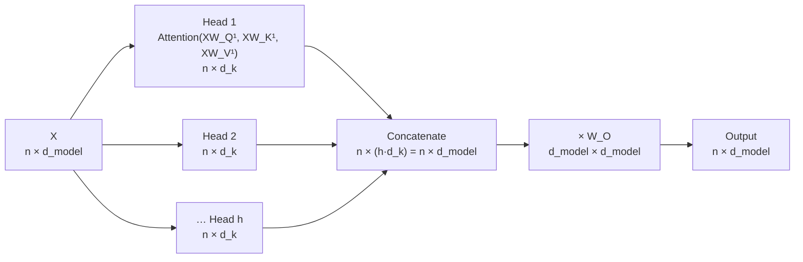

# Section 6 — Multi-Head Attention

> **In one line:** instead of one attention operation, a Transformer layer runs **$h$ smaller attentions ("heads") side by side**, each with its own $W_Q, W_K, W_V$, then glues their outputs together and mixes them with one more matrix $W_O$. Each head can look for a different kind of relationship.

---

## 1. Learning objectives

By the end of this section you should be able to:

1. **Explain** why a single attention head is limited, and what multiple heads add.
2. **Write** the multi-head attention formula, including the concatenation and the output projection $W_O$.
3. **Trace** every shape through multi-head attention, including the "split into heads" reshape.
4. **Compute** a small two-head example by hand.
5. **Count** parameters and compare MHA with its memory-saving variants, MQA and GQA.

---

## 2. Prerequisites

- **Section 5**: $\text{Attention}(Q, K, V) = \text{softmax}\!\left(\frac{QK^{\top}}{\sqrt{d_k}} + M\right)V$.
- **Section 4**: $Q = XW_Q$, $K = XW_K$, $V = XW_V$, with $W_Q$ of shape $d_{model} \times d_k$.
- **Concatenation**: placing matrices side by side. Two $3 \times 1$ matrices concatenated along columns give a $3 \times 2$ matrix: $[\,a \mid b\,]$.

**Quick refresher: one weighted average = one choice.** In Section 5, each token's output is *one* weighted average of the values, using *one* set of weights that sum to 1. If the weights favour token A, they must take weight away from token B. A single head can't say "100% A for one purpose and 100% B for another" at the same time.

---

## 3. Motivation: one head has to compromise

Take the word **"it"** in

> *The phone didn't fit in the pocket because **it** was too small.*

To understand "it", the model needs several things **at once**:
- **Which noun** "it" refers to (the pocket) — a coreference relationship.
- **What is being said about it** ("was too small") — a nearby-words relationship.
- **Grammar** — "it" is the subject of "was".

A single head produces a single weighted average. If it puts most of its weight on "pocket", it has little left for "small" and "was". It must **compromise**, blending everything into one muddled mixture.

The fix: run **several heads in parallel**. Each head has its own projections, so each can learn to look for something different, and the layer combines all their findings.

---

## 4. Intuition first: a study group with coloured highlighters

Four friends prepare for an exam from the same textbook page. Each uses a different coloured highlighter:

- **Yellow** marks definitions.
- **Green** marks formulas.
- **Pink** marks examples.
- **Blue** marks dates and names.

Every friend reads the **whole page**, but each pays attention to different parts. At the end they **combine their highlights** into one set of notes that is richer than any single friend's.

That is multi-head attention:
- Each **friend** = one **head**.
- Each friend's **highlighter rule** = that head's own $W_Q, W_K, W_V$.
- **Combining the highlights** = concatenating the head outputs and mixing them with $W_O$.

**Where the analogy breaks:**
- Nobody assigns the heads their jobs. Each head's "highlighter rule" is **learned**, and many heads end up with jobs humans can't easily name (or with no useful job at all).
- Friends read at different speeds; heads run **truly in parallel**, as one batched matrix operation.

---

## 5. The formal idea

### 5.1 The formula

For heads $i = 1, \dots, h$, each with its own weight matrices:

$$\text{head}_i = \text{Attention}\!\left(X W_Q^{(i)},\; X W_K^{(i)},\; X W_V^{(i)}\right)$$

Then concatenate and project:

$$\text{MultiHead}(X) = \big[\,\text{head}_1 \;\big|\; \text{head}_2 \;\big|\; \cdots \;\big|\; \text{head}_h\,\big]\; W_O$$

In words: *run $h$ independent attentions, stack their outputs side by side, then mix them with one learned matrix.*

### 5.2 Shapes

The standard choice is to split the width evenly: $d_k = d_v = d_{model} / h$.

| Matrix | Shape | Count |
|---|---|---|
| $X$ | $n \times d_{model}$ | 1 |
| $W_Q^{(i)}, W_K^{(i)}, W_V^{(i)}$ | $d_{model} \times d_k$ | $h$ of each |
| $\text{head}_i$ | $n \times d_k$ | $h$ |
| Concatenation | $n \times (h \cdot d_k) = n \times d_{model}$ | 1 |
| $W_O$ | $d_{model} \times d_{model}$ | 1 |
| Output | $n \times d_{model}$ | 1 |

The output has the **same shape as the input**, which is exactly what a Transformer block needs (Section 1).

### 5.3 Why $W_O$?

Without $W_O$, the output would just be the heads' results placed side by side: dimensions $1$ to $d_k$ would come only from head 1, the next $d_k$ only from head 2, and so on. $W_O$ lets **every output dimension draw on every head**, so the layer can combine findings ("head 3 found the noun, head 7 found the adjective") into one representation.

### 5.4 Cost: more heads, same price

Splitting $d_{model}$ into $h$ heads of width $d_{model}/h$ means:

- **Parameters:** $W_Q, W_K, W_V$ for all heads together are $3 \times d_{model} \times d_{model}$, plus $W_O$ at $d_{model} \times d_{model}$, so **$4\,d_{model}^2$ per layer** (ignoring biases), whatever $h$ is.
- **Compute:** about the same as one big head of width $d_{model}$.
- **What does grow with $h$:** the number of $n \times n$ attention matrices, $h \cdot n^2$ scores in total.

So multiple heads are almost a **free upgrade**: same parameters, similar compute, but $h$ different attention patterns instead of one.

### 5.5 How it is really computed: one big matrix, then reshape

In practice nobody multiplies by $h$ separate small matrices. Implementations:

1. Multiply once by a big $W_Q$ of shape $d_{model} \times d_{model}$ (the $h$ small ones side by side) → $Q$ is $n \times d_{model}$.
2. **Reshape** $Q$ to $h \times n \times d_k$: split its columns into $h$ groups of $d_k$.
3. Run attention on all heads at once as a batched operation → $h \times n \times d_k$.
4. Reshape back to $n \times d_{model}$ (this *is* the concatenation) and multiply by $W_O$.

### 5.6 Saving memory: MQA and GQA

During text generation, models store every past token's keys and values (the **KV cache**, Section 14). With standard multi-head attention (**MHA**), every head has its own keys and values. Two popular variants share them:

| Variant | Query heads | Key/value heads | KV cache vs MHA |
|---|---|---|---|
| **MHA** (multi-head) | $h$ | $h$ | 1× |
| **GQA** (grouped-query) | $h$ | $g$ (e.g. 8) | $g/h$ |
| **MQA** (multi-query) | $h$ | 1 | $1/h$ |

In GQA, each group of $h/g$ query heads shares one key head and one value head. Quality stays close to MHA, while the cache shrinks a lot. Most recent LLMs use GQA.

---

## 6. Worked examples

### 6.1 Two heads on "the bat flew"

We reuse the toy 2-D vectors (axis 1 = *animal-ness*, axis 2 = *sport-ness*), with $d_{model} = 2$ and $h = 2$ heads, so $d_k = d_v = 1$:

| Token | $x$ |
|---|---|
| the | [0.2, 0.2] |
| bat | [1, 1] |
| flew | [2, 0] |

To keep the arithmetic short, each head simply **reads one axis** (in a real model these weights are learned, and $W_Q \ne W_K$ as in Section 4):

- **Head 1, the "animal" head:** $W_Q^{(1)} = W_K^{(1)} = W_V^{(1)} = \begin{bmatrix} 1 \\ 0 \end{bmatrix}$, so $q = k = v = x_1$.
- **Head 2, the "sport" head:** $W_Q^{(2)} = W_K^{(2)} = W_V^{(2)} = \begin{bmatrix} 0 \\ 1 \end{bmatrix}$, so $q = k = v = x_2$.
- $W_O = I$ (the identity), so the output is just the concatenation.

Since $d_k = 1$, the scaling factor is $\sqrt{1} = 1$.

**Head 1 for "bat".** $q = 1$; keys (animal values) $= [0.2, 1, 2]$.
- Scores $= [0.2, 1, 2]$
- $e^{0.2} = 1.22$, $e^{1} = 2.72$, $e^{2} = 7.39$, total $11.33$ → weights $[0.11, 0.24, 0.65]$
- Output $= 0.11(0.2) + 0.24(1) + 0.65(2) = \mathbf{1.57}$

**Head 2 for "bat".** $q = 1$; keys (sport values) $= [0.2, 1, 0]$.
- Scores $= [0.2, 1, 0]$
- $e^{0.2} = 1.22$, $e^{1} = 2.72$, $e^{0} = 1$, total $4.94$ → weights $[0.25, 0.55, 0.20]$
- Output $= 0.25(0.2) + 0.55(1) + 0.20(0) = \mathbf{0.60}$

**Concatenate** (and $W_O = I$): $y_{\text{bat}} = [1.57,\; 0.60]$.

The two heads looked at the **same sentence differently**: head 1 sent 65% of its attention to "flew", while head 2 kept 55% on "bat" itself.

**All three tokens:**

| Token | Head 1 weights (the, bat, flew) | Head 2 weights (the, bat, flew) | Output $[\text{head}_1 \mid \text{head}_2]$ |
|---|---|---|---|
| the | 0.28, 0.33, 0.40 | 0.32, 0.37, 0.31 | [1.18, 0.44] |
| bat | 0.11, 0.24, **0.65** | 0.25, **0.55**, 0.20 | [1.57, 0.60] |
| flew | 0.02, 0.12, **0.86** | **0.33, 0.33, 0.33** | [1.84, 0.40] |

**Something to notice:** for "flew", head 2's query is $0$ (flew has no sport-ness), so all its scores are $0$ and it spreads attention **evenly**. That's a head with "nothing to look for". Real models have this problem too, and trained heads often handle it by attending to a harmless token such as the first token or punctuation.

### 6.2 Compared with one head

A single head with $d_k = 2$ and identity projections (scaled by $\sqrt{2}$) gives "bat" **one** set of weights, $[0.14, 0.43, 0.43]$, and output $[1.32, 0.46]$. Both dimensions are forced to use the *same* weights. With two heads, the animal dimension and the sport dimension each get their own weights. This is the "no compromise" benefit from Section 3.

### 6.3 Shape trace for BERT-base

$n = 128$ tokens, $d_{model} = 768$, $h = 12$ heads, $d_k = 768 / 12 = 64$.

| Step | Shape |
|---|---|
| $X$ | $128 \times 768$ |
| $Q = XW_Q$ (all heads at once) | $128 \times 768$ |
| Split into heads | $12 \times 128 \times 64$ |
| Scores $QK^{\top}$ per head | $12 \times 128 \times 128$ |
| Head outputs | $12 \times 128 \times 64$ |
| Concatenate | $128 \times 768$ |
| $\times W_O$ ($768 \times 768$) | $128 \times 768$ |

**Parameters per layer:** $4 \times 768^2 = 2{,}359{,}296$. For LLaMA-2 7B ($d_{model} = 4096$, 32 heads, $d_k = 128$): $4 \times 4096^2 = 67{,}108{,}864$ per layer.

### 6.4 How much GQA saves

The KV cache stores, per token per layer, $2 \times (\text{KV heads}) \times d_k$ numbers (keys + values):

| Model | Query heads | KV heads | Per token per layer | Saving vs MHA |
|---|---|---|---|---|
| LLaMA-2 7B (MHA) | 32 | 32 | $2 \times 32 \times 128 = 8{,}192$ | 1× |
| Mistral 7B (GQA) | 32 | 8 | $2 \times 8 \times 128 = 2{,}048$ | 4× smaller |
| LLaMA-2 70B (GQA) | 64 | 8 | $2 \times 8 \times 128 = 2{,}048$ | 8× smaller |

---

## 7. Diagram

---

## 8. In practice

### Typical head counts

| Model | $d_{model}$ | Heads $h$ | $d_k$ |
|---|---|---|---|
| Original Transformer (base) | 512 | 8 | 64 |
| BERT-base / GPT-2 small | 768 | 12 | 64 |
| LLaMA-2 7B | 4096 | 32 | 128 |
| LLaMA-2 70B | 8192 | 64 (8 KV heads) | 128 |

$d_k$ is almost always **64 or 128**. Bigger models add more heads rather than making each head wider.

### What heads learn
Researchers who inspect trained models find heads that track the previous token, syntactic relations, coreference, rare words, or copying patterns (induction heads, Section 3). They also find that **many heads can be removed after training with little loss in accuracy**: a few specialised heads do most of the work.

### PyTorch
`torch.nn.MultiheadAttention(embed_dim=768, num_heads=12)` implements this whole section, including $W_O$. Internally it uses the reshape trick from 5.5.

---

## 9. Common mistakes and misconceptions

- **"Each head sees only part of the input."** Every head sees the **full** $d_{model}$-wide input. Each head *projects* it into its own smaller $d_k$-dimensional space.
- **"More heads means more parameters and compute."** With $d_k = d_{model}/h$, the parameter count stays $4d_{model}^2$ and compute stays about the same. Only the number of attention maps grows.
- **"Heads are assigned roles like 'syntax head'."** Nothing assigns roles. Any specialisation **emerges** from training, and many heads don't have a clean, nameable role.
- **"Concatenation is the final step."** It's followed by $W_O$, which mixes information across heads. Without it, each output dimension would only ever come from one head.
- **"GQA means fewer query heads."** GQA keeps all the **query** heads and shares **key/value** heads between groups of them.

---

## 10. Summary

- **Multi-head attention** runs $h$ attention heads in parallel, each with its own $W_Q^{(i)}, W_K^{(i)}, W_V^{(i)}$, so each can focus on a different relationship.
- $\text{MultiHead}(X) = [\text{head}_1 | \cdots | \text{head}_h]\,W_O$; with $d_k = d_{model}/h$ the output is $n \times d_{model}$, the same as the input.
- Same parameters ($4d_{model}^2$ per layer) and similar compute as one big head, but $h$ attention patterns.
- Implemented as one big matrix multiply plus a **reshape** to $h \times n \times d_k$.
- **MQA/GQA** share key/value heads to shrink the KV cache; most recent LLMs use GQA.

---

## 11. Check your understanding

1. A model has $d_{model} = 1024$ and $h = 16$ heads. What is $d_k$? How many attention parameters (Q, K, V and O, no biases) does one layer have?
2. Using 6.1, what would "bat"'s output be if $W_O = \begin{bmatrix} 0.5 & 0.5 \\ 0.5 & 0.5 \end{bmatrix}$ instead of the identity? What has $W_O$ done?
3. A model has 32 query heads and uses GQA with 4 key/value heads. By what factor is its KV cache smaller than MHA's? How many query heads share each key/value head?

Answers

1. $d_k = 1024 / 16 = \mathbf{64}$. Parameters $= 4 \times 1024^2 = \mathbf{4{,}194{,}304}$.
2. $[1.566, 0.600] \begin{bmatrix} 0.5 & 0.5 \\ 0.5 & 0.5 \end{bmatrix} = [0.5(1.566) + 0.5(0.600),\; 0.5(1.566) + 0.5(0.600)] = \mathbf{[1.08, 1.08]}$. $W_O$ has **mixed the two heads' findings** so that both output dimensions now depend on both heads.
3. $32 / 4 = \mathbf{8\times}$ smaller. Each key/value head is shared by $32 / 4 = \mathbf{8}$ query heads.

---

## 12. Further reading

1. Vaswani, A. et al. (2017). **"Attention Is All You Need."** *NeurIPS 2017.* arXiv:1706.03762. Section 3.2.2 introduces multi-head attention.
2. Michel, P., Levy, O., & Neubig, G. (2019). **"Are Sixteen Heads Really Better than One?"** *NeurIPS 2019.* arXiv:1905.10650. Many heads can be pruned after training.
3. Voita, E. et al. (2019). **"Analyzing Multi-Head Self-Attention: Specialized Heads Do the Heavy Lifting, the Rest Can Be Pruned."** *ACL 2019.* arXiv:1905.09418.
4. Shazeer, N. (2019). **"Fast Transformer Decoding: One Write-Head is All You Need."** arXiv:1911.02150. Introduces multi-query attention.
5. Ainslie, J. et al. (2023). **"GQA: Training Generalized Multi-Query Transformer Models from Multi-Head Checkpoints."** arXiv:2305.13245.
