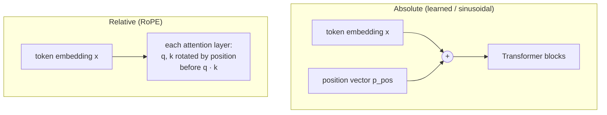

# Section 7 — Positional Information

> **In one line:** self-attention can't tell word order apart, so Transformers inject position information, either by **adding a position vector** to each token's embedding (learned or sinusoidal) or by building position directly into the attention scores (**RoPE**, **ALiBi**). Modern LLMs mostly use RoPE.

---

## 1. Learning objectives

By the end of this section you should be able to:

1. **Explain** why self-attention needs position information, using the "shuffle" result from Section 3.
2. **Compute** sinusoidal positional encodings by hand and add them to token embeddings.
3. **Describe** learned absolute positions and their maximum-length limit.
4. **Show** with a small example that RoPE makes attention scores depend only on **relative** position.
5. **Compare** the main schemes (learned, sinusoidal, RoPE, ALiBi) and say which real models use each.

---

## 2. Prerequisites

- **Section 3**: shuffling the input tokens only shuffles the outputs; each token's output vector stays exactly the same.
- **Section 2**: $X$ is the matrix of token embeddings, one row per token.
- **Section 5**: attention scores $q \cdot k / \sqrt{d_k}$, and adding a bias to scores before the softmax (as the mask did).

**Quick refresher: sine, cosine and rotation.** The point $(\cos\phi, \sin\phi)$ lies on a circle of radius 1 at angle $\phi$. Rotating a 2-D vector $[x_1, x_2]$ by angle $\phi$ gives

$$[\,x_1\cos\phi - x_2\sin\phi,\;\; x_1\sin\phi + x_2\cos\phi\,]$$

Rotation changes direction but not length. The dot product of two vectors depends only on their lengths and the **angle between them**.

---

## 3. Motivation: "dog bites man" = "man bites dog"?

Section 3 showed that self-attention is **order-blind**: the score between two tokens depends only on their vectors, never on where they sit. So for a Transformer without position information:

- *"dog bites man"* and *"man bites dog"* give each word the **same** output vector.
- *"not good, actually bad"* and *"not bad, actually good"* look identical.

Word order carries a lot of meaning, so the model needs to know **where** each token is. There are two broad strategies:

1. **Tell each token its absolute position**: add a "position vector" to its embedding ("I am word number 5").
2. **Tell attention the relative distance**: adjust each score according to how far apart the two tokens are ("you are 3 words before me").

---

## 4. Intuition first: seat numbers and clocks

**Absolute positions: seat numbers.** At an exam, every student's answer sheet has their **seat number** stamped on it. The examiner now knows not just *what* each student wrote but *where* they sat. Adding a position vector to each token is that stamp.

**Sinusoidal positions: a set of clocks.** How do you stamp a position using numbers that stay small? Use a wall of clocks running at different speeds: a seconds hand, a minutes hand, an hours hand, a days hand. Read together, the hands identify any moment uniquely, and every hand stays between −1 and 1 however much time passes. Sinusoidal encodings give each position the readings of many "clocks" ticking at different speeds.

**Relative positions: "how far apart?"** When you read *"it"*, you care that the noun was "two words ago", not that it was "word 1,847 of the book". Relative schemes such as RoPE and ALiBi give attention exactly this: the **distance** between tokens.

**Where the analogy breaks:** a seat number is a label someone reads. The model never "reads" a position; position just changes the numbers it computes with, and the model has to *learn* how to use those changes.

---

## 5. The formal idea

### 5.1 Absolute positions, added to the embeddings

For the token at position $pos$ (counting from 0):

$$x'_{pos} = x_{pos} + p_{pos}$$

where $p_{pos}$ is a $d_{model}$-long **position vector**. Now the same word at different positions enters the model as different vectors.

**Option A, learned positions.** Keep a trainable table $P$ of shape $L_{max} \times d_{model}$ (one row per position) and learn it like the embedding table. Used in BERT ($L_{max} = 512$) and GPT-2 ($L_{max} = 1024$).
- *Pro:* simple and flexible.
- *Con:* there is **no row for position $L_{max}$ or beyond**, so the model can't handle longer inputs at all.

**Option B, sinusoidal positions** (the original 2017 Transformer). No parameters; use fixed waves:

$$p_{pos,\,2i} = \sin\!\left(\frac{pos}{10000^{2i/d_{model}}}\right), \qquad p_{pos,\,2i+1} = \cos\!\left(\frac{pos}{10000^{2i/d_{model}}}\right)$$

In words: dimensions come in **(sin, cos) pairs**. Pair $i$ is a clock hand that turns at speed $\omega_i = 1/10000^{2i/d_{model}}$ radians per position. The first pair turns fast (1 radian per step); the last pairs turn very slowly.
- Every value stays between −1 and 1.
- Each position gets a unique pattern.
- Moving forward $k$ positions **rotates** each (sin, cos) pair by the same angle $k\omega_i$, whatever the starting position. This makes relative offsets easy for the model to detect, and it is the idea RoPE builds on.

### 5.2 RoPE: rotate the queries and keys

**Rotary Position Embedding (RoPE)** doesn't add anything to $x$. Instead, inside every attention layer it **rotates** each query and key according to its position, just before the dot product:

- Split $q$ and $k$ into pairs of dimensions.
- Rotate pair $i$ of the query at position $m$ by angle $m\,\theta_i$, and pair $i$ of the key at position $n$ by angle $n\,\theta_i$, where $\theta_i = 10000^{-2i/d_k}$.

**The key fact:** rotating $q$ by $m\theta$ and $k$ by $n\theta$ changes the angle *between* them by $(m - n)\theta$. So

$$\text{score}(q \text{ at } m,\; k \text{ at } n) \;\text{ depends only on }\; q,\; k \;\text{ and }\; (m - n).$$

Attention automatically sees **relative distance**. Shifting a whole phrase further along the text doesn't change its internal scores.

RoPE is used by LLaMA, Mistral, Qwen, Gemma and most open LLMs today.

### 5.3 ALiBi: a distance penalty on the scores

**ALiBi** (Attention with Linear Biases) adds no vectors at all. It subtracts a penalty proportional to distance from each score:

$$s_{ij} = \frac{q_i \cdot k_j}{\sqrt{d_k}} - m \cdot (i - j) \qquad (j \le i)$$

where $m$ is a fixed slope (each head gets a different slope). Far-away tokens get a bigger penalty, so heads prefer nearby context, some strongly and some weakly. Used in BLOOM and MPT.

### 5.4 Comparison

| Scheme | Where it acts | Parameters | Relative? | Beyond training length? | Used in |
|---|---|---|---|---|---|
| Learned absolute | added to $x$ | $L_{max} \times d_{model}$ | no | **no** (no row exists) | BERT, GPT-2 |
| Sinusoidal | added to $x$ | 0 | indirectly | defined, but works poorly in practice | Original Transformer |
| **RoPE** | rotates $q, k$ in every layer | 0 | **yes** | with tricks (5.5) | LLaMA, Mistral, Qwen |
| ALiBi | bias on scores | 0 | **yes** | fairly well | BLOOM, MPT |

### 5.5 Stretching the context window (brief)

A model trained on 4,096-token texts sees RoPE angles only up to $4096\,\theta_i$. To use longer contexts, practitioners:
- **Position interpolation:** squeeze the positions (e.g. divide by 4) so a 16k-token text uses the angles seen during training, then fine-tune briefly.
- **Change the base:** use a larger base than 10,000, so the clocks turn more slowly (e.g. LLaMA-3 uses 500,000).
- **NTK-aware scaling / YaRN:** smarter mixtures of the two, treating fast and slow pairs differently.

---

## 6. Worked examples

### 6.1 Sinusoidal encodings for $d_{model} = 4$

With $d_{model} = 4$ there are two (sin, cos) pairs:
- Pair 0: $\omega_0 = 1/10000^{0} = 1$, so $(\sin pos, \cos pos)$.
- Pair 1: $\omega_1 = 1/10000^{2/4} = 1/100 = 0.01$, so $(\sin 0.01pos, \cos 0.01pos)$.

| pos | $\sin(pos)$ | $\cos(pos)$ | $\sin(0.01\,pos)$ | $\cos(0.01\,pos)$ |
|---|---|---|---|---|
| 0 | 0.000 | 1.000 | 0.000 | 1.000 |
| 1 | 0.841 | 0.540 | 0.010 | 1.000 |
| 2 | 0.909 | −0.416 | 0.020 | 1.000 |
| 3 | 0.141 | −0.990 | 0.030 | 1.000 |

The first pair changes a lot from one position to the next (the fast hand); the second barely moves (the slow hand). The slow pairs matter for telling apart positions that are far apart.

### 6.2 Order finally matters

Use our toy 2-D vectors and $d_{model} = 2$, so $p_{pos} = [\sin pos,\; \cos pos]$:
- $p_0 = [0.000, 1.000]$, $p_1 = [0.841, 0.540]$, $p_2 = [0.909, -0.416]$

**"the bat flew"** with positions added:

| Token (pos) | $x$ | $+\,p_{pos}$ | $x'$ |
|---|---|---|---|
| the (0) | [0.2, 0.2] | [0.000, 1.000] | [0.20, 1.20] |
| bat (1) | [1, 1] | [0.841, 0.540] | [1.84, 1.54] |
| flew (2) | [2, 0] | [0.909, −0.416] | [2.91, −0.42] |

**"flew bat the"**: now "flew" is at position 0 and "the" at position 2, so they get *different* additions: flew → [2.00, 1.00], the → [1.11, −0.22].

Running the naive self-attention from Section 3 on both orders, "bat"'s output is:

| Order | Without positions | With sinusoidal positions |
|---|---|---|
| the bat flew | [1.38, 0.47] | [2.08, 1.04] |
| flew bat the | [1.38, 0.47] | [1.89, 1.33] |

**Without positions** the outputs are identical, as Section 3 found. **With positions** they differ: the model can now tell the two orders apart.

### 6.3 RoPE depends only on the distance

Take 2-D queries and keys and a rotation of $\theta = 30°$ per position.

**Simple case:** $q = k = [1, 0]$.
- Query at $m = 1$ → rotated by 30°; key at $n = 3$ → rotated by 90°. Angle between them $= 60°$, so the score is $\cos 60° = \mathbf{0.5}$.
- Query at $m = 4$ (120°), key at $n = 6$ (180°). Angle between them is again 60°, so the score is $\mathbf{0.5}$.
- Query at $m = 3$, key at $n = 3$: angle 0°, so the score is $\mathbf{1}$.

**A general case:** $q = [1, 0.5]$, $k = [0.5, 1]$.
- Rotating $q$ to position $m = 2$ (60°): $[1\cos60° - 0.5\sin60°,\; 1\sin60° + 0.5\cos60°] = [0.07, 1.12]$.
- Doing the same for $k$ at $n = 5$ (150°) and taking the dot product gives $\mathbf{-0.75}$.
- Moving both 5 positions later ($m = 7$, $n = 10$) gives **exactly $-0.75$** again.

The score changed only when the **gap** $m - n$ changed. That's the property that makes RoPE a relative scheme.

### 6.4 ALiBi in one row

The token at position 3 (causal, so it sees positions 0–3), with slope $m = 0.5$. Suppose all four content scores are equal (say 1). The biases are $-0.5 \times (3 - j)$:

| $j$ | 0 | 1 | 2 | 3 |
|---|---|---|---|---|
| Distance $3 - j$ | 3 | 2 | 1 | 0 |
| Bias | −1.5 | −1.0 | −0.5 | 0 |
| Weight after softmax | 0.10 | 0.17 | 0.28 | **0.46** |

With nothing else to go on, the head prefers **nearby** tokens. (Adding the same content score to every entry doesn't change the softmax, so the result is the same for any equal content scores.)

### 6.5 Cost of learned positions

- GPT-2: $1024 \times 768 = 786{,}432$ position parameters.
- BERT-base: $512 \times 768 = 393{,}216$.

Small next to the full models, but they **hard-limit** the input length.

---

## 7. Diagram

---

## 8. In practice

| Model | Position scheme | Trained context |
|---|---|---|
| Original Transformer (2017) | Sinusoidal | — |
| BERT | Learned absolute | 512 |
| GPT-2 | Learned absolute | 1,024 |
| T5 | Learned relative biases (bucketed distances) | 512 |
| BLOOM | ALiBi | 2,048 |
| LLaMA-2 | RoPE | 4,096 |
| LLaMA-3 | RoPE (base 500,000) | 8,192 |

- **Causal masks give a hint of position too.** In a decoder, token $i$ sees exactly $i$ earlier tokens, so a model can partly infer position even with no explicit scheme. Every production model still uses one.
- **Long-context models** (100k+ tokens) are usually RoPE models extended with position interpolation, a larger base, or YaRN, plus fine-tuning on long documents.
- **Positions in other data:** Vision Transformers use 2-D positions for image patches (Section 15). Audio models use positions along time.

---

## 9. Common mistakes and misconceptions

- **"Transformers read left to right, so they already know order."** Only the causal mask is directional. Attention scores ignore order unless position information is added.
- **"Positional encoding is concatenated to the embedding."** In the learned and sinusoidal schemes it is **added**, element by element, so the width stays $d_{model}$.
- **"RoPE adds a vector to the input like sinusoidal encoding."** RoPE **rotates queries and keys inside each attention layer**. Nothing is added to $x$, and values are not rotated.
- **"Sinusoidal encodings let models handle any length perfectly."** They're defined for any position, but models trained on short texts usually perform poorly on much longer ones.
- **"Position 0 is always the first word of the document."** It's the first token of the **input sequence**, which may be a special token like `<bos>` or the middle of a document chunk.

---

## 10. Summary

- Self-attention is order-blind; **position information** makes word order count.
- **Absolute** schemes add a position vector to each embedding: **learned** (BERT, GPT-2; hard length limit) or **sinusoidal** (fixed (sin, cos) "clocks" at different speeds).
- **RoPE** rotates queries and keys by position-dependent angles, so scores depend only on the **relative distance** $m - n$. It's the standard in modern LLMs.
- **ALiBi** subtracts a distance-proportional penalty from scores, favouring nearby tokens.
- Context windows can be stretched with position interpolation, a larger RoPE base, or YaRN.

---

## 11. Check your understanding

1. Using the $d_{model} = 4$ formula in 6.1, compute the sinusoidal encoding for position 4. (Use $\sin 4 = -0.757$, $\cos 4 = -0.654$.)
2. A learned-position model has $L_{max} = 512$. What happens if you feed it 600 tokens? What could a RoPE model do instead?
3. With RoPE and $\theta = 30°$ per position, a query at position 10 and a key at position 7 have score $s$. Give two other (query position, key position) pairs with the same score, and explain why.

Answers

1. $[\sin 4, \cos 4, \sin 0.04, \cos 0.04] = \mathbf{[-0.757, -0.654, 0.040, 0.999]}$.
2. There is **no position vector** for positions 512–599, so the model cannot process them. Usually the input is cut to 512 tokens or split into chunks. A RoPE model has no table to run out of: its angles are defined for any position. Quality may drop past the training length, but it can be improved with position interpolation or YaRN.
3. Any pair with the same gap $m - n = 3$, e.g. **(3, 0)** and **(103, 100)**. RoPE rotates the query by $m\theta$ and the key by $n\theta$; only the difference $(m - n)\theta = 90°$ affects the angle between them, and therefore the score.

---

## 12. Further reading

1. Vaswani, A. et al. (2017). **"Attention Is All You Need."** *NeurIPS 2017.* arXiv:1706.03762. Section 3.5 introduces sinusoidal positional encoding.
2. Su, J. et al. (2021). **"RoFormer: Enhanced Transformer with Rotary Position Embedding."** arXiv:2104.09864. The RoPE paper.
3. Press, O., Smith, N. A., & Lewis, M. (2021). **"Train Short, Test Long: Attention with Linear Biases Enables Input Length Extrapolation."** arXiv:2108.12409. The ALiBi paper.
4. Shaw, P., Uszkoreit, J., & Vaswani, A. (2018). **"Self-Attention with Relative Position Representations."** arXiv:1803.02155. An early relative-position method.
5. Chen, S. et al. (2023). **"Extending Context Window of Large Language Models via Positional Interpolation."** arXiv:2306.15595. And Peng, B. et al. (2023). **"YaRN: Efficient Context Window Extension of Large Language Models."** arXiv:2309.00071.
