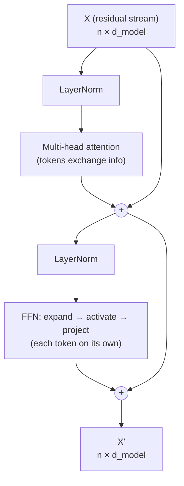

# Section 8 — Residuals, LayerNorm & the Feed-Forward Network

> **In one line:** a Transformer block is attention plus three supporting parts: **residual connections** (add the input back so information and gradients can flow through deep stacks), **layer normalization** (keep each token's numbers in a stable range), and a **feed-forward network** (a small two-layer network that processes each token on its own).

---

## 1. Learning objectives

By the end of this section you should be able to:

1. **Explain** why residual connections make deep networks trainable, using the gradient of $x + F(x)$.
2. **Compute** LayerNorm and RMSNorm by hand for a single token vector.
3. **Compute** a feed-forward network's output for a small example, with ReLU and GELU.
4. **Write** a full pre-norm Transformer block and compare pre-norm with post-norm.
5. **Count** the parameters of a complete model (GPT-2 small, LLaMA-2 7B) from its dimensions.

---

## 2. Prerequisites

- **Section 6**: multi-head attention maps $n \times d_{model}$ to $n \times d_{model}$ and has $4d_{model}^2$ parameters.
- **Section 1**: the block outline $A = X + \text{Attn}(\text{LN}(X))$, $X' = A + \text{FFN}(\text{LN}(A))$, now explained piece by piece.
- **Mean and variance** of a list of numbers: $\mu = \frac{1}{d}\sum x_i$ and $\sigma^2 = \frac{1}{d}\sum (x_i - \mu)^2$.
- **Chain rule**: the derivative of $f(g(x))$ is $f'(g(x))\,g'(x)$. Gradients through a stack of layers **multiply**.

**Quick refresher: activation functions.** **ReLU** is $\max(0, z)$: negatives become 0. **GELU** is a smooth version, $z \cdot \Phi(z)$, where $\Phi$ is the standard normal CDF. It lets small negatives through a little: GELU(1) ≈ 0.84, GELU(−0.5) ≈ −0.15.

---

## 3. Motivation: attention alone isn't enough

Stacking many attention layers by themselves runs into three problems:

1. **Deep stacks are hard to train.** Gradients pass through every layer by multiplication (chain rule). If each layer shrinks them a little, then after 24, 48 or 96 layers they **vanish**.
2. **Numbers drift.** Each layer adds and mixes vectors, so values can grow or shrink layer after layer, making training unstable.
3. **Attention only *moves* information.** Its output is a weighted average of value vectors, which is a fairly simple, almost linear operation. The model also needs a place to **transform** information non-linearly and to store what it has learned ("Paris is the capital of France").

The three fixes, one for each problem:

| Problem | Fix |
|---|---|
| Vanishing gradients in deep stacks | **Residual connections** |
| Drifting values | **Layer normalization** |
| Attention can mix but not really "think" | **Feed-forward network (FFN)** |

---

## 4. Intuition first: editing a shared document

Think of each token's vector as a **shared document** that passes through many editors, one per layer.

- **Residual connection:** an editor doesn't rewrite the document from scratch; they **add tracked changes** on top. If an editor has nothing useful to add, the document passes through unchanged. Many small, safe edits instead of 48 complete rewrites. This running document is often called the **residual stream**.
- **LayerNorm:** before each editor reads the document, it's reformatted to a standard font size, so no editor is thrown off by text that has become huge or tiny.
- **Attention vs FFN:** the attention editor **gathers quotes from other documents** (other tokens). The FFN editor then **thinks privately** about their own document, using their background knowledge.

**Where the analogy breaks:** the "reformatting" (LayerNorm) is applied to the copy the editor reads, not to the document itself. In pre-norm Transformers the residual stream itself is never normalized until the very end.

---

## 5. The formal idea

### 5.1 Residual connections

Instead of $y = F(x)$, a residual (skip) connection computes

$$y = x + F(x)$$

where $F$ is a sub-layer (attention or FFN). Its derivative is

$$\frac{\partial y}{\partial x} = 1 + F'(x)$$

In words: the **"1" is a gradient highway**. Even if $F'(x)$ is tiny, the gradient through this layer is at least about 1, so it doesn't vanish as layers are stacked. This idea came from ResNets for images (2015), and it is what made 100+-layer networks trainable.

Residuals also require $F(x)$ to have **the same shape as $x$**. This is why attention and the FFN both map $d_{model}$ back to $d_{model}$.

### 5.2 Layer normalization

For **one token's** vector $x \in \mathbb{R}^{d_{model}}$:

$$\mu = \frac{1}{d}\sum_{i} x_i, \qquad \sigma^2 = \frac{1}{d}\sum_{i}(x_i - \mu)^2, \qquad \text{LN}(x)_i = \gamma_i \,\frac{x_i - \mu}{\sqrt{\sigma^2 + \epsilon}} + \beta_i$$

- Subtract the mean and divide by the standard deviation, so the token's features have mean 0 and variance 1.
- $\epsilon$ (e.g. $10^{-5}$) avoids dividing by zero.
- $\gamma$ (scale) and $\beta$ (shift) are **learned**, one value per feature, so the model can undo the normalization where useful.

**LayerNorm vs BatchNorm.** LayerNorm normalizes **across the features of one token**. BatchNorm (common in CNNs) normalizes each feature **across the examples in a batch**. LayerNorm doesn't depend on batch size or on other sequences, which suits variable-length text.

**RMSNorm** (used in LLaMA, Mistral) skips the mean subtraction and $\beta$:

$$\text{RMSNorm}(x)_i = \gamma_i \,\frac{x_i}{\sqrt{\frac{1}{d}\sum_j x_j^2 + \epsilon}}$$

It's slightly cheaper and works just as well in practice.

### 5.3 The feed-forward network (FFN)

Applied to **each token separately**, with the **same weights** for every position:

$$\text{FFN}(x) = \phi(x W_1 + b_1)\, W_2 + b_2$$

| Part | Shape | Role |
|---|---|---|
| $W_1$ | $d_{model} \times d_{ff}$ | expand into a wider hidden layer |
| $\phi$ | — | non-linear activation (ReLU, GELU, …) |
| $W_2$ | $d_{ff} \times d_{model}$ | project back to the model width |

Usually $d_{ff} = 4\,d_{model}$, giving $2 \times 4d_{model}^2 = 8\,d_{model}^2$ parameters, **twice the attention's $4d_{model}^2$**. So roughly two-thirds of each block's parameters are in the FFN.

**A useful way to picture it:** each of the $d_{ff}$ hidden units is a **detector**. A column of $W_1$ is a pattern; if the token matches it, that unit fires, and the matching row of $W_2$ is written into the token's vector. Research suggests these "detector → write" pairs store much of a model's factual knowledge.

**SwiGLU** (LLaMA, PaLM) uses three matrices and a gate:

$$\text{FFN}_{\text{SwiGLU}}(x) = \big(\text{SiLU}(xW_1) \odot xW_3\big)\, W_2$$

where $\odot$ is element-wise multiplication. To keep the parameter count similar, $d_{ff}$ is set to about $\frac{8}{3}d_{model}$ (LLaMA-2 7B: $d_{ff} = 11{,}008$ for $d_{model} = 4{,}096$).

### 5.4 The complete block (pre-norm)

$$
\begin{aligned}
A &= X + \text{MultiHead}(\text{LN}_1(X)) \\
X' &= A + \text{FFN}(\text{LN}_2(A))
\end{aligned}
$$

Pre-norm models also apply one **final LayerNorm** after the last block, before the output head.

### 5.5 Pre-norm vs post-norm

| | Post-norm (2017 original, BERT) | Pre-norm (GPT-2 onwards, most LLMs) |
|---|---|---|
| Formula | $\text{LN}(x + F(x))$ | $x + F(\text{LN}(x))$ |
| Residual path | passes through LN every layer | **clean**: $x$ is never normalized on the highway |
| Training | needs careful learning-rate warm-up; unstable when very deep | stable even for very deep models |

---

## 6. Worked examples

### 6.1 LayerNorm by hand

One token with $d_{model} = 4$: $x = [2, 4, 6, 8]$ (take $\gamma = 1$, $\beta = 0$, $\epsilon \approx 0$).

1. Mean: $\mu = (2 + 4 + 6 + 8) / 4 = 5$
2. Variance: $\sigma^2 = \big((−3)^2 + (−1)^2 + 1^2 + 3^2\big) / 4 = 20 / 4 = 5$, so $\sigma = \sqrt{5} = 2.236$
3. Normalize: $\big[\tfrac{-3}{2.236}, \tfrac{-1}{2.236}, \tfrac{1}{2.236}, \tfrac{3}{2.236}\big] = \mathbf{[-1.34, -0.45, 0.45, 1.34]}$

The result has mean 0 and variance 1. The pattern (increasing, evenly spaced) is kept; only the scale and offset changed.

**With learned $\gamma = [1, 1, 2, 2]$ and $\beta = [0, 0, 0, 1]$:** $[-1.34, -0.45, 2(0.45), 2(1.34) + 1] = [-1.34, -0.45, 0.89, 3.68]$.

**RMSNorm of the same $x$:** $\text{rms} = \sqrt{(4 + 16 + 36 + 64)/4} = \sqrt{30} = 5.477$, so the result is $x / 5.477 = [0.37, 0.73, 1.10, 1.46]$. There is no centring, so all the values stay positive.

### 6.2 A feed-forward network by hand

A tiny FFN with $d_{model} = 2$, $d_{ff} = 4$, no biases:

$$W_1 = \begin{bmatrix} 1 & -1 & 0.5 & 0 \\ 0 & 1 & 1 & -1 \end{bmatrix}, \qquad W_2 = \begin{bmatrix} 0.5 & 0 \\ 0 & 1 \\ 0 & 0.5 \\ 1 & 1 \end{bmatrix}$$

Input token $x = [1, 0.5]$.

**Step 1, expand:** $h = xW_1 = [1(1) + 0.5(0),\; 1(-1) + 0.5(1),\; 1(0.5) + 0.5(1),\; 1(0) + 0.5(-1)] = [1, -0.5, 1, -0.5]$

**Step 2, activate (ReLU):** $\phi(h) = [1, 0, 1, 0]$. Hidden units 1 and 3 "fire"; units 2 and 4 stay silent.

**Step 3, project back:** only the rows of $W_2$ for the firing units contribute:

$$1 \cdot [0.5, 0] + 0 \cdot [0, 1] + 1 \cdot [0, 0.5] + 0 \cdot [1, 1] = [0.5, 0.5]$$

**Step 4, residual:** $x + \text{FFN}(x) = [1, 0.5] + [0.5, 0.5] = \mathbf{[1.5, 1.0]}$

**With GELU instead of ReLU:** $\phi(h) = [0.84, -0.15, 0.84, -0.15]$ (silent units now leak a little). The FFN output becomes $[0.27, 0.11]$ and the residual sum $[1.27, 0.61]$. The activation function changes the result noticeably.

### 6.3 Why residuals rescue gradients

Suppose every sub-layer has derivative $F'(x) = 0.1$ (a layer that changes its input only a little).

| Depth | Without residuals ($0.1^L$) | With residuals ($1.1^L$) |
|---|---|---|
| 3 layers | 0.001 | 1.331 |
| 24 layers | $10^{-24}$ | $1.1^{24} \approx 9.8$ |

Without residuals, the gradient reaching the first layer is effectively **zero**, so early layers never learn. With residuals, it stays a usable size. (It can also grow, which is one reason normalization and careful initialization are still needed.)

### 6.4 Counting a whole model

Per block (ignoring biases and norms): attention $4d^2$ + FFN $8d^2$ = $\mathbf{12\,d_{model}^2}$.

**GPT-2 small** ($d = 768$, 12 blocks, vocabulary 50,257, 1,024 positions, tied output head):

| Part | Formula | Parameters |
|---|---|---|
| 12 blocks | $12 \times 12 \times 768^2$ | 84,934,656 |
| Token embeddings (Section 2) | $50{,}257 \times 768$ | 38,597,376 |
| Position embeddings (Section 7) | $1{,}024 \times 768$ | 786,432 |
| Biases | $12 \times (3d + d + 4d + d)$ | 82,944 |
| LayerNorm $\gamma, \beta$ | $12 \times 2 \times 2 \times 768 + 2 \times 768$ | 38,400 |
| **Total** | | **124,439,808** |

That's exactly GPT-2 small's reported size of **124M**.

**LLaMA-2 7B** ($d = 4096$, 32 blocks, SwiGLU with $d_{ff} = 11{,}008$, vocabulary 32,000, separate output head, RMSNorm, no biases):

| Part | Formula | Parameters |
|---|---|---|
| Attention per block | $4 \times 4096^2$ | 67,108,864 |
| SwiGLU FFN per block | $3 \times 4096 \times 11{,}008$ | 135,266,304 |
| 32 blocks | $32 \times 202{,}375{,}168$ | 6,476,005,376 |
| Embeddings + output head | $2 \times 32{,}000 \times 4096$ | 262,144,000 |
| RMSNorm $\gamma$ | $32 \times 2 \times 4096 + 4096$ | 266,240 |
| **Total** | | **6,738,415,616** |

That's the reported **6.74B**. Every parameter in these models is accounted for by Sections 2–8.

---

## 7. Diagram

---

## 8. In practice

| Model | Norm | Placement | FFN activation | $d_{ff}$ |
|---|---|---|---|---|
| Original Transformer | LayerNorm | post-norm | ReLU | $4d$ (2,048) |
| BERT | LayerNorm | post-norm | GELU | $4d$ (3,072) |
| GPT-2 | LayerNorm | pre-norm (+ final LN) | GELU | $4d$ (3,072) |
| LLaMA-2 / Mistral | RMSNorm | pre-norm (+ final norm) | SwiGLU | ≈ $\frac{8}{3}d$ (11,008 / 14,336) |

- **Dropout** is often applied to each sub-layer's output before it's added to the residual stream (0.1 in the original Transformer and BERT). Large LLMs trained on huge data often use none.
- The **FFN is where most compute goes** for short inputs: for each token, about $2 \times 8d^2$ operations for the FFN against $2 \times 4d^2$ for the attention projections.
- **Mixture-of-Experts (MoE)** models (e.g. Mixtral) replace the single FFN with several "expert" FFNs and send each token to only a few of them: more parameters, similar compute per token.

---

## 9. Common mistakes and misconceptions

- **"LayerNorm normalizes across the batch."** That's BatchNorm. LayerNorm normalizes **each token's own features**, independently of other tokens and other examples.
- **"The FFN mixes information between tokens."** It doesn't; it's applied to every token **separately** (with shared weights). Only attention moves information between positions.
- **"Residual connections are an optional extra."** Without them, deep Transformers essentially fail to train. They also require every sub-layer to keep the $d_{model}$ shape.
- **"Normalization removes information."** It removes the token's overall **offset and scale**. The pattern across features is kept, and the learned $\gamma, \beta$ can restore scale where it's useful.
- **"Attention holds most of the parameters."** In standard blocks the FFN holds about **two-thirds** ($8d^2$ of $12d^2$).

---

## 10. Summary

- **Residual connections** $y = x + F(x)$ give gradients a highway ($\partial y/\partial x = 1 + F'$) and turn each layer into a small edit of the **residual stream**.
- **LayerNorm** rescales each token's features to mean 0, variance 1, then applies learned $\gamma, \beta$; **RMSNorm** skips the centring.
- The **FFN** expands each token to $d_{ff}$ (often $4d$), applies a non-linearity, and projects back. It holds about 2/3 of the block's parameters and acts like a bank of detectors.
- **Pre-norm** blocks, $x + F(\text{LN}(x))$, train more stably than **post-norm**, $\text{LN}(x + F(x))$.
- A block has about $12d_{model}^2$ parameters; adding embeddings reproduces GPT-2's 124M and LLaMA-2 7B's 6.74B exactly.

---

## 11. Check your understanding

1. Compute LayerNorm (with $\gamma = 1$, $\beta = 0$) of $x = [1, 1, 1, 5]$.
2. In 6.2, which hidden units fire for the input $x = [0, 1]$ with ReLU, and what is $x + \text{FFN}(x)$?
3. A model has $d_{model} = 1024$, 24 blocks, standard FFN ($d_{ff} = 4d$) and a tied vocabulary of 50,000. Estimate its parameter count, ignoring biases, norms and positions.

Answers

1. $\mu = 8/4 = 2$; deviations $[-1, -1, -1, 3]$; $\sigma^2 = (1 + 1 + 1 + 9)/4 = 3$, so $\sigma = 1.732$. Result: **$[-0.58, -0.58, -0.58, 1.73]$**.
2. $h = [0, 1]W_1 = [0, 1, 1, -1]$, and ReLU gives $[0, 1, 1, 0]$, so **units 2 and 3** fire. FFN output $= [0, 1] + [0, 0.5] = [0, 1.5]$, so $x + \text{FFN}(x) = \mathbf{[0, 2.5]}$.
3. Blocks: $24 \times 12 \times 1024^2 = 301{,}989{,}888$. Embeddings: $50{,}000 \times 1024 = 51{,}200{,}000$. Total ≈ **353 million**. (This is close to GPT-2 medium, which has the same shape and about 355M parameters.)

---

## 12. Further reading

1. He, K., Zhang, X., Ren, S., & Sun, J. (2015). **"Deep Residual Learning for Image Recognition."** arXiv:1512.03385. The origin of residual connections.
2. Ba, J. L., Kiros, J. R., & Hinton, G. E. (2016). **"Layer Normalization."** arXiv:1607.06450.
3. Zhang, B., & Sennrich, R. (2019). **"Root Mean Square Layer Normalization."** arXiv:1910.07467. RMSNorm.
4. Xiong, R. et al. (2020). **"On Layer Normalization in the Transformer Architecture."** arXiv:2002.04745. Why pre-norm trains more stably.
5. Shazeer, N. (2020). **"GLU Variants Improve Transformer."** arXiv:2002.05202. SwiGLU and related FFNs.
6. Geva, M. et al. (2021). **"Transformer Feed-Forward Layers Are Key-Value Memories."** arXiv:2012.14913. The "detectors that write" view of the FFN.
