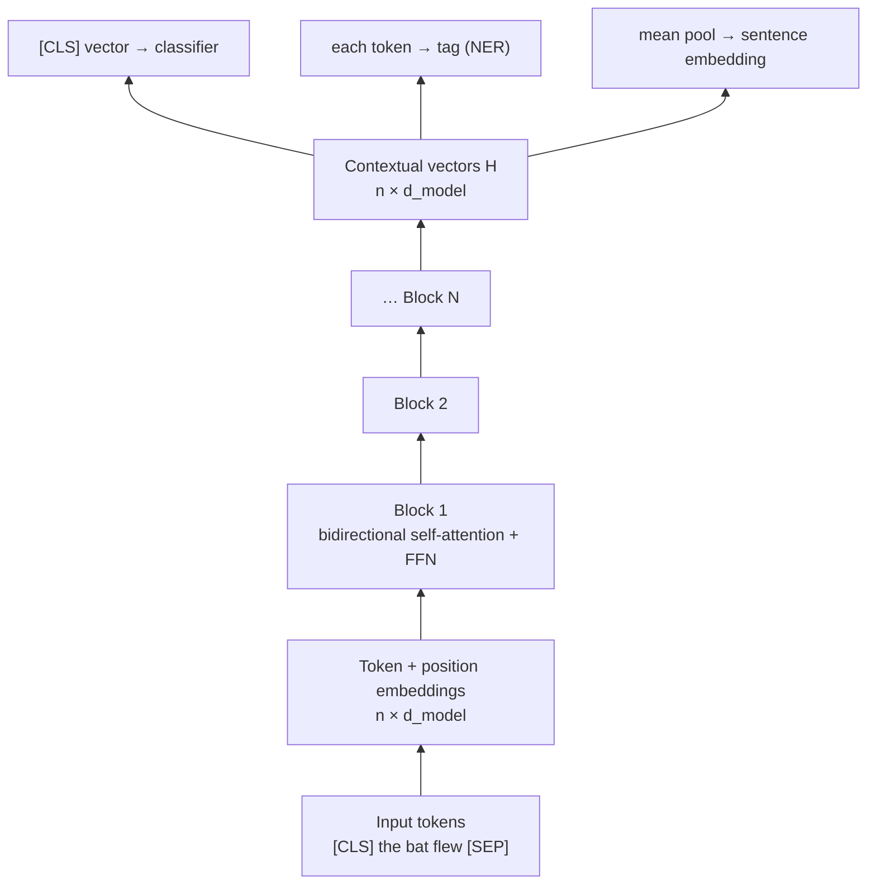

# Section 9 — The Encoder Stack

> **In one line:** an **encoder** is a stack of $N$ identical Transformer blocks with **bidirectional** self-attention (every token sees every other token). It turns a sequence of token embeddings into a sequence of **contextual vectors** — one per token — that downstream tasks like classification, tagging and search are built on.

---

## 1. Learning objectives

By the end of this section you should be able to:

1. **Describe** the encoder's input, its stack of blocks, and its output (shapes included).
2. **Explain** what "bidirectional" means and how it differs from the causal attention of decoders.
3. **Trace** how a token's vector changes layer by layer, using a small worked example.
4. **Explain** masked language modelling (MLM) — including the 15% and 80/10/10 rules — and compute its loss.
5. **Choose** how to use encoder outputs for sentence classification, token tagging and sentence embeddings.

---

## 2. Prerequisites

- **Section 8:** a pre-norm block $X' = A + \text{FFN}(\text{LN}(A))$ with $A = X + \text{MHA}(\text{LN}(X))$; each block maps $n \times d_{model} \to n \times d_{model}$.
- **Section 5:** masks — padding masks hide filler tokens; causal masks hide future tokens.
- **Section 2:** cosine similarity between vectors.

**Quick refresher — cross-entropy loss.** If a model gives the correct answer probability $p$, its loss is $-\log p$. Confident and right ($p = 0.9$) → small loss $0.105$; unsure ($p = 0.2$) → larger loss $1.609$. Training minimizes the average loss.

---

## 3. Motivation: understanding needs both sides

Consider:

> *I went to the **bank** to deposit my salary.*
> *I sat on the **bank** and watched the river.*

The words that disambiguate "bank" ("deposit", "river") come **after** it. A model that reads only left-to-right — like a text generator — must decide what "bank" means before seeing those clues.

For **understanding** tasks — "is this review positive?", "which words are names?", "which document answers this question?" — the whole text is available at once. There is no reason to hide the future. So we want a model where every token can look **both left and right**: an **encoder**.

---

## 4. Intuition first: a committee drafting a report in rounds

A committee of 12 people is writing a joint report. Each member holds one paragraph.

- **Round 1:** everyone reads everyone else's paragraph and updates their own to fit the whole report.
- **Round 2:** they read the *updated* paragraphs and refine again — now each paragraph reflects not only the others, but the others' first-round understanding.
- After **many rounds**, every paragraph is consistent with — and informed by — the entire report.

That is an encoder:
- Each **member/paragraph** = one token's vector.
- Each **round** = one Transformer block (layer).
- **Reading everyone's paragraph** = bidirectional self-attention.
- **Updating your own** = the residual + FFN.

**Where the analogy breaks:** committee members could choose to read only some paragraphs. In an encoder, *every* token attends to *every* token in every layer (except padding) — the only choice is how much weight to give each one.

---

## 5. The formal idea

### 5.1 The pipeline

$$
\begin{aligned}
X^{(0)} &= \text{Embed}(\text{tokens}) + \text{Positions} && (n \times d_{model}) \\
X^{(\ell)} &= \text{Block}_\ell\!\left(X^{(\ell-1)}\right), \quad \ell = 1, \dots, N && (n \times d_{model}) \\
H &= \text{LN}_{\text{final}}\!\left(X^{(N)}\right) && (n \times d_{model})
\end{aligned}
$$

$H$ holds one **contextual vector** per input token — the encoder's output.

### 5.2 "Bidirectional" = no causal mask

In each block, self-attention uses only a **padding mask** (Section 5). So token $i$ can attend to every real token $j$, before or after it:

| | Encoder (bidirectional) | Decoder (causal) |
|---|---|---|
| Token $i$ sees | all tokens $1 \dots n$ | only tokens $1 \dots i$ |
| Attention matrix | full | lower-triangular |
| Good for | understanding the whole input | generating text left-to-right |

"Bidirectional" does **not** mean reading the text twice (once each way). All tokens see all others **simultaneously**, in one attention step.

### 5.3 What the layers learn

Studies of trained encoders (e.g. BERT) find a rough progression:
- **Lower layers:** surface features — word identity, part of speech, nearby words.
- **Middle layers:** syntax — phrase structure, which word modifies which.
- **Upper layers:** meaning in context — word sense, coreference, task-specific features.

Each layer refines the previous one, like the committee's rounds.

### 5.4 Pre-training with masked language modelling (MLM)

You can't train a bidirectional encoder with "predict the next word" — each token can already *see* the next word, so it would just copy it. Instead, BERT-style encoders **hide some words and ask the model to fill them in**:

1. Pick **15%** of the tokens at random.
2. Of those picked:
   - **80%** are replaced with `[MASK]`,
   - **10%** are replaced with a **random** token,
   - **10%** are left **unchanged**.
3. The model predicts the **original** token at each picked position.
4. The loss is cross-entropy **only at the picked positions**:

$$\mathcal{L}_{\text{MLM}} = -\frac{1}{|\mathcal{M}|}\sum_{i \in \mathcal{M}} \log P(\text{original token}_i \mid \text{corrupted text})$$

where $\mathcal{M}$ is the set of picked positions.

**Why the 80/10/10 split?** At fine-tuning and test time, real text contains no `[MASK]` tokens. If the model only ever saw `[MASK]` at prediction positions, it might learn to make good representations *only* there. The random and unchanged cases force it to build a good representation for **every** token.

Other encoder objectives you'll meet:
- **NSP (next sentence prediction):** "does sentence B follow sentence A?" — used by BERT, later dropped (RoBERTa showed it wasn't helping).
- **Replaced token detection (ELECTRA):** a small generator swaps some tokens; the encoder classifies *every* token as original or replaced — learning from all positions, not just 15%.
- **Contrastive training** (sentence-embedding models): pull vectors of matching sentence pairs together and push non-matching pairs apart.

### 5.5 Using the encoder's output

| Task | What you take from $H$ | Head on top |
|---|---|---|
| Sentence classification (sentiment, spam) | vector of the special `[CLS]` token (or mean of all tokens) | linear layer → classes |
| Token tagging (names, parts of speech) | **every** token's vector | linear layer per token → tags |
| Extractive QA ("find the answer span") | every token's vector | two scores per token: "answer starts here" / "ends here" |
| Sentence embeddings (search, RAG) | **mean pooling** of all token vectors, usually normalized | none — compare with cosine similarity |

---

## 6. Worked examples

### 6.1 Two layers of a tiny encoder

We use our toy 2-D vectors and a **simplified block**: one attention head with identity projections and scaling ($\sqrt{2}$), plus the residual — LayerNorm and FFN left out so the arithmetic stays visible:

$$X^{(\ell)} = X^{(\ell-1)} + \text{softmax}\!\left(\frac{X^{(\ell-1)} X^{(\ell-1)\top}}{\sqrt{2}}\right) X^{(\ell-1)}$$

**Sentence A: "the bat flew"**, $X^{(0)} = [\,0.2, 0.2\,;\; 1, 1\,;\; 2, 0\,]$.

**Layer 1 — attention weights** (each row sums to 1; every token sees all three):

| | the | bat | flew |
|---|---|---|---|
| the | 0.29 | 0.36 | 0.36 |
| bat | 0.14 | 0.43 | 0.43 |
| flew | 0.06 | 0.18 | 0.76 |

**bat's new vector** $= [1, 1] + (0.14[0.2, 0.2] + 0.43[1, 1] + 0.43[2, 0]) = [1, 1] + [1.32, 0.46] = [2.32, 1.46]$.

The full outputs:

| Token | Layer 0 | Layer 1 | Layer 2 |
|---|---|---|---|
| the | [0.20, 0.20] | [1.33, 0.61] | [4.44, 1.21] |
| bat | [1.00, 1.00] | [2.32, 1.46] | [5.61, 2.00] |
| flew | [2.00, 0.00] | [3.71, 0.20] | [7.37, 0.43] |

**Sentence B: "the bat hit"** gives the mirror image (the two axes swap): bat → $[1.46, 2.32]$ after layer 1, $[2.00, 5.61]$ after layer 2.

**How similar is "bat" in the two sentences?** (cosine similarity)

| Layer | 0 | 1 | 2 | 3 |
|---|---|---|---|---|
| cos(bat in A, bat in B) | **1.00** | 0.90 | 0.63 | 0.36 |

At layer 0, "bat" is the *same* vector in both sentences (it's just the embedding). Each layer pulls it further toward its own sentence's meaning, so the two "bat"s **diverge** — animal-bat and cricket-bat become different representations. This is exactly what "contextual vectors" means.

*(Notice the numbers also grow each layer. That's because we left out LayerNorm; real encoders normalize, which keeps the scale steady while preserving these directions.)*

### 6.2 The MLM recipe on a 20-token sentence

Expected numbers for one 20-token sentence:
- Picked: $15\% \times 20 = 3$ tokens.
- Of these, on average: $0.8 \times 3 = 2.4$ become `[MASK]`, $0.3$ become a random token, $0.3$ stay unchanged.

Suppose the model gives the correct original tokens probabilities $0.6$, $0.2$ and $0.9$ at the three picked positions:

$$\mathcal{L} = \tfrac{1}{3}\big(-\log 0.6 - \log 0.2 - \log 0.9\big) = \tfrac{1}{3}(0.511 + 1.609 + 0.105) = \mathbf{0.742}$$

The other 17 positions contribute **nothing** to the loss — one reason MLM learns less per sentence than next-token prediction (and why ELECTRA's "every token" objective is more sample-efficient).

### 6.3 BERT-base, every parameter accounted for

BERT-base: $d = 768$, 12 layers, 12 heads, $d_{ff} = 3072$, vocabulary 30,522, 512 positions, 2 segment types, post-norm LayerNorm with biases.

| Part | Formula | Parameters |
|---|---|---|
| Token + position + segment embeddings, embedding LayerNorm | $(30{,}522 + 512 + 2) \times 768 + 2 \times 768$ | 23,837,184 |
| One layer: attention ($4d^2 + 4d$) + FFN ($2d \cdot d_{ff} + d_{ff} + d$) + 2 LayerNorms ($4d$) | | 7,087,872 |
| 12 layers | $12 \times 7{,}087{,}872$ | 85,054,464 |
| Pooler (a $d \times d$ layer on `[CLS]`) | $768^2 + 768$ | 590,592 |
| **Total** | | **109,482,240** |

That's BERT-base's "110M". The same recipe with $d = 1024$, 24 layers, $d_{ff} = 4096$ gives BERT-large's **335M**.

---

## 7. Diagram

---

## 8. In practice

| Model | Year | Layers / $d_{model}$ | Pre-training | Notes |
|---|---|---|---|---|
| BERT-base / large | 2018 | 12 / 768, 24 / 1024 | MLM + NSP | the classic encoder |
| RoBERTa | 2019 | same as BERT | MLM only, more data, longer training | drops NSP |
| ELECTRA | 2020 | various | replaced token detection | learns from every token |
| DeBERTa | 2020 | various | MLM | separates content and position in attention |
| Sentence-embedding models (e.g. E5, BGE) | 2022+ | BERT-sized | contrastive | power semantic search and RAG |
| ModernBERT | 2024 | 22 / 768 (base) | MLM | RoPE, 8,192-token context |

- **Encoders are still everywhere** even in the LLM era: search engines, spam filters, recommendation, and the **retrieval step of RAG** (Section 18) mostly run on encoders because they are small, fast and excellent at "understanding" tasks.
- **Fine-tuning** an encoder for classification usually means adding one linear layer and training the whole thing for a few epochs on labelled data.
- **Cross-encoders vs bi-encoders:** a *bi-encoder* embeds query and document separately (fast, used for search over millions of documents); a *cross-encoder* feeds both into one encoder together (slower, more accurate, used to **re-rank** the top results).

---

## 9. Common mistakes and misconceptions

- **"An encoder can write text like GPT."** Encoders produce vectors for the input they're given; they aren't trained to generate text token by token.
- **"Bidirectional means it reads left-to-right, then right-to-left."** All tokens attend to all others **at once**, in every layer.
- **"The `[CLS]` vector magically summarizes the sentence."** It only becomes a useful summary through training (pre-training objectives and fine-tuning). For raw sentence similarity, mean pooling from a model trained for embeddings usually works much better.
- **"Encoders need a causal mask."** No — only a padding mask. A causal mask would throw away the right-hand context that makes encoders good at understanding.
- **"The last layer is always the best representation."** For some tasks (e.g. syntax), middle layers carry more useful information; the top layers are shaped by the pre-training objective.

---

## 10. Summary

- An **encoder** = embeddings + positions → $N$ identical blocks with **bidirectional** self-attention → one **contextual vector** per token ($n \times d_{model}$).
- Every token sees every other token in every layer; only padding is masked.
- Layers refine representations progressively; the same word **diverges** into different vectors in different contexts (bat: cosine 1.00 → 0.36 over three toy layers).
- Encoders are pre-trained with **MLM**: pick 15% of tokens (80% `[MASK]`, 10% random, 10% unchanged) and predict the originals; the loss counts only the picked positions.
- Outputs are used via `[CLS]`/mean pooling (classification, embeddings) or per-token heads (tagging, QA). BERT-base = **109,482,240** parameters.

---

## 11. Check your understanding

1. BERT-base has 12 layers with 12 heads each. For a 128-token input, how many attention scores ($q \cdot k$ values) are computed in total across all heads and layers?
2. A 40-token sentence goes through the MLM recipe. How many tokens are picked, and how many of them are expected to become `[MASK]`, random, and unchanged?
3. Why can't a bidirectional encoder be trained with ordinary next-token prediction? What would it learn?

Answers

1. Per head per layer: $128^2 = 16{,}384$. Total: $16{,}384 \times 12 \times 12 = \mathbf{2{,}359{,}296}$.
2. $15\% \times 40 = \mathbf{6}$ picked; expected $\mathbf{4.8}$ `[MASK]`, $\mathbf{0.6}$ random, $\mathbf{0.6}$ unchanged.
3. With no causal mask, the token at position $i$ can attend directly to position $i+1$ — the very word it's asked to predict. The model would learn to **copy** the next token through attention, reaching near-zero loss while learning nothing useful about language.

---

## 12. Further reading

1. Devlin, J., Chang, M.-W., Lee, K., & Toutanova, K. (2019). **"BERT: Pre-training of Deep Bidirectional Transformers for Language Understanding."** *NAACL 2019.* arXiv:1810.04805 — MLM, the 80/10/10 rule, `[CLS]`.
2. Liu, Y. et al. (2019). **"RoBERTa: A Robustly Optimized BERT Pretraining Approach."** arXiv:1907.11692.
3. Clark, K., Luong, M.-T., Le, Q. V., & Manning, C. D. (2020). **"ELECTRA: Pre-training Text Encoders as Discriminators Rather Than Generators."** arXiv:2003.10555.
4. Tenney, I., Das, D., & Pavlick, E. (2019). **"BERT Rediscovers the Classical NLP Pipeline."** arXiv:1905.05950 — what different layers encode.
5. Reimers, N., & Gurevych, I. (2019). **"Sentence-BERT: Sentence Embeddings using Siamese BERT-Networks."** arXiv:1908.10084 — bi-encoders for semantic search.
