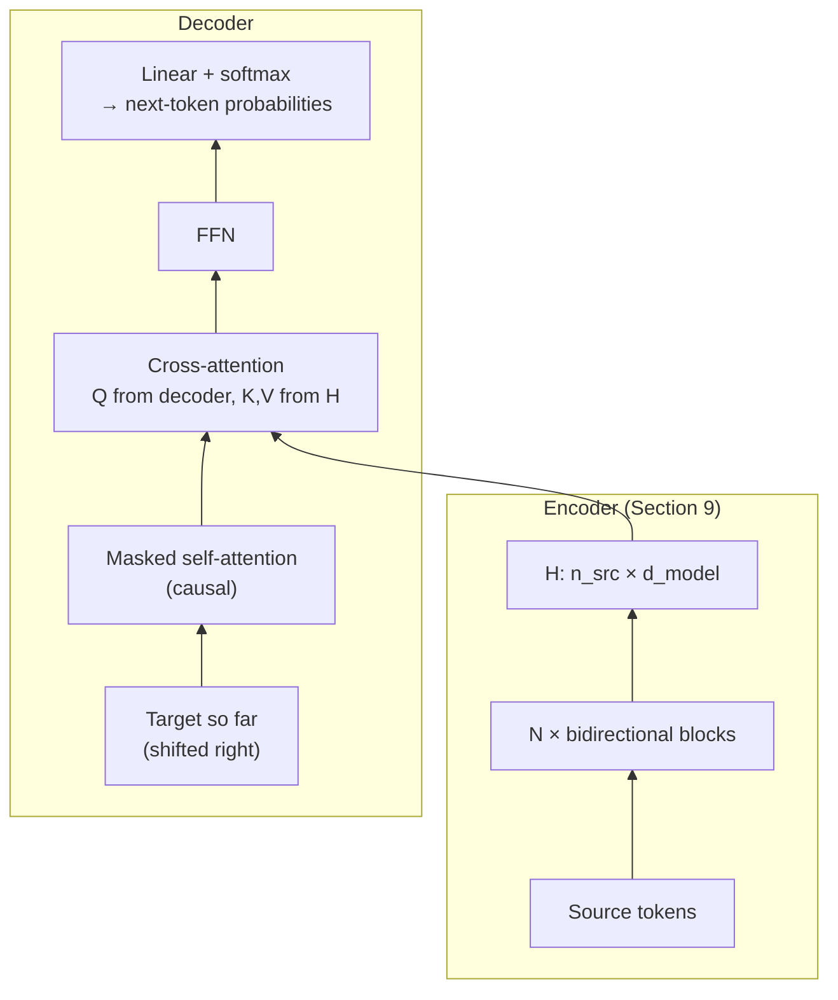

# Section 10 — The Decoder Stack

> **In one line:** a **decoder** is a stack of Transformer blocks with **causal (masked) self-attention**, so each position sees only the past. That lets it be **trained on every position of a sentence in parallel** but **generate text one token at a time**. In translation-style models it also has **cross-attention** to read the encoder's output.

---

## 1. Learning objectives

By the end of this section you should be able to:

1. **Describe** the decoder block: masked self-attention, optional cross-attention, FFN — with residuals and norms.
2. **Explain** teacher forcing: how one forward pass gives a training signal at *every* position.
3. **Contrast** training (parallel) with generation (sequential, one forward pass per new token).
4. **Compute** cross-attention by hand, with queries from the decoder and keys/values from the encoder.
5. **Distinguish** decoder-only models (GPT, LLaMA, Claude) from encoder–decoder models (original Transformer, T5).

---

## 2. Prerequisites

- **Section 5:** the causal mask — a lower-triangular pattern that sets future scores to $-\infty$.
- **Section 9:** the encoder produces contextual vectors $H$ ($n_{src} \times d_{model}$).
- **Section 8:** a block = sub-layers wrapped in residuals and normalization.
- **Cross-entropy:** loss $= -\log p(\text{correct token})$.

**Quick refresher — "autoregressive".** An **autoregressive** model produces a sequence one item at a time, feeding each output back in as input for the next step — like writing a sentence where every new word depends on all the words you have already written.

---

## 3. Motivation: generating text needs a "no peeking" model

To **write** text, a model must answer one question again and again:

> *Given everything so far, what is the next token?*

Two requirements follow:
1. When predicting position $t$, the model must **not see** positions $t, t+1, \dots$ — otherwise it would just copy the answer during training and fail at test time, where the future doesn't exist yet.
2. Training must still be **efficient** — we can't afford a separate forward pass for every word of every training sentence.

The causal mask solves both: it hides the future **inside** a single parallel pass. The decoder is the block stack built around this mask.

---

## 4. Intuition first: an exam answered line by line

Imagine writing an exam essay one line at a time:

- You may **look at every line you've already written**, but every line **below** the one you're on is covered by a card (the causal mask).
- **Training** is like a teacher grading a model essay: the teacher can check, for *every* line at once, "given the lines above, was this the right next line?" — all lines graded in one sitting.
- **Generating** is like writing a fresh essay: you can't write line 5 until line 4 exists, so you go **one line at a time**.
- **Cross-attention** is an open-book exam for translation: while writing your Hindi answer, you may consult the **entire** English question (the encoder's output) at any time.

**Where the analogy breaks:** a student revises earlier lines; a decoder never changes tokens it has already produced — each new token is simply appended.

---

## 5. The formal idea

### 5.1 The decoder block

**Decoder-only** (GPT, LLaMA, Claude) — two sub-layers:

$$
\begin{aligned}
A &= X + \text{MaskedMHA}(\text{LN}(X)) \\
X' &= A + \text{FFN}(\text{LN}(A))
\end{aligned}
$$

This is exactly the Section 8 block with a **causal mask** in the attention.

**Decoder in an encoder–decoder model** (original Transformer, T5) — three sub-layers:

$$
\begin{aligned}
A &= X + \text{MaskedMHA}(\text{LN}(X)) \\
B &= A + \text{CrossMHA}\big(\underbrace{\text{LN}(A)}_{\text{queries}},\; \underbrace{H}_{\text{keys, values}}\big) \\
X' &= B + \text{FFN}(\text{LN}(B))
\end{aligned}
$$

### 5.2 Cross-attention

Cross-attention is ordinary attention where the queries and the keys/values come from **different sequences**:

$$Q = \text{(decoder states)}\, W_Q, \qquad K = H\, W_K, \qquad V = H\, W_V$$

| Matrix | Shape |
|---|---|
| $Q$ (from the $n_{tgt}$ target tokens) | $n_{tgt} \times d_k$ |
| $K, V$ (from the $n_{src}$ source tokens) | $n_{src} \times d_k$ |
| Scores $QK^{\top}$ | $n_{tgt} \times n_{src}$ (**not square**) |

Each target token asks: *"which source words matter for what I'm writing now?"* There is **no causal mask** in cross-attention — the whole source sentence is already known.

### 5.3 The output head

After the last block (and a final norm), a linear layer maps each position to **one score per vocabulary word** (often reusing the embedding matrix — weight tying, Section 2), and softmax turns scores into probabilities:

$$P(\text{next token} \mid \text{tokens} \le t) = \text{softmax}(h_t W_{out}) \qquad (\text{shape } |\mathcal{V}|)$$

### 5.4 Training: teacher forcing

Take a training sentence and add start/end tokens: `<bos> the bat flew <eos>`.

- **Input** = the sequence **shifted right** (starts with `<bos>`): `<bos> the bat flew`
- **Target** = the same sequence **shifted left**: `the bat flew <eos>`

| Position | Sees (input up to here) | Must predict |
|---|---|---|
| 1 | `<bos>` | the |
| 2 | `<bos> the` | bat |
| 3 | `<bos> the bat` | flew |
| 4 | `<bos> the bat flew` | `<eos>` |

Because of the causal mask, all four rows are computed in **one forward pass**, each seeing only its allowed prefix. The loss averages over **every** position:

$$\mathcal{L} = -\frac{1}{T}\sum_{t=1}^{T} \log P(x_{t+1} \mid x_{\le t})$$

This is called **teacher forcing**: during training the model is always fed the **true** previous tokens, never its own guesses. Compared with MLM (Section 9), every token is a training signal, not just 15%.

### 5.5 Inference: the generation loop

At inference time there is no target to copy, so tokens are produced **one per forward pass**:

1. Start with the prompt (e.g. `<bos>`).
2. Run the decoder; take the distribution at the **last** position.
3. Choose a token (greedy, sampling, … — Section 13).
4. **Append** it to the input.
5. Repeat until `<eos>` or a length limit.

| | Training | Generation |
|---|---|---|
| Tokens processed per forward pass | all $T$ at once | the sequence so far, to get **one** new token |
| Forward passes for a $T$-token sentence | **1** | **$T$** |
| What is fed in | the true text (teacher forcing) | the model's own outputs |

Recomputing keys and values for the whole prefix at every step would be wasteful; the **KV cache** (Section 14) stores them so each step only processes the newest token.

### 5.6 Exposure bias

In training the model only ever sees *correct* prefixes; at generation time it sees its *own* outputs, mistakes included. If it makes an unusual choice, it finds itself in a situation it was never trained on, and errors can compound. This mismatch is called **exposure bias**. In practice, large-scale training makes models robust enough for this to matter less than early research feared, and decoding strategies (Section 13) help.

---

## 6. Worked examples

### 6.1 Teacher forcing on one sentence

Sentence: `<bos> the bat flew <eos>`. Suppose the model assigns the correct next token these probabilities:

| Position | Context | Target | $P(\text{target})$ | $-\log P$ |
|---|---|---|---|---|
| 1 | `<bos>` | the | 0.5 | 0.693 |
| 2 | `<bos> the` | bat | 0.4 | 0.916 |
| 3 | `<bos> the bat` | flew | 0.6 | 0.511 |
| 4 | `<bos> the bat flew` | `<eos>` | 0.7 | 0.357 |

$$\mathcal{L} = \tfrac{1}{4}(0.693 + 0.916 + 0.511 + 0.357) = \mathbf{0.619}$$

Four training signals from **one** forward pass of a 4-token input.

### 6.2 Generating the same sentence

Use a toy model whose next-token probabilities depend only on the last token (a stand-in for a real decoder):

| After… | most likely next tokens |
|---|---|
| `<bos>` | **the 0.50**, a 0.30, … |
| the | **bat 0.40**, ball 0.30, … |
| bat | **flew 0.60**, hit 0.25, … |
| flew | **`<eos>` 0.70**, … |

Greedy generation (always take the most likely token):

| Pass | Input | Chosen |
|---|---|---|
| 1 | `<bos>` | the |
| 2 | `<bos> the` | bat |
| 3 | `<bos> the bat` | flew |
| 4 | `<bos> the bat flew` | `<eos>` |

Same sentence — but **4 sequential passes** instead of 1, because pass $t+1$ needs the token chosen in pass $t$. Generating 1,000 tokens needs 1,000 passes; this is why text appears word by word in chatbots.

### 6.3 Cross-attention by hand: translating "bat flew"

An encoder has read the English source "bat flew" and produced (toy 2-D, our usual axes) $H = [\,\text{bat}: [1, 1];\; \text{flew}: [2, 0]\,]$. The decoder is writing the Hindi translation **"चमगादड़ उड़ा"** (*chamgaadad udaa*). Take identity projections ($K = V = H$) and $d_k = 2$, so scores are divided by $\sqrt{2}$.

**Step 1 — writing "चमगादड़" (bat).** Suppose the decoder's query is $q = [0, 2]$ ("looking for the noun").
- Scores: $q \cdot k_{\text{bat}} / \sqrt{2} = 2/1.414 = 1.41$; $q \cdot k_{\text{flew}} / \sqrt{2} = 0$
- Softmax: $e^{1.41} = 4.11$, $e^0 = 1$ → weights **[0.80, 0.20]**
- Output: $0.80[1, 1] + 0.20[2, 0] = [1.20, 0.80]$

**Step 2 — writing "उड़ा" (flew).** Query $q = [2, 0]$ ("looking for the action").
- Scores: $2/1.414 = 1.41$ and $4/1.414 = 2.83$
- Softmax → weights **[0.20, 0.80]**
- Output: $[1.80, 0.20]$

The cross-attention weights form a **soft alignment** between the two languages: when writing the Hindi word for "bat", the decoder looks mostly at "bat"; when writing "flew", mostly at "flew". Here the score matrix is $2 \times 2$ only because both sentences have two words; in general it is $n_{tgt} \times n_{src}$.

### 6.4 Counting the original Transformer (encoder–decoder)

Base model: $d = 512$, $d_{ff} = 2048$, 6 encoder + 6 decoder layers, a shared vocabulary of about 37,000 tokens (ignoring biases and norms):

| Part | Formula | Parameters |
|---|---|---|
| Encoder layer | self-attn $4d^2$ + FFN $2d \cdot d_{ff}$ | 3,145,728 |
| Decoder layer | self-attn $4d^2$ + **cross-attn $4d^2$** + FFN $2d \cdot d_{ff}$ | 4,194,304 |
| 6 + 6 layers | | 44,040,192 |
| Shared embeddings | $37{,}000 \times 512$ | 18,944,000 |
| **Total** | | **≈ 63.0 M** |

Biases and LayerNorms bring it to the paper's reported **65M**. Each decoder layer is a third bigger than an encoder layer because of cross-attention.

---

## 7. Diagram

A **decoder-only** model is the right-hand stack **without** the cross-attention box (and with no encoder at all).

---

## 8. In practice

| Model family | Architecture | Cross-attention? | Typical use |
|---|---|---|---|
| Original Transformer, T5, BART, Whisper | encoder–decoder | **yes** | translation, summarization, speech-to-text |
| GPT, LLaMA, Mistral, Claude | **decoder-only** | no | chat, writing, code, reasoning |

- **Decoder-only dominates LLMs** (Section 11 explains why): the prompt is simply the beginning of the sequence, and "understanding the input" happens through causal self-attention over it.
- **Prefill vs decode:** at inference the prompt is processed in one parallel pass ("prefill", like training), and then new tokens come one per pass ("decode"). Prefill is limited by compute; decode by memory bandwidth (Section 14).
- **Speech and images:** Whisper's decoder cross-attends to audio-encoder outputs; many image-captioning models cross-attend to image features (Section 15).

---

## 9. Common mistakes and misconceptions

- **"Decoders are trained one token at a time."** Training is fully parallel: the causal mask lets all positions be predicted in one pass. Only **generation** is sequential.
- **"Cross-attention uses a causal mask."** No — the source sentence is fully known, so every target position may attend to **every** source position. The causal mask applies to the decoder's **self**-attention.
- **"GPT-style models have cross-attention."** Decoder-only models have only masked self-attention + FFN; there is no encoder to attend to.
- **"Teacher forcing is used when the model generates."** Teacher forcing is a **training** procedure. At generation time the model consumes its own outputs.
- **"The output head chooses the next word."** It produces a **probability distribution**; a separate decoding strategy (Section 13) picks the token.

---

## 10. Summary

- A **decoder** uses **causal self-attention**: position $t$ sees only positions $\le t$.
- **Encoder–decoder** decoders add **cross-attention** (Q from the decoder, K/V from the encoder; scores $n_{tgt} \times n_{src}$; no causal mask) — the soft alignment between languages.
- **Teacher forcing:** input shifted right, targets shifted left; one forward pass gives a loss at **every** position.
- **Generation** is autoregressive: one forward pass per new token, appended to the input (sped up by the KV cache).
- Decoder-only models (GPT, LLaMA, Claude) drop cross-attention entirely; encoder–decoder models (T5, Whisper) keep it.

---

## 11. Check your understanding

1. A target sentence has 6 tokens (including `<eos>`). How many next-token predictions does one teacher-forced training pass produce? How many forward passes are needed to *generate* those 6 tokens from `<bos>` (without a KV cache)?
2. In a translation model the decoder has produced 5 target tokens and the source has 8 tokens, with $d_k = 64$. Give the shapes of $Q$, $K$ and the cross-attention score matrix for one head.
3. In 6.3, what are the cross-attention weights if the decoder's query is $q = [1, 1]$? What does that suggest about the step it's at?

Answers

1. **6** predictions in one training pass; **6** forward passes to generate them (one per token).
2. $Q$: $\mathbf{5 \times 64}$; $K$: $\mathbf{8 \times 64}$; scores: $\mathbf{5 \times 8}$.
3. Scores: $[1,1]\cdot[1,1] / 1.414 = 1.41$ and $[1,1]\cdot[2,0]/1.414 = 1.41$ — equal — so the weights are **[0.5, 0.5]**. The query isn't strongly looking for either word, as might happen at a step where the target word relates to both (or to neither).

---

## 12. Further reading

1. Vaswani, A. et al. (2017). **"Attention Is All You Need."** *NeurIPS 2017.* arXiv:1706.03762 — Section 3.1 describes the decoder with masked self-attention and encoder–decoder attention.
2. Radford, A. et al. (2018). **"Improving Language Understanding by Generative Pre-Training."** OpenAI — the original GPT, a decoder-only Transformer.
3. Raffel, C. et al. (2020). **"Exploring the Limits of Transfer Learning with a Unified Text-to-Text Transformer."** *JMLR.* arXiv:1910.10683 — T5, an encoder–decoder model.
4. Bahdanau, D., Cho, K., & Bengio, Y. (2014). **"Neural Machine Translation by Jointly Learning to Align and Translate."** arXiv:1409.0473 — the origin of attention as soft alignment between languages.
5. Bengio, S. et al. (2015). **"Scheduled Sampling for Sequence Prediction with Recurrent Neural Networks."** arXiv:1506.03099 — on the training/inference mismatch (exposure bias).
