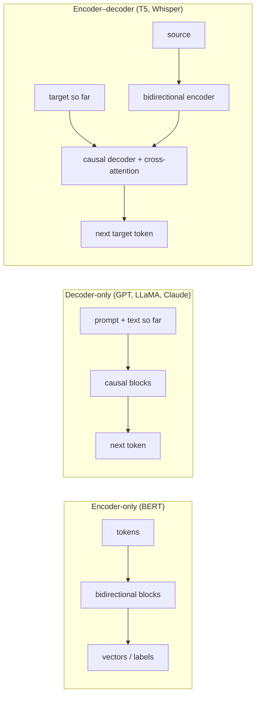

# Section 11 — Encoder vs Decoder vs Both

> **In one line:** all Transformers are built from the same block; what makes a model an **encoder**, a **decoder**, or an **encoder–decoder** is (1) its **attention mask** and (2) its **training objective**. Each combination is good at different jobs — and decoder-only models became the default for LLMs because one simple objective turns out to cover almost every task.

---

## 1. Learning objectives

By the end of this section you should be able to:

1. **Draw** the attention pattern of an encoder, a decoder, a prefix-LM and an encoder–decoder, and count the allowed connections.
2. **Compare** the pre-training objectives — masked LM, causal LM, span corruption — and how many training signals each gives per sentence.
3. **Frame** the same task (e.g. sentiment classification) for all three architectures.
4. **Explain** why decoder-only models dominate modern LLMs, and where the other two still win.
5. **Choose** an architecture for a given application and justify it.

---

## 2. Prerequisites

- **Section 9 (encoder):** bidirectional attention, MLM, `[CLS]`/mean pooling.
- **Section 10 (decoder):** causal attention, teacher forcing, generation, cross-attention.
- **Section 5:** masks are added to the scores ($0$ = allowed, $-\infty$ = blocked).

**Quick refresher — the same block everywhere.** Every model in this section uses the Section 8 block: attention + FFN with residuals and norms. Nothing about the block itself changes between architectures; only *who can attend to whom* and *what the model is trained to predict*.

---

## 3. Motivation: why not just one design?

Different jobs need different information flows:

| Job | What the model needs |
|---|---|
| "Is this email spam?" | read the **whole** input, output **one label** |
| "Write a reply to this email" | produce **new text**, one token at a time, never seeing the future |
| "Translate this email into Hindi" | read the whole input **and** produce new text |

An encoder is ideal for the first, a decoder for the second, and an encoder–decoder was designed for the third. Yet today a single decoder-only LLM does all three reasonably well. Understanding *why* is the goal of this section.

---

## 4. Intuition first: three kinds of students

- **The reviewer (encoder):** reads a whole essay, can flip back and forth freely, then writes **one verdict**: "Grade A". Great at understanding; never writes essays.
- **The storyteller (decoder):** writes a story one sentence at a time, only ever looking back at what's already written. Asked a question, they simply *continue the text* with an answer — so given the right opening, they can do almost anything.
- **The translator (encoder–decoder):** first reads the whole source document carefully (encoder), then writes the translation line by line (decoder), glancing back at the source whenever needed (cross-attention).

**Where the analogy breaks:** real people combine these skills. In models the difference is hard-wired by the mask — a decoder physically *cannot* look at later tokens, however useful they would be.

---

## 5. The formal idea

### 5.1 Four attention patterns

For a sequence of $n$ tokens (row = query, column = key; ✓ = allowed):

| Architecture | Pattern | Allowed pairs |
|---|---|---|
| **Encoder** (bidirectional) | full $n \times n$ | $n^2$ |
| **Decoder** (causal) | lower triangle | $n(n+1)/2$ |
| **Prefix-LM** | full on the first $p$ tokens ("prefix"), causal after | $p^2 + \sum_{i=p+1}^{n} i$ |
| **Encoder–decoder** | encoder: full $n_{src}^2$; decoder self: causal; cross: full $n_{tgt} \times n_{src}$ | $n_{src}^2 + \frac{n_{tgt}(n_{tgt}+1)}{2} + n_{tgt}\,n_{src}$ |

A **prefix-LM** is a decoder that treats the prompt like an encoder (every prompt token sees the whole prompt) and the answer like a decoder (each answer token sees the prompt plus earlier answer tokens).

### 5.2 Three pre-training objectives

| Objective | Used by | Input → target | Supervised positions |
|---|---|---|---|
| **Masked LM (MLM)** | encoders (BERT) | text with ~15% hidden → the hidden tokens | ~15% |
| **Causal LM (next-token)** | decoders (GPT, LLaMA) | text → the same text shifted by one | **100%** |
| **Span corruption / denoising** | encoder–decoders (T5, BART) | text with spans replaced by placeholders → the missing spans | the corrupted spans (~15% in T5) |

**Span corruption (T5):** pick short spans of the input, replace each with a unique **sentinel** token (`<X>`, `<Y>`, …), and train the decoder to output the missing spans, each introduced by its sentinel.

### 5.3 Why decoder-only won for LLMs

1. **One objective, any text.** Next-token prediction needs no labels and no special corruption — every web page, book and code file is training data, and **every** token is a training signal.
2. **Every task is "continue this text".** Questions, translation, classification, code: put the task in the prompt and let the model write the answer. This is **prompting**, and with scale it gives **in-context learning** — learning a task from a few examples in the prompt.
3. **Simplicity and scaling.** One stack, one mask, one loss. Easy to scale to hundreds of layers and thousands of GPUs; scaling-law research mostly studied this setup.
4. **Efficient generation.** Causal attention means earlier tokens never change, so their keys and values can be cached (the KV cache, Section 14). That makes long chats affordable.
5. **Chat is a single growing sequence.** A conversation is just text appended turn after turn — exactly what a decoder handles natively.

### 5.4 Where the others still win

- **Encoders:** when you need a **vector or a label**, not text — search embeddings, classification, tagging — encoders are smaller, faster and often more accurate per parameter. RAG retrieval runs on encoders (Section 18).
- **Encoder–decoders:** **input → output transformations** with a long input and a shorter output (translation, summarization, speech-to-text). The input is read once, bidirectionally, and the decoder can stay small. Whisper (speech recognition) is encoder–decoder.

---

## 6. Worked examples

### 6.1 Counting allowed connections

Sequence of $n = 5$ tokens: a 3-token prompt "the bat flew" followed by a 2-token continuation "away fast".

| Pattern | Calculation | Allowed pairs (of 25) |
|---|---|---|
| Encoder | $5^2$ | **25** |
| Decoder | $5 \cdot 6 / 2$ | **15** |
| Prefix-LM ($p = 3$) | $3^2 + 4 + 5$ | **18** |

In the prefix-LM, "the" can see "flew" (both are in the prefix) — impossible in a plain decoder — but "away" still cannot see "fast".

**Encoder–decoder version** (source "the bat flew", 3 tokens; target "away fast", 2 tokens):
- Encoder self-attention: $3 \times 3 = 9$
- Decoder self-attention (causal): $2 \cdot 3 / 2 = 3$
- Cross-attention: $2 \times 3 = 6$

### 6.2 Three objectives on one sentence

Sentence (8 tokens): **students often study late at night before exams**

**Masked LM** (one token hidden — 15% of 8 rounds to 1):
- Input: `students often [MASK] late at night before exams`
- Target: `study` at position 3 → **1** supervised position

**Causal LM:**
- Input: `<bos> students often study late at night before exams`
- Targets: `students often study late at night before exams <eos>` → **9** supervised positions (every one)

**Span corruption** (two spans, chosen large here so it's easy to see):
- Input: `students often <X> at night <Y> exams`
- Target: `<X> study late <Y> before <Z>`
- The decoder reconstructs **3** corrupted tokens (plus the sentinels marking where each span goes; `<Z>` marks the end).

### 6.3 One task, three framings

**Task:** decide whether the review *"the movie was great"* is positive or negative.

| Architecture | Input | Output | Extra parts needed |
|---|---|---|---|
| **Encoder** (BERT) | `[CLS] the movie was great [SEP]` | label from a classifier on the `[CLS]` vector | a trained classification head |
| **Encoder–decoder** (T5) | `sentiment: the movie was great` | the text `positive` | none — the label is generated as text |
| **Decoder-only** (GPT/LLaMA) | `Review: the movie was great. Sentiment:` | next token ` positive` | none — just a prompt |

The encoder needs a task-specific head and fine-tuning; the other two turn the task into **text generation**. The decoder-only version needs no fine-tuning at all if the model is large enough — the prompt alone defines the task.

### 6.4 Training signals per sentence

For a 20-token sentence:

| Objective | Supervised predictions |
|---|---|
| MLM (15%) | $0.15 \times 20 = 3$ |
| Span corruption (15%) | about 3 tokens (in 1–2 spans) |
| Causal LM | **20** (21 counting the final `<eos>`) |

Causal LM extracts the most supervision from each sentence — one reason it scales so well.

---

## 7. Diagram

---

## 8. In practice

| Architecture | Examples | Best at | Weak at |
|---|---|---|---|
| Encoder-only | BERT, RoBERTa, DeBERTa, E5/BGE, ModernBERT | classification, tagging, embeddings, re-ranking | generating text |
| Decoder-only | GPT series, LLaMA, Mistral, Qwen, Claude | open-ended generation, chat, code, reasoning, few-shot tasks | overkill (large and slow) for simple labelling jobs |
| Encoder–decoder | T5 / Flan-T5, BART, mT5, Whisper | translation, summarization, speech-to-text | open-ended chat at scale |
| Prefix-LM / hybrids | UL2, GLM | mixes of understanding and generation | less common today |

**Choosing in practice:**

| If you need… | Choose |
|---|---|
| a label or a score for each input, cheaply, at high volume | **encoder** (fine-tuned) |
| a vector to search millions of documents | **encoder** (embedding model) |
| a fixed input→output transform, e.g. speech-to-text or translation, on limited hardware | **encoder–decoder** |
| open-ended answers, many different tasks, chat, tool use | **decoder-only LLM** |

The lines are blurring: some recent embedding models are built from decoder LLMs, and decoder-only LLMs now translate and summarize very well.

---

## 9. Common mistakes and misconceptions

- **"Encoders and decoders use different kinds of blocks."** They use the same block; the **mask** (and the objective) differ.
- **"Decoder-only models can't understand input; they only generate."** The prompt *is* the input; causal self-attention over it provides understanding. Each prompt token just can't see later prompt tokens.
- **"Encoder–decoder is always better because it has both."** It's better suited to some transformation tasks, but it's more complex and less convenient for chat and in-context learning. Most frontier LLMs are decoder-only.
- **"BERT is obsolete."** Encoders are still the workhorse for search, classification and RAG retrieval because they're small, fast and accurate.
- **"Span corruption is the same as MLM."** MLM predicts each hidden token in place with an encoder; span corruption removes whole spans and has a **decoder** generate them as a sequence.

---

## 10. Summary

- Encoder, decoder and encoder–decoder share the same block; they differ in **attention mask** and **training objective**.
- Masks: encoder **full** ($n^2$), decoder **causal** ($n(n+1)/2$), prefix-LM **full on the prompt, causal after**, encoder–decoder **full + causal + cross**.
- Objectives: **MLM** (~15% supervised), **causal LM** (100% supervised), **span corruption** (reconstruct removed spans).
- Any task can be framed as text generation; decoder-only LLMs win on simplicity, scaling, prompting/in-context learning and cacheable generation.
- Encoders still win for embeddings and labels; encoder–decoders for long-input → short-output transforms like translation and speech recognition.

---

## 11. Check your understanding

1. For $n = 6$ tokens with a prefix of $p = 4$, how many pairs are allowed under (a) bidirectional, (b) causal, and (c) prefix-LM attention?
2. Pick an architecture for each, with one reason: (a) a spam filter scanning one million emails a day; (b) a customer-support chatbot; (c) converting lecture recordings to text.
3. Write the input and target for **span corruption** on "the bat flew out of the cave" if the spans "flew out" and "cave" are removed.

Answers

1. (a) $6^2 = \mathbf{36}$; (b) $6 \cdot 7/2 = \mathbf{21}$; (c) $4^2 + 5 + 6 = \mathbf{27}$.
2. (a) **Encoder** — a small fine-tuned classifier is fast and cheap at high volume. (b) **Decoder-only LLM** — open-ended conversation, many kinds of request. (c) **Encoder–decoder** (e.g. Whisper) — long audio input read once, text output generated.
3. Input: `the bat <X> of the <Y>`. Target: `<X> flew out <Y> cave <Z>`.

---

## 12. Further reading

1. Devlin, J. et al. (2019). **"BERT: Pre-training of Deep Bidirectional Transformers for Language Understanding."** arXiv:1810.04805 — the encoder-only recipe.
2. Radford, A. et al. (2019). **"Language Models are Unsupervised Multitask Learners."** OpenAI — GPT-2: tasks as text continuation.
3. Brown, T. et al. (2020). **"Language Models are Few-Shot Learners."** arXiv:2005.14165 — GPT-3 and in-context learning.
4. Raffel, C. et al. (2020). **"Exploring the Limits of Transfer Learning with a Unified Text-to-Text Transformer."** arXiv:1910.10683 — T5, span corruption, and a systematic comparison of architectures and objectives.
5. Lewis, M. et al. (2019). **"BART: Denoising Sequence-to-Sequence Pre-training for Natural Language Generation, Translation, and Comprehension."** arXiv:1910.13461.
6. Wang, T. et al. (2022). **"What Language Model Architecture and Pretraining Objective Work Best for Zero-Shot Generalization?"** arXiv:2204.05832.
