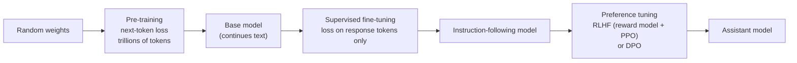

# Section 12 — Training an LLM

> **In one line:** an LLM is made in stages — **pre-training** (predict the next token on trillions of tokens of text), then **supervised fine-tuning** (imitate good answers to instructions), then **preference tuning** (RLHF or DPO: prefer answers people like). Underneath all three is the same loop: forward pass → cross-entropy loss → backpropagation → AdamW update.

---

## 1. Learning objectives

By the end of this section you should be able to:

1. **Describe** the three training stages and what data each one uses.
2. **Compute** cross-entropy loss and perplexity for a short sequence, and interpret them.
3. **Perform** one AdamW update by hand and compute a warm-up + cosine learning-rate schedule.
4. **Estimate** training compute ($\approx 6ND$), GPU-hours and memory for a real model, and explain the Chinchilla "20 tokens per parameter" rule.
5. **Explain** SFT loss masking, RLHF, and the DPO loss.

---

## 2. Prerequisites

- **Section 10:** teacher forcing — one forward pass gives a next-token loss at every position.
- **Section 8:** parameter counts (LLaMA-2 7B = 6.74 billion).
- **Gradient descent:** $\theta \leftarrow \theta - \eta \, \nabla_\theta \mathcal{L}$, with learning rate $\eta$.
- **Logarithms:** $\ln 1 = 0$, $\ln 0.5 = -0.693$; and $e^{\ln x} = x$.

**Quick refresher — the sigmoid function.** $\sigma(z) = \frac{1}{1 + e^{-z}}$ squashes any number into $(0, 1)$: $\sigma(0) = 0.5$, large positive $z$ → close to 1. It appears in the DPO loss.

---

## 3. Motivation: from random numbers to a helpful assistant

A freshly built Transformer has random weights; it outputs gibberish. Turning it into a helpful assistant takes three different kinds of learning:

| Stage | What the model learns | Data | Rough scale |
|---|---|---|---|
| **1. Pre-training** | language, facts, reasoning patterns — "how text continues" | trillions of tokens of web pages, books, code | weeks–months on thousands of GPUs |
| **2. Supervised fine-tuning (SFT)** | to follow instructions and answer in a helpful format | ~10k–1M (instruction, good response) pairs | hours–days |
| **3. Preference tuning (RLHF / DPO)** | to prefer responses people rate as better — more helpful, honest, harmless | pairs of responses ranked by people (or AI) | hours–days |

A pre-trained-only model asked "What is the capital of France?" might continue with *"What is the capital of Germany? What is…"* — it's continuing text, not answering. Stages 2 and 3 teach it to **respond**.

---

## 4. Intuition first: training a doctor

- **Pre-training = years of reading.** A medical student reads thousands of textbooks and papers. They absorb a huge amount, but don't yet know how to talk to a patient.
- **SFT = residency.** They watch senior doctors handle real cases and imitate them: "when a patient says X, respond like this."
- **Preference tuning = feedback from patients and supervisors.** Two ways of explaining a diagnosis are compared; "this one was clearer and kinder" — and the doctor adjusts towards the preferred style.

**Where the analogy breaks:** the "reading" stage isn't passive. Every single token of text is a little exam — predict the next word, get graded, adjust — trillions of times.

---

## 5. The formal idea

### 5.1 The training loop

For each step:
1. Take a **batch** of token sequences (e.g. 1,000 sequences × 4,096 tokens ≈ 4 million tokens).
2. **Forward pass:** compute next-token probabilities at every position (teacher forcing).
3. **Loss:** average cross-entropy over all positions.
4. **Backward pass:** backpropagation computes the gradient of the loss for every parameter.
5. **Clip** the gradient if its overall size exceeds a threshold (e.g. 1.0) — protects against rare huge updates.
6. **Update** every parameter with **AdamW**, using the current **learning rate** from the schedule.

### 5.2 Loss and perplexity

For a sequence of $T$ predictions:

$$\mathcal{L} = -\frac{1}{T}\sum_{t=1}^{T} \log P_\theta(x_{t+1} \mid x_{\le t}), \qquad \text{Perplexity} = e^{\mathcal{L}}$$

**Perplexity** reads as "the model is as uncertain as if it were choosing uniformly among this many tokens". A model that guesses uniformly over a 50,257-token vocabulary has loss $\ln 50{,}257 = 10.8$ and perplexity 50,257; good LLMs reach perplexities in the single digits on typical text.

### 5.3 AdamW

Plain gradient descent uses the same step size for every parameter. **Adam** keeps, for each parameter, a running average of its gradient ($m$, "momentum") and of its squared gradient ($v$), and scales the step by $1/\sqrt{v}$ — so parameters with consistently large gradients take smaller steps, and rarely-updated ones take bigger steps.

$$
\begin{aligned}
m_t &= \beta_1 m_{t-1} + (1 - \beta_1)\, g_t, & v_t &= \beta_2 v_{t-1} + (1 - \beta_2)\, g_t^2 \\
\hat m_t &= \frac{m_t}{1 - \beta_1^t}, & \hat v_t &= \frac{v_t}{1 - \beta_2^t} \\
\theta_t &= \theta_{t-1} - \eta\left(\frac{\hat m_t}{\sqrt{\hat v_t} + \epsilon} + \lambda\,\theta_{t-1}\right)
\end{aligned}
$$

- $\hat m, \hat v$ are **bias-corrected** (at the start $m$ and $v$ are 0, which would make them too small).
- **AdamW** applies **weight decay** $\lambda$ directly to the weights ("decoupled"), gently pulling them towards zero.
- Typical LLM values: $\beta_1 = 0.9$, $\beta_2 = 0.95$, $\epsilon = 10^{-8}$ to $10^{-5}$, $\lambda = 0.1$.

### 5.4 The learning-rate schedule

Two phases:
1. **Warm-up:** increase linearly from 0 to the peak over the first few thousand steps. Early on, Adam's statistics are unreliable and the weights are random; big steps would be unstable.
2. **Cosine decay:** smoothly decrease from the peak to a small minimum (often 10% of the peak):

$$\eta(s) = \eta_{\min} + \tfrac{1}{2}(\eta_{\max} - \eta_{\min})\left(1 + \cos\!\left(\pi\,\frac{s - s_{\text{warm}}}{s_{\text{total}} - s_{\text{warm}}}\right)\right)$$

Large steps early make fast progress; small steps late let the model settle into a good minimum.

### 5.5 How much compute? $C \approx 6ND$

For a model with $N$ parameters trained on $D$ tokens, training costs about

$$C \approx 6\,N\,D \ \text{floating-point operations (FLOPs)}$$

— roughly $2N$ per token for the forward pass and $4N$ for the backward pass.

**Scaling laws and Chinchilla.** Loss falls smoothly and predictably as $N$, $D$ and $C$ grow. For a *fixed* compute budget, research on "compute-optimal" training found that parameters and tokens should grow together, at about **20 training tokens per parameter**. Modern models often train far beyond this (e.g. 100+ tokens per parameter): it costs more training compute, but gives a smaller model for the same quality — cheaper to *run* for millions of users.

### 5.6 Memory for training

With AdamW and mixed precision, each parameter needs roughly:

| Item | Bytes per parameter |
|---|---|
| weights (16-bit) | 2 |
| gradients (16-bit) | 2 |
| master copy of weights (32-bit) | 4 |
| Adam $m$ (32-bit) | 4 |
| Adam $v$ (32-bit) | 4 |
| **Total** | **≈ 16** |

…plus memory for **activations** (intermediate values kept for the backward pass), which grows with batch size and sequence length. Large models don't fit on one GPU, so these states are sharded across many GPUs (Section 17).

### 5.7 Supervised fine-tuning (SFT)

Training examples are conversations: an **instruction** (prompt) and a high-quality **response**. The model is trained with the same next-token loss, **but only on the response tokens** — the prompt tokens are masked out of the loss (they're still in the input, as context). Otherwise the model would partly learn to imitate users' questions rather than the assistant's answers.

### 5.8 Preference tuning: RLHF and DPO

Both start from **preference data**: for a prompt $x$, two responses — a preferred one $y_w$ ("winner") and a rejected one $y_l$ ("loser").

**RLHF** (reinforcement learning from human feedback):
1. Train a **reward model** — usually an LLM with a scalar head — to score $y_w$ above $y_l$.
2. Use reinforcement learning (typically PPO) to make the LLM produce high-reward responses, with a **KL penalty** that keeps it close to the SFT model (so it doesn't drift into strange text that fools the reward model).

**DPO** (direct preference optimization) skips the reward model and the RL loop. It directly increases the probability of $y_w$ relative to $y_l$, compared with a frozen reference model $\pi_{\text{ref}}$:

$$\mathcal{L}_{\text{DPO}} = -\log \sigma\!\Big(\beta\Big[\underbrace{\log\tfrac{\pi_\theta(y_w \mid x)}{\pi_{\text{ref}}(y_w \mid x)}}_{\text{how much more likely the winner became}} - \underbrace{\log\tfrac{\pi_\theta(y_l \mid x)}{\pi_{\text{ref}}(y_l \mid x)}}_{\text{how much more likely the loser became}}\Big]\Big)$$

In words: *push the winner's probability up and the loser's down, relative to where they started.* $\beta$ (e.g. 0.1) controls how far the model may move from the reference.

---

## 6. Worked examples

### 6.1 Loss and perplexity

A model predicts 4 tokens, giving the correct ones probabilities 0.5, 0.25, 0.8 and 0.1:

| Position | $P(\text{correct})$ | $-\ln P$ |
|---|---|---|
| 1 | 0.50 | 0.693 |
| 2 | 0.25 | 1.386 |
| 3 | 0.80 | 0.223 |
| 4 | 0.10 | 2.303 |

$$\mathcal{L} = \frac{0.693 + 1.386 + 0.223 + 2.303}{4} = \mathbf{1.151}, \qquad \text{Perplexity} = e^{1.151} = \mathbf{3.16}$$

On average the model is "as unsure as choosing among about 3 tokens". Notice one confident mistake (position 4, $P = 0.1$) contributes as much loss as the other three combined.

**At the start of training** (uniform over 50,257 tokens): every $P = 1/50{,}257$, so $\mathcal{L} = \ln 50{,}257 = 10.82$ and perplexity 50,257.

### 6.2 One AdamW step by hand

Parameter $\theta = 1.0$, gradient $g = 0.5$, learning rate $\eta = 0.1$, $\beta_1 = 0.9$, $\beta_2 = 0.999$, weight decay $\lambda = 0.01$, first step ($t = 1$, $m_0 = v_0 = 0$):

1. $m_1 = 0.9(0) + 0.1(0.5) = 0.05$ and $v_1 = 0.999(0) + 0.001(0.25) = 0.00025$
2. Bias-correct: $\hat m_1 = 0.05 / (1 - 0.9) = 0.5$ and $\hat v_1 = 0.00025 / (1 - 0.999) = 0.25$
3. Adam step: $\eta \cdot \hat m_1 / \sqrt{\hat v_1} = 0.1 \times 0.5 / 0.5 = 0.1$
4. Weight decay: $\eta \lambda \theta = 0.1 \times 0.01 \times 1.0 = 0.001$
5. New value: $\theta = 1.0 - 0.1 - 0.001 = \mathbf{0.899}$

**Notice:** the step size ($0.1 = \eta$) didn't depend on the gradient's *size* — a gradient of 50 or 0.005 would give the same first step. Adam normalizes each parameter's step, which is why one learning rate works across very different layers.

### 6.3 A learning-rate schedule

Peak $3 \times 10^{-4}$, warm-up 2,000 steps, 100,000 steps in total, cosine decay to $3 \times 10^{-5}$ (10% of peak):

| Step | Phase | Learning rate |
|---|---|---|
| 1,000 | warm-up, halfway | $1.5 \times 10^{-4}$ |
| 2,000 | peak | $3.0 \times 10^{-4}$ |
| 51,000 | halfway through decay ($\cos(\pi/2) = 0$) | $\frac{3 \times 10^{-4} + 3 \times 10^{-5}}{2} = 1.65 \times 10^{-4}$ |
| 100,000 | end | $3.0 \times 10^{-5}$ |

### 6.4 How expensive was LLaMA-2 7B?

$N = 6.74 \times 10^9$ parameters, $D = 2 \times 10^{12}$ tokens:

$$C \approx 6 \times 6.74 \times 10^9 \times 2 \times 10^{12} = 8.1 \times 10^{22} \text{ FLOPs}$$

An NVIDIA A100 GPU peaks at about $312 \times 10^{12}$ FLOP/s in 16-bit; real training achieves perhaps 40% of that, i.e. $1.25 \times 10^{14}$ FLOP/s:

$$\frac{8.1 \times 10^{22}}{1.25 \times 10^{14}} = 6.5 \times 10^{8} \text{ GPU-seconds} \approx \mathbf{180{,}000 \text{ GPU-hours}}$$

Meta reported **184,320** A100 GPU-hours for this model — the simple $6ND$ estimate lands within a few percent. On 2,048 GPUs, that's about 3.7 days of continuous running… for the smallest LLaMA-2.

**Chinchilla check:** $20 \times 6.74 \times 10^9 \approx 135$ billion tokens would be "compute-optimal"; LLaMA-2 7B used 2 trillion — about **15×** more, trading extra training compute for a cheaper-to-run model.

**Memory check:** $16 \times 6.74 \times 10^9 \approx 108$ GB of weights, gradients and optimizer states — more than one 80 GB GPU holds, before counting activations. Hence sharding.

### 6.5 SFT loss masking

Example: prompt *"What is 2 + 2?"* (5 tokens), response *"2 + 2 = 4."* (7 tokens).
- Positions predicting **prompt** tokens: in the input, **excluded** from the loss.
- Positions predicting the 7 **response** tokens: **included**.

The loss is the average over just those 7 positions.

### 6.6 One DPO step

$\beta = 0.1$. After some training, the winner's log-probability has risen by 2.0 relative to the reference, and the loser's has fallen by 1.0:

- Margin inside the brackets: $2.0 - (-1.0) = 3.0$; times $\beta$: $0.3$
- $\sigma(0.3) = 0.574$, so $\mathcal{L}_{\text{DPO}} = -\ln 0.574 = \mathbf{0.554}$

At the start (policy = reference, both log-ratios 0): $\sigma(0) = 0.5$ and $\mathcal{L} = \ln 2 = 0.693$. The loss falls as the model separates winners from losers.

---

## 7. Diagram

---

## 8. In practice

| Model | Parameters | Training tokens | Tokens per parameter |
|---|---|---|---|
| GPT-3 (2020) | 175 B | 300 B | ≈ 1.7 |
| Chinchilla (2022) | 70 B | 1.4 T | 20 |
| LLaMA-2 7B (2023) | 6.74 B | 2 T | ≈ 300 |
| LLaMA-3 8B (2024) | 8 B | 15 T | ≈ 1,900 |

The trend moved from "big model, fewer tokens" to "smaller model, far more tokens" — because inference cost, paid for every user request, came to dominate.

**Typical pre-training settings** (LLaMA-2): AdamW with $\beta_1 = 0.9$, $\beta_2 = 0.95$; peak learning rate $3 \times 10^{-4}$; 2,000 warm-up steps; cosine decay to 10%; weight decay 0.1; gradient clipping at 1.0; batches of about 4 million tokens; context length 4,096.

**Data work is most of the work:** removing duplicates, filtering low-quality and unsafe pages, balancing sources (web, code, books, maths, many languages), and removing benchmark test sets from the training data. Data quality often matters more than small architecture changes.

**Training instabilities** — sudden loss spikes — are handled with gradient clipping, careful learning rates, restarting from a checkpoint before the spike, and skipping problematic batches.

---

## 9. Common mistakes and misconceptions

- **"Pre-training teaches the model to be an assistant."** Pre-training teaches it to *continue text*. Following instructions comes from SFT; helpful, safe preferences from RLHF/DPO.
- **"Lower loss always means a better chatbot."** Pre-training loss measures text prediction. Helpfulness, honesty and safety need separate evaluation.
- **"More parameters is always the best use of compute."** For a fixed budget, parameters and data should grow together (Chinchilla); for cheap deployment, a smaller model trained on more tokens is often better.
- **"In SFT the model learns from the whole conversation."** The loss is usually computed only on the assistant's response tokens.
- **"DPO is reinforcement learning."** DPO turns preference learning into a simple classification-style loss on log-probabilities — no reward model, no sampling loop.

---

## 10. Summary

- Three stages: **pre-training** (next-token prediction on huge text corpora) → **SFT** (imitate good responses; loss on response tokens only) → **preference tuning** (RLHF with a reward model + PPO, or DPO).
- Loss = average $-\log P$ of the correct next tokens; **perplexity** $= e^{\mathcal{L}}$.
- **AdamW** normalizes each parameter's step and applies decoupled weight decay; learning rate follows **warm-up + cosine decay**.
- Compute $\approx 6ND$ FLOPs (LLaMA-2 7B ≈ $8 \times 10^{22}$ ≈ 180k GPU-hours); memory ≈ 16 bytes/parameter + activations.
- **Chinchilla:** compute-optimal ≈ 20 tokens/parameter; modern models deliberately train far longer to be cheaper at inference.

---

## 11. Check your understanding

1. A model gives the correct next tokens probabilities 0.9, 0.9, 0.9 and 0.01. Compute the loss and perplexity. What does this show about confident mistakes?
2. Using $C \approx 6ND$, how many FLOPs did GPT-3 (175 B parameters, 300 B tokens) need? About how many tokens would Chinchilla's rule suggest for a 175 B model?
3. In 6.2, what would the first AdamW step be if the gradient were $g = 50$ instead of $0.5$ (ignore weight decay)? Why?

Answers

1. $-\ln 0.9 = 0.105$ (three times) and $-\ln 0.01 = 4.605$; average $= (0.316 + 4.605)/4 = \mathbf{1.230}$, perplexity $e^{1.230} = \mathbf{3.42}$. One confident mistake outweighs three good predictions — cross-entropy punishes confident errors heavily.
2. $6 \times 175 \times 10^9 \times 300 \times 10^9 = \mathbf{3.15 \times 10^{23}}$ FLOPs. Chinchilla: $20 \times 175\text{B} = \mathbf{3.5}$ **trillion** tokens — more than 10× what GPT-3 used.
3. Still **0.1**. On the first step $\hat m_1 = g$ and $\sqrt{\hat v_1} = |g|$, so the step is $\eta \cdot g/|g| = \eta$: Adam's first step has size $\eta$ whatever the gradient's magnitude.

---

## 12. Further reading

1. Kaplan, J. et al. (2020). **"Scaling Laws for Neural Language Models."** arXiv:2001.08361.
2. Hoffmann, J. et al. (2022). **"Training Compute-Optimal Large Language Models."** arXiv:2203.15556 — the Chinchilla paper.
3. Loshchilov, I., & Hutter, F. (2019). **"Decoupled Weight Decay Regularization."** *ICLR 2019.* arXiv:1711.05101 — AdamW.
4. Touvron, H. et al. (2023). **"Llama 2: Open Foundation and Fine-Tuned Chat Models."** arXiv:2307.09288 — pre-training settings, SFT and RLHF in detail.
5. Ouyang, L. et al. (2022). **"Training language models to follow instructions with human feedback."** arXiv:2203.02155 — InstructGPT / RLHF.
6. Rafailov, R. et al. (2023). **"Direct Preference Optimization: Your Language Model is Secretly a Reward Model."** arXiv:2305.18290.
