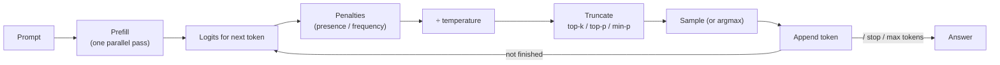

# Section 13 — Inference & Decoding

> **In one line:** at each step an LLM outputs a **probability for every token in its vocabulary**; a **decoding strategy** — greedy, beam search, or sampling shaped by temperature, top-k, top-p or min-p — decides which token is actually written. The same model can sound robotic, creative or incoherent depending only on these choices.

---

## 1. Learning objectives

By the end of this section you should be able to:

1. **Describe** the inference loop, and the difference between the prefill and decode phases.
2. **Apply** temperature to logits and explain its effect on the distribution.
3. **Apply** top-k, top-p (nucleus) and min-p filtering to a distribution by hand.
4. **Run** beam search on a small example and explain when it beats greedy decoding.
5. **Choose** sensible decoding settings for tasks like code, chat and creative writing, and estimate response latency.

---

## 2. Prerequisites

- **Section 10:** autoregressive generation — one forward pass per new token, appended to the input.
- **Section 5/12:** softmax turns scores (**logits**) into probabilities; $\log$-probabilities add when probabilities multiply.

**Quick refresher — logits.** The model's output head produces one raw score per vocabulary token, called a **logit** $z_i$. Softmax turns them into probabilities $p_i = e^{z_i}/\sum_j e^{z_j}$. Only the *differences* between logits matter: adding the same number to every logit changes nothing.

---

## 3. Motivation: the model doesn't pick words — you do

After reading *"The monsoon rain"*, a model might output:

| Token | fell | poured | stopped | began | was | danced |
|---|---|---|---|---|---|---|
| Probability | 0.43 | 0.26 | 0.16 | 0.10 | 0.06 | 0.01 |

The model has done its job: it has said how likely each continuation is. Now *we* must choose. Different choices lead to very different behaviour:

- Always take the top token → safe, but repetitive and sometimes stuck in loops.
- Sample in proportion to the probabilities → varied, but occasionally picks something odd like "danced".
- Something in between → usually best.

Decoding is how we control the trade-off between **reliability** and **diversity**.

---

## 4. Intuition first: ordering at a restaurant

You visit a new restaurant and the waiter tells you how popular each dish is.

- **Greedy:** always order the most popular dish. Safe; boring after a week.
- **Temperature:** how adventurous you feel today. Low temperature → stick to favourites; high → anything goes.
- **Top-k:** "only consider the top 3 dishes".
- **Top-p:** "only consider the dishes that together make up 90% of orders" — sometimes that's 2 dishes, sometimes 6, depending on how clear the favourites are.
- **Beam search:** planning a whole three-course meal by keeping your best few *combinations* in mind, rather than choosing each course in isolation.

**Where the analogy breaks:** a person's taste is stable; the model's distribution changes after every single token, because each new word changes the context.

---

## 5. The formal idea

### 5.1 The inference loop and its two phases

1. **Prefill:** the whole prompt is processed in **one parallel pass**. Its keys and values are stored (KV cache, Section 14). The time until the first token appears is the **time to first token (TTFT)**.
2. **Decode:** then one token per forward pass: get logits → apply the decoding strategy → append the chosen token → repeat until a stop condition.

**Stop conditions:** an end-of-sequence token, a maximum number of new tokens, or a user-defined **stop sequence** (e.g. `"\n\nUser:"`).

### 5.2 Greedy decoding

$$x_{t+1} = \arg\max_i\, p_i$$

Deterministic and fast. Good for short, factual or structured outputs. Weaknesses: can **repeat itself** in loops, and choosing the best token *now* doesn't always lead to the best *sequence*.

### 5.3 Temperature

Divide the logits by a temperature $T > 0$ before the softmax:

$$p_i(T) = \frac{e^{z_i / T}}{\sum_j e^{z_j / T}}$$

| $T$ | Effect |
|---|---|
| $T \to 0$ | all mass on the top token (same as greedy) |
| $T < 1$ | sharper: likely tokens get likelier |
| $T = 1$ | the model's own distribution |
| $T > 1$ | flatter: unlikely tokens get a bigger share |

Temperature never changes the **ranking** of tokens, only how peaked the distribution is. (It's the same "divide the scores" idea as $\sqrt{d_k}$ in Section 5.)

### 5.4 Truncation: top-k, top-p, min-p

Sampling from the *full* distribution occasionally picks a token from the long tail of thousands of unlikely tokens — and one bad token can derail a whole answer. Truncation removes the tail, then **renormalizes** what's left so it sums to 1.

- **Top-k:** keep the $k$ most likely tokens.
- **Top-p (nucleus):** sort tokens by probability and keep the smallest set whose cumulative probability reaches $p$ (e.g. 0.9). The set size **adapts**: few tokens when the model is confident, many when it's unsure.
- **Min-p:** keep every token whose probability is at least $\text{min\_p} \times p_{\max}$. Also adaptive, and it behaves well at high temperatures.

A common order of operations: **logits → penalties → temperature → truncation → renormalize → sample**.

### 5.5 Beam search

Instead of committing to one token at a time, keep the **$B$ best partial sequences** ("beams"), scored by their total log-probability:

1. Start with $B$ copies of the prompt.
2. Extend every beam by every possible next token.
3. Keep the $B$ highest-scoring extensions.
4. Repeat until all beams finish; return the best.

Beam search finds higher-probability sequences than greedy. It is standard for **translation** and **speech recognition**, where there's roughly one right answer. For open-ended chat it tends to produce bland, generic, repetitive text — the most *probable* text isn't the most *interesting* — so sampling is preferred there.

Because adding more tokens can only add negative log-probabilities, beam search favours short outputs; implementations usually apply a **length penalty** (divide the score by length$^{\alpha}$).

### 5.6 Penalties against repetition

- **Presence penalty:** subtract a fixed amount from the logit of any token that has already appeared.
- **Frequency penalty:** subtract an amount proportional to how many times it has appeared.
- **Repetition penalty:** divide positive logits (multiply negative ones) of already-seen tokens by a factor such as 1.1–1.3.

They discourage loops but, if too strong, stop the model from repeating words it legitimately needs (names, code variables).

### 5.7 Constrained (structured) decoding

To guarantee valid output — e.g. JSON matching a schema, or one of a fixed set of labels — set the logits of every token that would break the format to $-\infty$ at each step (a mask again!). The model can only ever choose tokens that keep the output valid.

---

## 6. Worked examples

### 6.1 Temperature on "The monsoon rain…"

Logits: fell 3.0, poured 2.5, stopped 2.0, began 1.5, was 1.0, danced −1.0.

| Token | logit | $T = 0.5$ | $T = 1$ | $T = 2$ |
|---|---|---|---|---|
| fell | 3.0 | **0.636** | 0.425 | 0.298 |
| poured | 2.5 | 0.234 | 0.258 | 0.232 |
| stopped | 2.0 | 0.086 | 0.156 | 0.180 |
| began | 1.5 | 0.032 | 0.095 | 0.141 |
| was | 1.0 | 0.012 | 0.058 | 0.109 |
| danced | −1.0 | 0.000 | 0.008 | **0.040** |

**How to compute** (for $T = 1$): $e^{3.0} = 20.09$, $e^{2.5} = 12.18$, $e^{2.0} = 7.39$, $e^{1.5} = 4.48$, $e^{1.0} = 2.72$, $e^{-1} = 0.37$; total $47.23$; "fell" $= 20.09/47.23 = 0.425$.

At $T = 0.5$ "fell" dominates; at $T = 2$ even "danced" gets 4%. The ranking never changes.

### 6.2 Top-k, top-p and min-p (at $T = 1$)

**Top-k, $k = 3$:** keep fell, poured, stopped (total 0.84) and renormalize: $0.425/0.84 = 0.51$, $0.258/0.84 = 0.31$, $0.156/0.84 = 0.19$.

**Top-p, $p = 0.9$:** add up in order: fell 0.425 → +poured 0.683 → +stopped 0.839 → +began **0.935** ≥ 0.9, stop. Keep **4** tokens; renormalize by 0.935: fell 0.45, poured 0.28, stopped 0.17, began 0.10.

**Min-p, 0.1:** threshold $= 0.1 \times 0.425 = 0.0425$. Keep every token with $p \ge 0.0425$ — fell, poured, stopped, began, **was** (0.058) — and drop only "danced" (0.008).

All three remove "danced"; they differ in how much of the middle they keep.

### 6.3 Beam search beats greedy

A two-step toy problem. First-word probabilities: **the 0.5**, a 0.4, my 0.1. Second-word probabilities depend on the first:

| After… | cat | dog | end |
|---|---|---|---|
| the | 0.4 | 0.3 | 0.3 |
| a | **0.9** | 0.05 | 0.05 |
| my | 0.5 | 0.5 | — |

**Greedy:** step 1 picks "the" (0.5); step 2 picks "cat" (0.4) → "the cat" with probability $0.5 \times 0.4 = 0.20$.

**Beam search, $B = 2$:**
- Step 1: keep the two best: "the" (0.5) and "a" (0.4).
- Step 2: extend both: the cat 0.20, the dog 0.15, the end 0.15, **a cat 0.36**, a dog 0.02, a end 0.02.
- Keep the best two: **"a cat" (0.36)** and "the cat" (0.20).

Beam search finds "a cat", nearly twice as probable as greedy's answer. Greedy was misled by a slightly better first word that led to weaker continuations. In log-probabilities: $\ln 0.36 = -1.02$ beats $\ln 0.20 = -1.61$.

### 6.4 A presence penalty

Suppose "fell" has already been written once and the presence penalty is 0.5. Its logit becomes $3.0 - 0.5 = 2.5$, tying with "poured". New probabilities at $T = 1$: fell 0.31, poured 0.31, stopped 0.19, began 0.11, was 0.07, danced 0.01. The model is now less likely to repeat itself.

### 6.5 How long will the answer take?

A 500-token prompt and a 200-token answer, on a server that prefills 5,000 tokens/s and decodes at 30 ms per token:
- **TTFT:** $500 / 5{,}000 = 0.1$ s
- **Decode:** $200 \times 0.03 = 6.0$ s
- **Total:** about **6.1 s** — almost all of it spent generating, one token at a time.

That's why answers are **streamed**: users start reading after 0.1 s instead of waiting 6 s.

---

## 7. Diagram

---

## 8. In practice

| Task | Typical settings | Why |
|---|---|---|
| Code, maths, extraction, classification | temperature 0–0.2 (near greedy) | one correct answer; consistency matters |
| General chat | temperature 0.6–0.8, top-p 0.9–0.95 | natural, varied but focused |
| Brainstorming, stories | temperature 0.9–1.2, top-p 0.95 or min-p 0.05 | more diversity |
| Translation, speech-to-text | beam search, $B$ = 4–5 | find the single most likely output |

- **Determinism:** temperature 0 (or a fixed random seed) gives repeatable outputs in principle, but GPU arithmetic and batching can still cause tiny differences between runs.
- **Speculative decoding:** a small fast "draft" model proposes several tokens; the big model checks them all in one pass and keeps the ones it agrees with. Same output distribution, often 2–3× faster (Section 17).
- **Sampling several answers** and picking the most common final answer ("self-consistency") improves accuracy on reasoning problems, at extra cost.
- **Latency metrics:** TTFT (time to first token) and time per output token / tokens per second are the numbers serving systems optimize (Section 18).

---

## 9. Common mistakes and misconceptions

- **"Temperature 0 makes the model more accurate."** It makes it more *consistent*. If the most likely token is wrong, greedy decoding is consistently wrong.
- **"Higher temperature makes the model more creative."** It makes it more *random*. Past a point, output becomes incoherent rather than creative.
- **"Top-k and top-p remove bad tokens and keep the probabilities as they were."** The survivors are **renormalized** to sum to 1, so each one's probability goes up.
- **"Beam search is always better than sampling."** Beam search maximizes probability, which suits translation; for open-ended text it produces bland, repetitive output.
- **"The model chooses its words."** The model only outputs a distribution. The decoding strategy — set by the developer — makes the choice.

---

## 10. Summary

- Each decode step turns **logits** into a choice: penalties → **temperature** → **truncation** (top-k / top-p / min-p) → renormalize → sample (or argmax).
- **Temperature** reshapes the distribution (sharper below 1, flatter above 1) without changing the ranking.
- **Top-k** keeps a fixed number of tokens; **top-p** and **min-p** keep an adaptive set based on probability.
- **Beam search** tracks the $B$ best partial sequences and can beat greedy (0.36 vs 0.20 in our example); great for translation, bland for chat.
- Inference = **prefill** (parallel, sets TTFT) + **decode** (one token per pass, dominates total time); responses are streamed.

---

## 11. Check your understanding

1. Using the $T = 1$ probabilities in 6.1, which tokens are kept by top-p with $p = 0.7$? What are their renormalized probabilities?
2. Two logits are 4.0 and 2.0. Compute their probabilities at $T = 1$ and at $T = 2$ (consider only these two tokens).
3. In 6.3, what would beam search with $B = 1$ return? With $B = 3$?

Answers

1. fell 0.425 → +poured 0.683 (< 0.7) → +stopped 0.839 ≥ 0.7. Keep **fell, poured, stopped**; renormalized by 0.839: **0.51, 0.31, 0.19**.
2. $T = 1$: $e^4 / (e^4 + e^2) = 1/(1 + e^{-2}) = \mathbf{0.88}$ and $\mathbf{0.12}$. $T = 2$: logits become 2.0 and 1.0 → $1/(1 + e^{-1}) = \mathbf{0.73}$ and $\mathbf{0.27}$.
3. $B = 1$ is exactly greedy: **"the cat" (0.20)**. $B = 3$ keeps the, a, my after step 1 and still finds **"a cat" (0.36)**.

---

## 12. Further reading

1. Holtzman, A. et al. (2020). **"The Curious Case of Neural Text Degeneration."** *ICLR 2020.* arXiv:1904.09751 — introduces nucleus (top-p) sampling and explains why beam search degenerates for open-ended text.
2. Fan, A., Lewis, M., & Dauphin, Y. (2018). **"Hierarchical Neural Story Generation."** arXiv:1805.04833 — popularized top-k sampling.
3. Keskar, N. S. et al. (2019). **"CTRL: A Conditional Transformer Language Model for Controllable Generation."** arXiv:1909.05858 — the repetition penalty.
4. Leviathan, Y., Kalman, M., & Matias, Y. (2023). **"Fast Inference from Transformers via Speculative Decoding."** arXiv:2211.17192.
5. Wang, X. et al. (2023). **"Self-Consistency Improves Chain of Thought Reasoning in Language Models."** arXiv:2203.11171.
