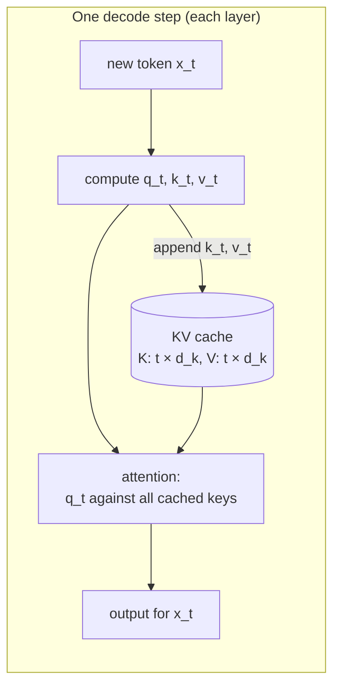
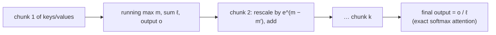

# Section 14 — KV Cache & Fast Attention

> **In one line:** during generation, a token's keys and values never change once computed, so we **cache** them instead of recomputing the whole prefix every step. That makes decoding fast but turns memory into the bottleneck — solved with smaller caches (GQA, quantization, sliding windows, paging) and with **FlashAttention**, which computes exact attention without ever storing the $n \times n$ score matrix.

---

## 1. Learning objectives

By the end of this section you should be able to:

1. **Explain** why keys and values can be cached during generation, and count the work saved.
2. **Calculate** the size of a KV cache for a real model, context length and batch size.
3. **Explain** why decoding is limited by memory bandwidth, and estimate a lower bound on time per token.
4. **Describe** the main ways to shrink the cache: GQA/MQA, quantization, sliding windows, PagedAttention, prefix caching.
5. **Compute** softmax in chunks with the **online softmax** trick, and explain how FlashAttention uses it.

---

## 2. Prerequisites

- **Section 10:** generation runs one forward pass per new token; causal attention means earlier tokens never see later ones.
- **Section 6:** GQA — groups of query heads share key/value heads.
- **Section 5:** attention scores, softmax, and the "subtract the max" trick for numerical stability.
- **Section 13:** prefill vs decode.

**Quick refresher — bandwidth vs compute.** A GPU can do arithmetic extremely fast (hundreds of trillions of operations per second), but it can only **read memory** at a few terabytes per second. If a job needs very few calculations per byte it reads, it is **memory-bound**: its speed is set by how fast data can be loaded, not by how fast the GPU can calculate.

---

## 3. Motivation: generation repeats itself

Without any caching, generating token $t+1$ means running the model on **all** $t$ previous tokens again — recomputing every key and value for the whole prefix — only to use the output at the last position.

But with a causal mask, the key and value of token $j$ depend only on tokens $1 \dots j$. Adding new tokens later **never changes them**. Recomputing them is pure waste.

| Generating 500 tokens after a 1,000-token prompt | K/V computations (per layer, per head) |
|---|---|
| Without caching | $1000 + 1001 + \dots + 1499 = 624{,}750$ |
| With a KV cache | $1000 + 499 = 1{,}499$ (≈ **417× fewer**) |

So every LLM server keeps a **KV cache**. But the cache itself costs memory — often more than the model weights — and that creates the next set of problems.

---

## 4. Intuition first: a running class notebook

A teacher dictates a long passage, one sentence at a time, and after each sentence asks the class a question about everything so far.

- **No cache:** after every new sentence, students rewrite their notes on the *whole* passage from scratch before answering. Exhausting, and it gets slower with every sentence.
- **KV cache:** students keep a **notebook**. For each new sentence they add one new line of notes, then answer by reading back through the notebook. Fast — but the notebook keeps growing, and with 100 students' notebooks the shelf fills up.
- **FlashAttention:** instead of spreading the whole notebook across a big table to read it (which needs a huge table), a student reads it **one page at a time**, keeping a small running tally — and gets exactly the same answer.

**Where the analogy breaks:** the "notebook" isn't a summary; it's an exact copy of every past token's key and value vectors, in every layer and every key/value head.

---

## 5. The formal idea

### 5.1 Decoding with a KV cache

**Prefill:** run the whole prompt once; store each layer's $K$ and $V$ (shape $n_{\text{prompt}} \times d_k$ per KV head) in the cache.

**Each decode step**, in every layer:
1. Compute $q_t, k_t, v_t$ for the **new token only**.
2. Append $k_t, v_t$ to the cache.
3. Attend: $\text{softmax}\!\left(q_t K_{\text{cache}}^{\top} / \sqrt{d_k}\right) V_{\text{cache}}$ — one query row against all cached keys.

The output is **identical** to recomputing everything; the cache just avoids redundant work. Per step, the cost of the projections no longer grows with the context; the attention itself still reads all $t$ cached keys and values.

### 5.2 How big is the cache?

$$\text{bytes} = \underbrace{2}_{K \text{ and } V} \times \text{layers} \times \text{KV heads} \times d_{\text{head}} \times \text{bytes per number} \times \text{tokens} \times \text{batch}$$

It grows **linearly** with context length and with the number of simultaneous users.

### 5.3 Why decoding is memory-bound

At each decode step with batch size 1, the GPU must **read every weight once** (and the whole KV cache) to produce **one** token. That's only about 2 floating-point operations per weight read — far too few to keep the GPU's arithmetic units busy. So:

$$\text{time per token} \;\gtrsim\; \frac{\text{bytes of weights} + \text{bytes of KV cache}}{\text{memory bandwidth}}$$

**Batching** helps enormously: one read of the weights can serve many users' tokens at once, so throughput rises almost linearly with batch size — until the KV caches of all those users fill the GPU's memory. That's why cache size matters so much.

### 5.4 Shrinking the cache

| Technique | Idea | Saving |
|---|---|---|
| **GQA / MQA** (Section 6) | fewer key/value heads, shared by groups of query heads | $h / g$ (e.g. 4–8×) |
| **KV quantization** | store cached values in 8-bit (or fewer) instead of 16-bit | 2× or more |
| **Sliding-window attention** | each layer attends only to the last $W$ tokens, so older entries are dropped | cache capped at $W$ tokens |
| **PagedAttention** | store the cache in fixed-size blocks ("pages") anywhere in memory, like an OS's virtual memory | almost no wasted (fragmented) memory → more users per GPU |
| **Prefix caching** | reuse the cached K/V of a shared prompt (e.g. a long system prompt) across requests | skip repeated prefill |

### 5.5 FlashAttention: exact attention without the $n \times n$ matrix

Standard attention writes the full score matrix $S = QK^{\top}$ ($n \times n$) to GPU main memory, reads it back for the softmax, writes $A$, reads it again for $AV$. For long sequences that's a lot of memory **traffic** — and memory traffic, not arithmetic, is the slow part.

**FlashAttention** splits $Q$, $K$ and $V$ into **tiles** small enough to fit in the GPU's tiny but very fast on-chip memory (SRAM), and processes the keys/values tile by tile. The problem: softmax needs the maximum and the sum over the **whole** row before any weight is known. The solution is the **online softmax**.

**Online softmax.** Process scores in chunks, keeping three running quantities per query row:
- $m$: the largest score seen so far,
- $\ell$: the sum of $e^{s - m}$ so far,
- $o$: the sum of $e^{s - m}\, v$ so far.

When a new chunk arrives with a larger maximum $m'$, rescale the old totals by $e^{m - m'}$, then add the new chunk's contributions. At the end, the output is $o / \ell$ — **exactly** the same as normal softmax attention.

Results:
- **Memory:** $O(n)$ instead of $O(n^2)$ — the full score matrix is never stored.
- **Speed:** typically 2–4× faster in practice, because far less data moves between memory and the chip.
- **Exactness:** not an approximation; same output up to floating-point rounding.

### 5.6 Beyond full attention (brief)

Other ideas trade some exactness or generality for lower cost: **sparse attention** (each token attends to a selected subset), **linear attention** (rewrite attention to avoid the $n^2$ term), and **state-space / recurrent models** (e.g. Mamba) with a fixed-size state instead of a growing cache. Several recent models mix such layers with standard attention.

---

## 6. Worked examples

### 6.1 One decode step with a cache

Prompt "the bat" (2 tokens). After prefill, each layer's cache holds $k_{\text{the}}, k_{\text{bat}}$ and $v_{\text{the}}, v_{\text{bat}}$.

To generate the next token after "flew" has just been chosen:
1. Compute $q_{\text{flew}}, k_{\text{flew}}, v_{\text{flew}}$ — **one** new set of projections.
2. Cache becomes $K = [k_{\text{the}}; k_{\text{bat}}; k_{\text{flew}}]$, $V$ likewise.
3. Attention for "flew": one row of scores $q_{\text{flew}} \cdot [k_{\text{the}}, k_{\text{bat}}, k_{\text{flew}}]$ → softmax → mix the three cached values.

Small count: generating 3 tokens after a 5-token prompt needs $5 + 6 + 7 = 18$ K/V computations without a cache, but only $5 + 1 + 1 = 7$ with it.

### 6.2 Cache sizes for real models (16-bit numbers)

| Model | Layers | KV heads | $d_{\text{head}}$ | Per token | 4,096-token context |
|---|---|---|---|---|---|
| LLaMA-2 7B (MHA) | 32 | 32 | 128 | $2 \cdot 32 \cdot 32 \cdot 128 \cdot 2 = 524{,}288$ B = **0.5 MB** | **2 GiB** |
| Mistral 7B (GQA) | 32 | 8 | 128 | 0.125 MB | 0.5 GiB |
| LLaMA-2 70B (GQA) | 80 | 8 | 128 | 0.31 MB | 1.25 GiB |

**Serving 32 users** of LLaMA-2 7B at 4,096 tokens each needs $32 \times 2 = 64$ GiB (≈ 69 GB) of cache — about **5×** the model's own weights (13.5 GB). Mistral's GQA brings that down to 16 GiB.

### 6.3 A lower bound on decode speed

LLaMA-2 7B in 16-bit: $6.74 \times 10^9 \times 2 = 13.5$ GB of weights. On an A100 GPU with about 2.0 TB/s of memory bandwidth, batch size 1, short context:

$$\frac{13.5 \times 10^9 \text{ bytes}}{2.0 \times 10^{12} \text{ bytes/s}} = 6.75 \text{ ms per token} \;\Rightarrow\; \text{at most} \approx 150 \text{ tokens/s}$$

No amount of extra arithmetic speed can beat this — the weights simply can't be read faster. Ways around it: **quantize** the weights (8-bit → half the bytes → about twice as fast, Section 17), and **batch** many users so each weight read produces many tokens.

### 6.4 Online softmax by hand

One query, four keys with scores $s = [2, 1, 3, 0]$ and (scalar) values $v = [1, 2, 3, 4]$. Process the keys in **two chunks** of two.

**Chunk 1** (scores 2, 1):
- $m = 2$
- $\ell = e^{2-2} + e^{1-2} = 1 + 0.3679 = 1.3679$
- $o = 1 \cdot 1 + 0.3679 \cdot 2 = 1.7358$

**Chunk 2** (scores 3, 0) — new maximum $m' = 3$:
- Rescale the old totals by $e^{2-3} = 0.3679$: $\ell = 0.5032$, $o = 0.6386$
- Add the new terms: $e^{3-3} = 1$ (value 3) and $e^{0-3} = 0.0498$ (value 4):
  - $\ell = 0.5032 + 1 + 0.0498 = 1.5530$
  - $o = 0.6386 + 3 + 0.1991 = 3.8377$

**Output:** $o / \ell = 3.8377 / 1.5530 = \mathbf{2.4711}$.

**Check with ordinary softmax:** weights $[0.2369, 0.0871, 0.6439, 0.0321]$, output $= 0.2369(1) + 0.0871(2) + 0.6439(3) + 0.0321(4) = \mathbf{2.4711}$. Identical — but we never needed all four scores at once.

### 6.5 Why the score matrix is a problem

For a 32,768-token context, one head's score matrix in 16-bit is $32{,}768^2 \times 2 \approx 2.1$ GB — per head, per layer. A model with 32 heads would need about 69 GB *per layer* just to hold scores. FlashAttention never builds this matrix, so the memory stays proportional to $n$.

---

## 7. Diagram

---

## 8. In practice

- **Every production LLM server** uses a KV cache; systems like **vLLM** add PagedAttention and **continuous batching** (new requests join the running batch at every step) to serve many users per GPU (Section 18).
- **Long-context costs:** a 128k-token conversation needs a cache 32× larger than at 4k tokens. Long contexts are expensive mainly because of cache memory and the time to read it every step, not the weights.
- **FlashAttention** (and successors) is the default attention implementation in modern training and inference libraries; in PyTorch, `scaled_dot_product_attention` selects it automatically when it can.
- **Prefix caching** makes repeated system prompts and multi-turn chats cheaper: the shared beginning is prefilled once and reused.
- **Speculative decoding** (Section 13/17) tackles the same memory-bound problem from another angle: verify several drafted tokens per weight read.

---

## 9. Common mistakes and misconceptions

- **"The KV cache is an approximation."** It gives exactly the same results as recomputing everything; it only removes redundant work.
- **"Queries are cached too."** Only keys and values. Each past query was used once, at its own step, and is never needed again.
- **"Decoding is slow because GPUs can't compute fast enough."** For small batches it's limited by memory **bandwidth** — reading the weights and cache — not arithmetic.
- **"FlashAttention is a cheaper, approximate attention."** It computes **exact** attention; it's faster because it moves less data, not because it computes less.
- **"Bigger context only costs more compute."** It costs **memory**: the KV cache grows linearly with context for every user, limiting how many users fit on a GPU.

---

## 10. Summary

- Causal attention means past keys and values never change, so the **KV cache** stores them; each decode step computes $q, k, v$ only for the new token (417× fewer K/V computations in our example).
- Cache size $= 2 \times \text{layers} \times \text{KV heads} \times d_{\text{head}} \times \text{bytes} \times \text{tokens} \times \text{batch}$ — LLaMA-2 7B: 0.5 MB per token, 2 GiB per 4k-token conversation.
- Decoding is **memory-bandwidth bound**: ≥ (weights + cache) / bandwidth per step (≈ 6.75 ms/token for a 7B model on an A100); batching and quantization help.
- Shrink the cache with **GQA/MQA**, **quantization**, **sliding windows**, **PagedAttention** and **prefix caching**.
- **FlashAttention** tiles the computation and uses the **online softmax** (running max, sum, output with rescaling) to get exact attention in $O(n)$ memory.

---

## 11. Check your understanding

1. Without a cache, how many K/V computations are needed to generate 4 tokens after a 10-token prompt? With a cache?
2. A model has 40 layers, 8 KV heads, $d_{\text{head}} = 128$, 16-bit cache. How much cache does one token need? How much for a batch of 16 users at 8,192 tokens each?
3. Redo the online softmax of 6.4 with chunks in the order (3, 0) then (2, 1). Do you get the same output? Which running quantity changes on the second chunk?

Answers

1. Without: $10 + 11 + 12 + 13 = \mathbf{46}$. With: $10 + 1 + 1 + 1 = \mathbf{13}$.
2. Per token: $2 \times 40 \times 8 \times 128 \times 2 = \mathbf{163{,}840}$ bytes = **0.156 MB**. Batch: $163{,}840 \times 8{,}192 \times 16 = 21{,}474{,}836{,}480$ bytes ≈ **20 GiB**.
3. Chunk 1 (3, 0): $m = 3$, $\ell = 1 + e^{-3} = 1.0498$, $o = 3 + 4e^{-3} = 3.1991$. Chunk 2 (2, 1): the maximum stays 3, so **no rescaling** is needed; add $e^{-1} = 0.3679$ (value 1) and $e^{-2} = 0.1353$ (value 2): $\ell = 1.5530$, $o = 3.1991 + 0.3679 + 0.2707 = 3.8377$. Output **2.4711** — the same. Only $\ell$ and $o$ change; $m$ doesn't, because the second chunk has no larger score.

---

## 12. Further reading

1. Pope, R. et al. (2022). **"Efficiently Scaling Transformer Inference."** arXiv:2211.05102 — memory-bandwidth limits, KV cache, and batching trade-offs.
2. Dao, T. et al. (2022). **"FlashAttention: Fast and Memory-Efficient Exact Attention with IO-Awareness."** arXiv:2205.14135.
3. Milakov, M., & Gimelshein, N. (2018). **"Online normalizer calculation for softmax."** arXiv:1805.02867 — the online softmax.
4. Kwon, W. et al. (2023). **"Efficient Memory Management for Large Language Model Serving with PagedAttention."** arXiv:2309.06180 — vLLM.
5. Ainslie, J. et al. (2023). **"GQA: Training Generalized Multi-Query Transformer Models from Multi-Head Checkpoints."** arXiv:2305.13245.
6. Jiang, A. Q. et al. (2023). **"Mistral 7B."** arXiv:2310.06825 — sliding-window attention with GQA.
