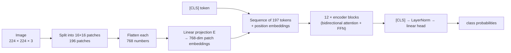

# Section 15 — Vision Transformers (ViT)

> **In one line:** a Vision Transformer cuts an image into small square **patches**, turns each patch into a vector (a "visual token"), adds position information, and feeds the sequence to a standard Transformer **encoder** — the same architecture as BERT, applied to pictures instead of words.

---

## 1. Learning objectives

By the end of this section you should be able to:

1. **Convert** an image into a sequence of patch tokens and compute the number of tokens for any image and patch size.
2. **Compute** patch embeddings by hand as a linear projection of flattened pixel values.
3. **Count** the parameters of ViT-B/16 using the formulas from earlier sections.
4. **Compare** ViTs with convolutional networks (CNNs): built-in assumptions, data needs, and cost.
5. **Explain** the key ViT-family ideas: DeiT, Swin, MAE, CLIP, and how vision–language models connect a ViT to an LLM.

---

## 2. Prerequisites

- **Section 9:** the encoder — bidirectional blocks, a `[CLS]` token for classification.
- **Section 7:** learned absolute position embeddings.
- **Section 2:** an embedding is a vector; cosine similarity.
- **Images as numbers:** a colour image of height $H$ and width $W$ is an $H \times W \times 3$ array (red, green, blue values for each pixel).

**Quick refresher — flattening.** "Flattening" a small block of numbers means listing them in one row, e.g. the $2 \times 2$ block $\begin{bmatrix} a & b \\ c & d \end{bmatrix}$ becomes $[a, b, c, d]$. A $16 \times 16 \times 3$ patch flattens to $16 \cdot 16 \cdot 3 = 768$ numbers.

---

## 3. Motivation: can attention replace convolutions?

For a decade, image recognition was dominated by **convolutional neural networks (CNNs)**, which slide small filters over the image. CNNs build in two strong assumptions:
- **Locality:** nearby pixels matter most.
- **Translation equivariance:** a cat in the corner is detected the same way as a cat in the centre.

Meanwhile Transformers had taken over language. The question was: *can the same architecture — with no image-specific assumptions — do vision too?*

The naive approach fails: treating every **pixel** as a token gives $224 \times 224 = 50{,}176$ tokens, and attention's $n^2$ cost makes that about 2.5 billion scores per head per layer. The **ViT** trick (2020): use **patches**, not pixels, as tokens. A $224 \times 224$ image becomes just **196** tokens.

---

## 4. Intuition first: a jigsaw puzzle

Cut a photograph into a $14 \times 14$ grid of jigsaw pieces.

- Each **piece** is a token. On its own it shows only a little — some fur, an edge, part of an eye.
- Each piece has a **position** written on the back (row 3, column 7) — the position embedding.
- **Self-attention** lets every piece "look at" every other piece: the piece with an ear figures out it belongs with the pieces showing whiskers and eyes — "together we're a cat".
- A special **summary card** (`[CLS]`) looks at all the pieces and announces the answer.

**Where the analogy breaks:** a jigsaw solver *moves* pieces to fit them. A ViT keeps every patch in place and instead updates each patch's **vector** to reflect what the whole image shows.

---

## 5. The formal idea

### 5.1 Image → patches → tokens

For an image of size $H \times W \times C$ and patch size $P$:

$$N = \frac{H}{P} \times \frac{W}{P} \quad \text{patches, each with } P^2 C \text{ numbers}$$

1. **Split** the image into $N$ non-overlapping $P \times P$ patches.
2. **Flatten** each patch into a vector of length $P^2 C$.
3. **Project** each flattened patch with a learned matrix $E$ of shape $P^2 C \times d_{model}$ (plus a bias) → a **patch embedding**.

In code this is usually written as a convolution with kernel size $P$ and stride $P$ — mathematically the same linear projection, applied to every patch.

### 5.2 The full ViT

$$
\begin{aligned}
z_0 &= [\,x_{\text{cls}};\; x_1 E;\; x_2 E;\; \dots;\; x_N E\,] + E_{\text{pos}} && (N+1) \times d_{model} \\
z_\ell &= \text{Block}_\ell(z_{\ell-1}), \quad \ell = 1, \dots, L \\
y &= \text{softmax}\big(\text{LN}(z_L^{\text{cls}})\, W_{\text{head}}\big)
\end{aligned}
$$

- $x_{\text{cls}}$: a learned `[CLS]` vector prepended to the sequence (as in BERT).
- $E_{\text{pos}}$: learned position embeddings, one per token ($N + 1$ of them).
- Blocks: standard **encoder** blocks — bidirectional self-attention + FFN (Section 8), no mask.
- Classification: a linear head on the final `[CLS]` vector (some models average all patch vectors instead).

### 5.3 ViT vs CNN

| | CNN | ViT |
|---|---|---|
| Built-in assumptions | locality, translation equivariance | almost none — learned from data |
| Each layer sees | a small neighbourhood | the **whole image** from layer 1 |
| Small datasets | usually better | worse (needs lots of data or tricks) |
| Very large datasets | improvements level off | keeps improving with scale |
| Cost vs resolution | grows with number of pixels | grows with **(number of patches)²** in attention |

The original ViT matched or beat strong CNNs only when pre-trained on very large datasets (hundreds of millions of images). With less data, a CNN's built-in assumptions are an advantage.

### 5.4 The ViT family

- **DeiT:** training recipes (heavy data augmentation, and distillation from a CNN teacher) that make ViTs work well on ImageNet-size data alone.
- **Swin Transformer:** attention inside **local windows** that shift between layers, plus a **hierarchy** that merges patches as the network deepens. Cost grows linearly with image size, and the multi-scale features suit detection and segmentation.
- **MAE (Masked Autoencoder):** hide **75%** of the patches and train the model to reconstruct the missing pixels — the vision version of masked language modelling. The encoder only processes the visible 25%, which makes pre-training cheap.
- **CLIP:** an image encoder (often a ViT) and a text encoder trained together so that matching image–caption pairs get **similar embeddings** (contrastive learning on hundreds of millions of pairs). Result: **zero-shot** classification — compare an image's embedding with the embeddings of texts like *"a photo of a dog"*.
- **Vision–language models (e.g. LLaVA-style):** a ViT turns an image into patch vectors, a small **projector** maps them into the LLM's embedding space, and they're placed in the LLM's input like ordinary tokens. The LLM can then answer questions about the image.

### 5.5 Higher resolution

Patch size stays fixed, so a bigger image means more patches: $384 \times 384$ with $P = 16$ gives $24^2 = 576$ tokens instead of 196. Two consequences:
- **Cost:** attention grows with $576^2 / 196^2 \approx 8.6\times$.
- **Positions:** a model trained at 224 has only 196 learned position embeddings, so they are **interpolated** (resized as a 2-D grid) to 576 before fine-tuning at the new resolution.

---

## 6. Worked examples

### 6.1 Patch arithmetic

| Image | Patch size | Patches $N$ | Numbers per patch | Tokens (with `[CLS]`) | Attention cost vs 196 |
|---|---|---|---|---|---|
| 224 × 224 × 3 | 16 | $14^2 = 196$ | $16 \cdot 16 \cdot 3 = 768$ | 197 | 1× |
| 224 × 224 × 3 | 8 | $28^2 = 784$ | 192 | 785 | **16×** |
| 224 × 224 × 3 | 32 | $7^2 = 49$ | 3,072 | 50 | 0.06× |
| 384 × 384 × 3 | 16 | $24^2 = 576$ | 768 | 577 | 8.6× |

Halving the patch size gives finer detail but quadruples the token count and multiplies attention cost by 16.

### 6.2 Patch embeddings by hand

A tiny $4 \times 4$ grey-scale image (one channel, brightness 0–8), patch size $P = 2$:

$$\text{image} = \begin{bmatrix} 0 & 8 & 8 & 8 \\ 0 & 8 & 8 & 8 \\ 0 & 0 & 0 & 8 \\ 0 & 0 & 0 & 8 \end{bmatrix}$$

That's $N = (4/2)^2 = 4$ patches of $2 \cdot 2 = 4$ numbers each (flattened row by row). Use a projection to $d_{model} = 2$ whose columns we've chosen to be meaningful (a real model learns them):

$$E = \begin{bmatrix} 0.25 & -0.5 \\ 0.25 & 0.5 \\ 0.25 & -0.5 \\ 0.25 & 0.5 \end{bmatrix} \quad \begin{matrix} \text{column 1: average brightness} \\ \text{column 2: right minus left (a vertical-edge detector)} \end{matrix}$$

| Patch | Pixels (flattened) | Embedding $[\text{brightness}, \text{edge}]$ |
|---|---|---|
| top-left | [0, 8, 0, 8] | $[0.25(16),\; 0.5(16)] = [4, 8]$ |
| top-right | [8, 8, 8, 8] | $[8, 0]$ |
| bottom-left | [0, 0, 0, 0] | $[0, 0]$ |
| bottom-right | [0, 8, 0, 8] | $[4, 8]$ |

The top-left and bottom-right patches both contain a dark-to-bright vertical edge, so they get the **same** embedding $[4, 8]$. Without position embeddings the model couldn't tell where each one is — exactly the order problem of Section 7, now in 2-D.

### 6.3 Every parameter of ViT-B/16

ViT-B/16: $d = 768$, 12 layers, 12 heads, $d_{ff} = 3072$, patch size 16, 224 × 224 input, 1,000 classes.

| Part | Formula | Parameters |
|---|---|---|
| Patch embedding | $768 \times 768 + 768$ (input 768 = $16 \cdot 16 \cdot 3$) | 590,592 |
| `[CLS]` token | $768$ | 768 |
| Position embeddings | $197 \times 768$ | 151,296 |
| 12 encoder blocks | $12 \times 7{,}087{,}872$ (same block as BERT-base, Section 9) | 85,054,464 |
| Final LayerNorm | $2 \times 768$ | 1,536 |
| Classification head | $768 \times 1000 + 1000$ | 769,000 |
| **Total** | | **86,567,656** |

That's ViT-B/16's reported **86M**. Notice almost everything is in the Transformer blocks — the "vision-specific" part (patch embedding) is under 1%.

### 6.4 CLIP zero-shot classification (toy)

Use 2-D unit vectors. An image embedding $[0.6, 0.8]$; text embeddings for three prompts:

| Prompt | Text embedding | Cosine with image | $\times 10$ | Softmax |
|---|---|---|---|---|
| "a photo of a cat" | [0.8, 0.6] | 0.96 | 9.6 | **0.81** |
| "a photo of a car" | [0, 1] | 0.80 | 8.0 | 0.16 |
| "a photo of a dog" | [1, 0] | 0.60 | 6.0 | 0.02 |

The image is classified as a **cat** — with no cat-specific training, just by comparing it with text. Real CLIP multiplies cosines by a learned scale of about 100, which makes the softmax much sharper (here "cat" would get essentially 1.00).

### 6.5 Why MAE pre-training is cheap

With 196 patches and 75% masked, the encoder sees only $196 \times 0.25 = 49$ patches. Attention cost: $49^2$ instead of $196^2$ — **16× less** per layer. A small decoder then reconstructs the hidden patches.

---

## 7. Diagram

---

## 8. In practice

| Model | Year | Idea | Used for |
|---|---|---|---|
| ViT | 2020 | patches + standard encoder | image classification |
| DeiT | 2021 | data-efficient training, distillation | ViTs without huge datasets |
| Swin | 2021 | shifted windows, hierarchy | detection, segmentation |
| CLIP | 2021 | contrastive image–text training | zero-shot classification, image search, text-to-image guidance |
| MAE | 2021 | mask 75% of patches, reconstruct | self-supervised pre-training |
| DINOv2 | 2023 | self-distillation | strong general-purpose image features |
| LLaVA-style VLMs | 2023+ | ViT features → projector → LLM | chat about images |

**Common sizes:** ViT-B/16 (86M), ViT-L/16 (about 300M, 24 layers, $d = 1024$), ViT-H/14 (about 630M). The "/16" or "/14" is the patch size.

**Beyond images:** the same "patchify and use a Transformer" idea works for **audio** (spectrogram patches or frames — Whisper's encoder), **video** (space-time patches), and even **diffusion image generators**, many of which now use Transformer backbones on patches.

---

## 9. Common mistakes and misconceptions

- **"ViTs treat every pixel as a token."** They use **patches** (e.g. $16 \times 16$ pixels each); per-pixel attention would be far too expensive.
- **"The patch embedding is a CNN, so ViT is really a CNN."** The "convolution" with stride = kernel size is just a convenient way to apply the same linear projection to every non-overlapping patch. There are no stacked convolutional layers.
- **"ViTs are always better than CNNs."** With limited data and no special training tricks, CNNs often win; ViTs shine with large-scale pre-training.
- **"Patch embeddings already know where they are."** Two identical patches get identical embeddings (6.2); position embeddings are required.
- **"CLIP was trained on a fixed list of classes."** It learned from free-form captions, so you can classify into any set of classes by writing text prompts.

---

## 10. Summary

- A **ViT** splits an image into $N = (H/P)(W/P)$ patches, flattens and linearly projects each into a token, adds a `[CLS]` token and position embeddings, and runs a standard **encoder**.
- 224 × 224 with $P = 16$ → **196 patches + `[CLS]` = 197 tokens**; halving $P$ multiplies attention cost by 16.
- ViT-B/16 has **86,567,656** parameters — 98% of them in ordinary Transformer blocks.
- ViTs have fewer built-in assumptions than CNNs: they need more data but scale better and see the whole image from the first layer.
- **DeiT** (efficient training), **Swin** (local windows, hierarchy), **MAE** (masked patches), **CLIP** (image–text contrastive, zero-shot) and **VLMs** (ViT → projector → LLM) extend the idea.

---

## 11. Check your understanding

1. A $512 \times 512 \times 3$ image is split into $32 \times 32$ patches. How many patch tokens are there, and how many numbers does each flattened patch contain? How does attention cost compare with the standard 196-token ViT?
2. In 6.2, what would the bottom-right patch's embedding be if its pixels were $[8, 0, 8, 0]$ (bright on the left)? What does the sign of the second number tell you?
3. A ViT trained at 224 × 224 ($P = 16$) is fine-tuned at 448 × 448. How many position embeddings are needed now, and where do the extra ones come from?

Answers

1. $(512/32)^2 = \mathbf{256}$ patches; each has $32 \cdot 32 \cdot 3 = \mathbf{3{,}072}$ numbers. Attention cost $\approx (256/196)^2 \approx \mathbf{1.7\times}$ the standard model.
2. $[0.25 \cdot 16,\; -0.5 \cdot 8 + 0.5 \cdot 0 - 0.5 \cdot 8 + 0.5 \cdot 0] = \mathbf{[4, -8]}$. The negative edge value means the **left is brighter than the right** — an edge in the opposite direction.
3. $(448/16)^2 = 784$ patches → **785** position embeddings (with `[CLS]`). The original $14 \times 14$ grid of learned patch positions is **interpolated** (resized) to $28 \times 28$; the `[CLS]` position is kept.

---

## 12. Further reading

1. Dosovitskiy, A. et al. (2021). **"An Image is Worth 16x16 Words: Transformers for Image Recognition at Scale."** *ICLR 2021.* arXiv:2010.11929 — the ViT paper.
2. Touvron, H. et al. (2021). **"Training data-efficient image transformers & distillation through attention."** arXiv:2012.12877 — DeiT.
3. Liu, Z. et al. (2021). **"Swin Transformer: Hierarchical Vision Transformer using Shifted Windows."** arXiv:2103.14030.
4. He, K. et al. (2021). **"Masked Autoencoders Are Scalable Vision Learners."** arXiv:2111.06377 — MAE.
5. Radford, A. et al. (2021). **"Learning Transferable Visual Models From Natural Language Supervision."** arXiv:2103.00020 — CLIP.
6. Liu, H. et al. (2023). **"Visual Instruction Tuning."** arXiv:2304.08485 — LLaVA.
