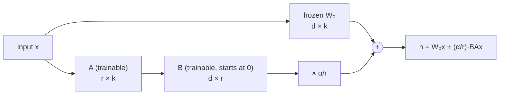

# Section 16 — Fine-Tuning & LoRA

> **In one line:** fine-tuning adapts a pre-trained model to your task or domain. Updating **all** the weights is expensive, so most practitioners use **parameter-efficient fine-tuning** — above all **LoRA**, which freezes the original weights and learns a tiny **low-rank** correction $\Delta W = BA$, often less than 1% of the parameters.

---

## 1. Learning objectives

By the end of this section you should be able to:

1. **Choose** between prompting, full fine-tuning and parameter-efficient methods for a given situation.
2. **Explain** LoRA: why a low-rank update works, how $B$ and $A$ are initialised, and how the update is merged after training.
3. **Compute** a LoRA forward pass by hand and count LoRA's trainable parameters.
4. **Estimate** GPU memory for full fine-tuning, LoRA and QLoRA.
5. **Describe** adapters and prompt tuning, and the practical risks of fine-tuning (overfitting, forgetting).

---

## 2. Prerequisites

- **Section 12:** training with AdamW; ≈ 16 bytes per trainable parameter for weights, gradients and optimizer states.
- **Section 4/8:** the attention projections $W_Q, W_K, W_V, W_O$ and FFN matrices are where most parameters live.
- **Matrix rank:** the **rank** of a matrix is the number of independent rows (or columns). A $d \times k$ matrix written as $BA$ with $B$ of shape $d \times r$ and $A$ of shape $r \times k$ has rank at most $r$.

**Quick refresher — the outer product.** A column vector $b$ ($d \times 1$) times a row vector $a$ ($1 \times k$) gives a $d \times k$ matrix $ba$ of **rank 1**: every row is a multiple of $a$. It's described by only $d + k$ numbers instead of $d \cdot k$.

---

## 3. Motivation: adapting a giant model cheaply

A pre-trained LLM knows a lot, but you may want it to:
- answer in your company's format and tone,
- handle a specialist domain (law, medicine, your codebase),
- do a narrow task very reliably (extract fields from invoices).

**Options, from cheapest to most expensive:**

| Approach | Trainable parameters | Cost | Good when |
|---|---|---|---|
| Prompting / few-shot examples | 0 | none | the model can already do it with instructions |
| Retrieval (RAG, Section 18) | 0 | low | the model needs **facts** it doesn't know |
| **LoRA / QLoRA** | ~0.1–1% | low | you need new **behaviour**, style, format or task skill |
| Full fine-tuning | 100% | very high | big domain shift, lots of data and hardware |

Full fine-tuning of a 7B model needs about $16 \times 6.74 \times 10^9 \approx 108$ GB just for weights, gradients and Adam states — more than one large GPU — and produces a full 13.5 GB copy of the model for every task. LoRA fixes both problems.

---

## 4. Intuition first: sticky notes on a textbook

You own an excellent textbook (the pre-trained model). You're taking a specialised course and want to adapt it.

- **Full fine-tuning** = rewriting the whole textbook by hand. Thorough, but slow, and you end up with one rewritten copy per course.
- **LoRA** = leaving the book untouched and adding a few **sticky notes** with corrections. The notes are tiny, you can keep different sets for different courses, and you can swap them in and out. When you're done, you can even copy the notes into the book permanently (merging).
- **Prompt tuning** = writing a short cheat-sheet at the front of the book that changes how you read the rest.

**Where the analogy breaks:** LoRA's "notes" aren't sentences; they're small matrices whose product slightly changes how every input passes through a layer.

---

## 5. The formal idea

### 5.1 Full fine-tuning

Start from the pre-trained weights and continue training on task data, updating every parameter (usually with a smaller learning rate than pre-training). Most powerful, most expensive. Every task needs its own full copy of the model.

### 5.2 LoRA: Low-Rank Adaptation

LoRA keeps each chosen weight matrix $W_0$ (shape $d \times k$) **frozen** and adds a trainable low-rank update (using the paper's convention $h = Wx$ with column vectors):

$$h = W_0 x + \frac{\alpha}{r}\, B A x, \qquad B \in \mathbb{R}^{d \times r},\; A \in \mathbb{R}^{r \times k},\; r \ll \min(d, k)$$

- **Rank $r$:** typically 4–64.
- **Initialisation:** $A$ random (small Gaussian), $B = 0$. So at the start $BA = 0$ and the model behaves **exactly** like the original — training begins from the pre-trained model, not from a damaged one.
- **Scaling** $\alpha / r$: a constant that keeps the update's size roughly independent of $r$ (e.g. $\alpha = 16$, $r = 8$ → factor 2).
- **Trainable parameters** for one matrix: $r(d + k)$ instead of $dk$.
- **Where:** usually the attention projections ($W_Q, W_V$ or all four), often the FFN matrices too.

**Why low rank is enough:** experiments show that the *change* needed to adapt a pre-trained model to a task tends to be much simpler than the weights themselves — it can be captured well by a few directions. A rank-$r$ update can only change the layer's behaviour along $r$ directions, but those turn out to be the ones that matter.

**Merging:** after training, compute $W = W_0 + \frac{\alpha}{r}BA$ once. The merged model has exactly the original shape and **no extra inference cost**. Or keep the small $A, B$ files separate and **swap** them per task — many LoRA "adapters" can share one base model.

### 5.3 QLoRA

QLoRA stores the frozen base model in **4-bit** precision (a special format called NF4) and trains LoRA matrices on top in 16-bit. The base weights take about 0.5 bytes per parameter instead of 2, so a 65B-parameter model can be fine-tuned on a single 48 GB GPU, and a 7B model on a consumer GPU.

### 5.4 Other parameter-efficient methods

- **Adapters:** small bottleneck networks inserted inside each block: down-project $d \to m$, non-linearity, up-project $m \to d$, plus a residual. Effective, but they add a little inference latency because they can't be merged away.
- **Prompt tuning / prefix tuning:** learn a handful of "virtual token" embeddings (prompt tuning) or per-layer key/value vectors (prefix tuning) that are prepended to the input. Extremely few parameters; works best on large models.
- **(IA)³, DoRA and others:** variations that scale activations or split weights into magnitude and direction.

### 5.5 Practical points

- **Data quality beats quantity:** a few thousand clean, consistent examples often beat a large noisy set.
- **Use the model's chat template** exactly; mismatched formatting is a common silent failure.
- **Learning rate:** LoRA typically uses about $10^{-4}$ to $2 \times 10^{-4}$, much higher than full fine-tuning (≈ $10^{-5}$), because only a few parameters move.
- **Catastrophic forgetting:** narrow fine-tuning can erase general abilities. Keep a held-out evaluation of general skills, use few epochs, or mix in general data. LoRA forgets somewhat less, since the base weights are frozen.
- **Overfitting:** watch validation loss; 1–3 epochs is usually enough.

---

## 6. Worked examples

### 6.1 Counting LoRA parameters

One $4096 \times 4096$ matrix ($d = k = 4096$):

| | Parameters | Share of the matrix |
|---|---|---|
| Full matrix | $4096^2 = 16{,}777{,}216$ | 100% |
| LoRA, $r = 8$ | $8 \times (4096 + 4096) = 65{,}536$ | **0.39%** |
| LoRA, $r = 16$ | $131{,}072$ | 0.78% |

**Whole model (LLaMA-2 7B):** LoRA with $r = 16$ on $W_Q, W_K, W_V, W_O$ in all 32 layers:

$$32 \times 4 \times 16 \times (4096 + 4096) = 16{,}777{,}216 \text{ trainable parameters} \approx 0.25\% \text{ of } 6.74\text{B}$$

The whole adapter file is about 34 MB in 16-bit — versus 13.5 GB for a fully fine-tuned copy.

### 6.2 A LoRA forward pass by hand

Take a tiny layer with $d = k = 3$, frozen weights $W_0 = I$ (the identity), rank $r = 1$, and $\alpha / r = 1$. After training, suppose

$$A = \begin{bmatrix} 1 & 0 & 1 \end{bmatrix} \;(1 \times 3), \qquad B = \begin{bmatrix} 0.5 \\ 0 \\ -0.5 \end{bmatrix} \;(3 \times 1)$$

Input $x = [1, 2, 3]^{\top}$.

1. Frozen path: $W_0 x = [1, 2, 3]^{\top}$
2. LoRA path, step 1: $A x = 1(1) + 0(2) + 1(3) = 4$ (one number, because $r = 1$)
3. LoRA path, step 2: $B (Ax) = 4 \times [0.5, 0, -0.5]^{\top} = [2, 0, -2]^{\top}$
4. Add: $h = [1, 2, 3] + [2, 0, -2] = \mathbf{[3, 2, 1]}$

**Merging:** $\Delta W = BA = \begin{bmatrix} 0.5 & 0 & 0.5 \\ 0 & 0 & 0 \\ -0.5 & 0 & -0.5 \end{bmatrix}$ (rank 1 — every row is a multiple of $[1, 0, 1]$).

$W = W_0 + \Delta W = \begin{bmatrix} 1.5 & 0 & 0.5 \\ 0 & 1 & 0 \\ -0.5 & 0 & 0.5 \end{bmatrix}$, and $Wx = [1.5 + 1.5,\; 2,\; -0.5 + 1.5] = [3, 2, 1]$ — **the same output**, with a single matrix.

**At initialisation** ($B = 0$): $h = W_0 x = [1, 2, 3]$ exactly — the model starts unchanged.

### 6.3 Memory: full fine-tuning vs LoRA vs QLoRA (7B model)

| Method | Frozen base weights | Trainable parameters × 16 bytes | Total before activations |
|---|---|---|---|
| Full fine-tuning | — | $6.74\text{B} \times 16 = 108$ GB | **≈ 108 GB** |
| LoRA ($r = 16$, attention) | 16-bit: $6.74\text{B} \times 2 = 13.5$ GB | $16.8\text{M} \times 16 = 0.27$ GB | **≈ 13.8 GB** |
| QLoRA (same LoRA) | 4-bit: $6.74\text{B} \times 0.5 = 3.4$ GB | 0.27 GB | **≈ 3.7 GB** |

Activations come on top and depend on batch size and sequence length, but the difference is dramatic: full fine-tuning needs several data-centre GPUs; QLoRA fits on a single consumer GPU.

### 6.4 How much rank do you need?

Suppose the "ideal" update for some $8 \times 8$ weight matrix is a sum of five rank-1 pieces with strengths $8, 4, 2, 1, 0.5$ (in orthogonal directions). The best rank-$r$ approximation keeps the $r$ strongest pieces:

| Rank $r$ | Parameters $r(8 + 8)$ | Relative error |
|---|---|---|
| 0 | 0 | 100% |
| 1 | 16 | 50% |
| 2 | 32 | 25% |
| 3 | 48 | 12% |
| 4 | 64 | 5% |
| 5 | 80 | 0% |

When an update is dominated by a few strong directions — as task adaptations tend to be — a small rank captures most of it.

### 6.5 Other methods, counted

- **Adapters** in BERT-base ($d = 768$, bottleneck $m = 64$, two per layer, 12 layers): each adapter $2 \times 768 \times 64 + 64 + 768 = 99{,}136$ parameters; total $24 \times 99{,}136 = 2{,}379{,}264$ ≈ **2.2%** of BERT-base.
- **Prompt tuning** with 20 virtual tokens on a model with $d = 4096$: $20 \times 4096 = 81{,}920$ parameters — about 0.001% of a 7B model.

---

## 7. Diagram

After training: $W = W_0 + \frac{\alpha}{r}BA$ → one ordinary matrix, no extra cost.

---

## 8. In practice

| Situation | Typical choice |
|---|---|
| Teach a consistent format, tone or task on a 7–70B model | LoRA / QLoRA on attention (and often FFN) matrices, $r$ = 8–64 |
| One GPU with limited memory | QLoRA |
| Serve many customers, each with their own customisation | one base model + many swappable LoRA adapters |
| Big domain shift, plenty of data and compute | full fine-tuning (or continued pre-training) |
| Model just lacks up-to-date facts | RAG first (Section 18), not fine-tuning |

- **Libraries:** Hugging Face **PEFT** provides LoRA, QLoRA (with bitsandbytes), adapters and prompt tuning with a few lines of configuration.
- **Instruction tuning** (Section 12's SFT) and **preference tuning** (DPO) are both commonly run with LoRA.
- **Evaluate before and after** on your task *and* on general ability, to catch forgetting.

---

## 9. Common mistakes and misconceptions

- **"Fine-tuning is the best way to add new knowledge."** Fine-tuning is better at teaching **behaviour and format**; for facts that change or need citations, retrieval (RAG) is usually more reliable.
- **"LoRA adds inference cost."** Only if you keep the adapter separate. After merging, the model is exactly the original size and speed.
- **"LoRA starts from a random model."** $B = 0$ at the start, so the adapted model initially equals the pre-trained one.
- **"A higher rank is always better."** Beyond a modest rank, gains are small and overfitting risk rises; small ranks often match full fine-tuning on narrow tasks.
- **"QLoRA trains a 4-bit model."** The **base** is stored in 4-bit and frozen; the LoRA weights are trained in 16-bit.

---

## 10. Summary

- **Full fine-tuning** updates every weight — powerful but ≈ 16 bytes/parameter of memory and a full model copy per task.
- **LoRA** freezes $W_0$ and learns $\Delta W = \frac{\alpha}{r} BA$ with $B$ ($d \times r$, starts at 0) and $A$ ($r \times k$); parameters $r(d + k)$ — e.g. 0.39% of a $4096 \times 4096$ matrix at $r = 8$.
- The update can be **merged** into $W_0$ (no inference cost) or kept as a small, swappable adapter.
- **QLoRA** stores the frozen base in 4-bit, bringing 7B fine-tuning to ≈ 4 GB plus activations.
- **Adapters** and **prompt/prefix tuning** are other parameter-efficient options; good data, the right template and checking for forgetting matter more than the method.

---

## 11. Check your understanding

1. A weight matrix is $4096 \times 11{,}008$ (an FFN projection in LLaMA-2 7B). How many trainable parameters does LoRA with $r = 8$ add? What fraction of the matrix is that?
2. In 6.2, what is $h$ if $x = [2, 0, -2]^{\top}$? Explain the result using the rank of $\Delta W$.
3. Why is $B$ initialised to zero rather than $A$ and $B$ both random?

Answers

1. $8 \times (4096 + 11{,}008) = \mathbf{120{,}832}$ parameters, out of $4096 \times 11{,}008 = 45{,}088{,}768$ — about **0.27%**.
2. $Ax = 1(2) + 0 + 1(-2) = 0$, so the LoRA path adds nothing and $h = W_0 x = \mathbf{[2, 0, -2]}$. $\Delta W$ has rank 1: it only responds to the component of $x$ along $A = [1, 0, 1]$, and this $x$ has none.
3. With $B = 0$, $BA = 0$ at the start, so the model begins **exactly** as the pre-trained model and training only moves it as far as the data requires. If both were random, the first forward pass would add a random distortion to every adapted layer, damaging the pre-trained behaviour before any learning happened. ($A$ must still be random — if both were zero, the gradients for both would be zero and nothing would ever learn.)

---

## 12. Further reading

1. Hu, E. J. et al. (2021). **"LoRA: Low-Rank Adaptation of Large Language Models."** arXiv:2106.09685.
2. Dettmers, T. et al. (2023). **"QLoRA: Efficient Finetuning of Quantized LLMs."** arXiv:2305.14314.
3. Houlsby, N. et al. (2019). **"Parameter-Efficient Transfer Learning for NLP."** arXiv:1902.00751 — adapters.
4. Lester, B., Al-Rfou, R., & Constant, N. (2021). **"The Power of Scale for Parameter-Efficient Prompt Tuning."** arXiv:2104.08691.
5. Li, X. L., & Liang, P. (2021). **"Prefix-Tuning: Optimizing Continuous Prompts for Generation."** arXiv:2101.00190.
6. Aghajanyan, A., Zettlemoyer, L., & Gupta, S. (2020). **"Intrinsic Dimensionality Explains the Effectiveness of Language Model Fine-Tuning."** arXiv:2012.13255 — why low-dimensional updates suffice.
