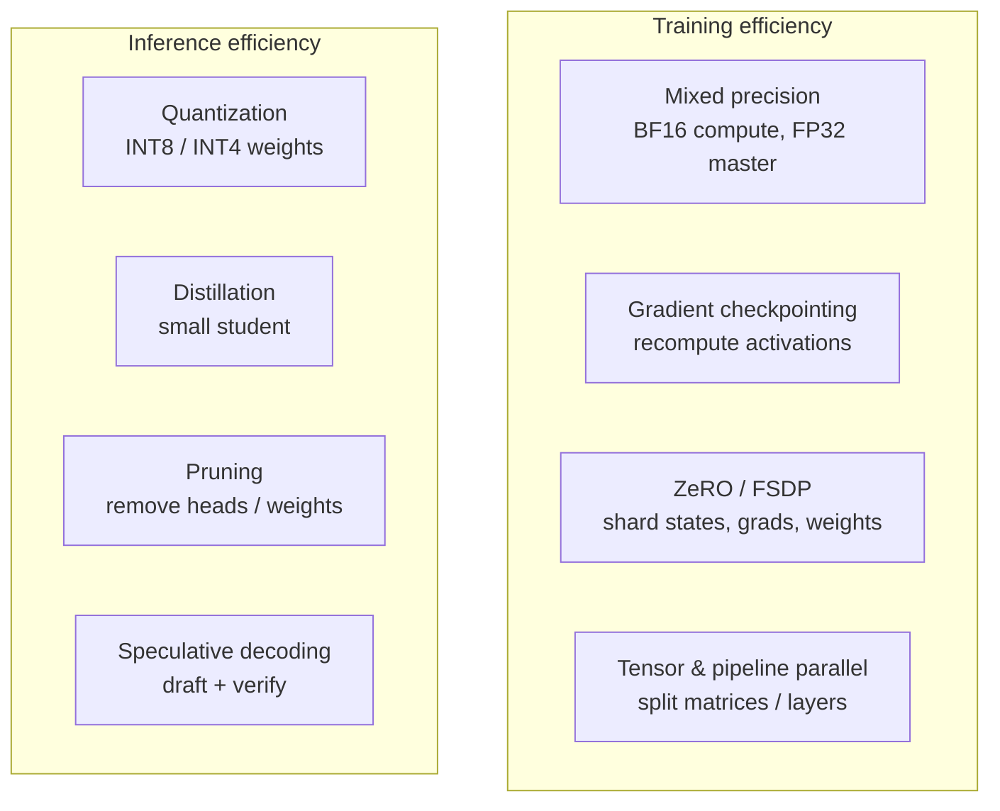

# Section 17 — Optimization & Quantization

> **In one line:** large models are only practical because of a toolbox of efficiency tricks — **lower-precision numbers** (BF16, INT8, INT4), **memory-saving training** (mixed precision, gradient checkpointing, ZeRO/FSDP sharding, model parallelism), and **cheaper inference** (quantization, distillation, pruning, speculative decoding).

---

## 1. Learning objectives

By the end of this section you should be able to:

1. **Compare** number formats (FP32, FP16, BF16, FP8, INT8, INT4) by range and precision, and explain why BF16 is preferred for training.
2. **Quantize** a list of weights to INT8 and INT4 by hand (absmax scaling), and explain why outliers and group-wise scales matter.
3. **Calculate** per-GPU training memory under data parallelism and ZeRO stages 1–3.
4. **Explain** gradient checkpointing, gradient accumulation, and tensor/pipeline parallelism.
5. **Estimate** the speed-up from speculative decoding, and describe distillation and pruning.

---

## 2. Prerequisites

- **Section 12:** AdamW training needs ≈ 16 bytes per parameter (weights, gradients, master weights, $m$, $v$).
- **Section 14:** decoding is memory-bandwidth bound — fewer bytes per weight means faster tokens.
- **Binary numbers:** with $b$ bits you can represent $2^b$ different values (8 bits → 256).

**Quick refresher — floating-point numbers.** A floating-point number is stored like scientific notation in base 2: a **sign**, an **exponent** (sets the range — how big or small) and a **mantissa** (sets the precision — how many significant digits). More exponent bits → bigger range; more mantissa bits → finer steps.

---

## 3. Motivation: the numbers are too big

A 70-billion-parameter model:
- **Weights alone** in 32-bit floats: $70 \times 10^9 \times 4 = 280$ GB. In 16-bit: 140 GB. Neither fits on one 80 GB GPU.
- **Training** with AdamW: ≈ $16 \times 70 \times 10^9 = 1{,}120$ GB of weights, gradients and optimizer states — before activations.
- **Generation** reads every weight for every token (Section 14), so the number of bytes directly sets the speed.

Every byte saved per parameter is multiplied by tens of billions. This section is about saving those bytes — and the compute that goes with them — without losing much accuracy.

---

## 4. Intuition first: packing for a trip

You're moving a huge library to a new city.

- **Lower precision** = writing measurements with fewer decimal places. "1.23456789 m" becomes "1.23 m": less space, slightly less exact, usually good enough.
- **Quantization** = sorting books onto a fixed set of shelves (only 16 shelves for INT4) instead of placing each at its exact height. One enormous book (an **outlier**) forces you to space all the shelves far apart, and small books all end up on the bottom shelf — unless each section of the library gets its own shelf spacing (**group-wise scales**).
- **ZeRO / sharding** = several friends each carry one part of the library instead of everyone carrying a full copy.
- **Gradient checkpointing** = not photocopying every page you read; if you need a page again later, re-read it.
- **Distillation** = a great teacher writes a short study guide that a smaller student learns from.
- **Speculative decoding** = a fast assistant drafts the next few sentences; the expert just checks them, which is quicker than writing.

**Where the analogy breaks:** quantization error isn't random clutter — it systematically shifts each weight to its nearest allowed value, and errors in thousands of weights can add up.

---

## 5. The formal idea

### 5.1 Number formats

| Format | Bits (sign / exponent / mantissa) | Largest value | Step just above 1.0 | Typical use |
|---|---|---|---|---|
| FP32 | 1 / 8 / 23 | $\approx 3.4 \times 10^{38}$ | $1.2 \times 10^{-7}$ | master weights, optimizer states |
| FP16 | 1 / 5 / 10 | 65,504 | $9.8 \times 10^{-4}$ | older mixed-precision training, inference |
| **BF16** | 1 / 8 / 7 | $\approx 3.4 \times 10^{38}$ | $7.8 \times 10^{-3}$ | **training today** |
| FP8 (E4M3) | 1 / 4 / 3 | 448 | 0.125 | newest GPUs: training and inference |
| INT8 | integer | 127 | 1 (with a scale) | inference weights/activations |
| INT4 | integer | 7 | 1 (with a scale) | inference weights |

**Why BF16 for training:** it has the **same range as FP32** (8 exponent bits), so values rarely overflow or underflow; it gives up precision, which training tolerates well. FP16 has more precision but a tiny range: gradients smaller than about $6 \times 10^{-8}$ round to zero, so FP16 training needs **loss scaling** (multiply the loss by e.g. 1,024 before the backward pass, divide the gradients afterwards).

**Mixed precision:** do the heavy matrix multiplications in BF16/FP16 (fast), but keep a **32-bit master copy** of the weights and the optimizer states, so tiny updates aren't lost to rounding.

### 5.2 Quantization

**Quantization** maps real numbers onto a small set of integers plus a **scale**. The simplest scheme is **symmetric absmax** quantization to $b$ bits:

$$s = \frac{\max_i |w_i|}{q_{\max}}, \quad q_{\max} = 2^{b-1} - 1 \qquad q_i = \text{round}\!\left(\frac{w_i}{s}\right) \qquad \hat w_i = s \cdot q_i$$

- Store the small integers $q_i$ (8 or 4 bits each) plus one scale $s$ per group.
- At use time, **dequantize** $\hat w_i = s\, q_i$ (or compute directly with integers on supporting hardware).
- The rounding error per weight is at most $s/2$.

**Granularity:** one scale for a whole tensor is cheapest but fragile; **per-channel** or **per-group** scales (e.g. one scale per 64 or 128 weights) keep errors small, at a small storage cost.

**The outlier problem:** a single very large value inflates $s$ for its whole group, so ordinary small weights all round to 0. Fixes: smaller groups, keeping outliers in higher precision (as in LLM.int8()), or rescaling channels before quantizing (as in SmoothQuant/AWQ).

**When to quantize:**
- **Post-training quantization (PTQ):** quantize a finished model; methods like **GPTQ** and **AWQ** choose roundings/scales that minimise the error on sample data. Takes minutes to hours; INT8 is nearly lossless and 4-bit usually loses only a little.
- **Quantization-aware training (QAT):** simulate quantization during training so the model learns to tolerate it; better at very low bit widths.

### 5.3 Saving memory during training

- **Gradient accumulation:** run several small batches, add up their gradients, then do one optimizer step — same effective batch size with less activation memory.
- **Gradient (activation) checkpointing:** store activations only at a few layer boundaries and **recompute** the rest during the backward pass. Saves most activation memory for about one extra forward pass (≈ 33% more compute, since a training step ≈ 1 forward + 2 forward-equivalents of backward).
- **Data parallelism:** every GPU holds a full model copy and processes different data; gradients are averaged (all-reduce) each step.
- **ZeRO / FSDP:** remove the redundant copies across data-parallel GPUs by **sharding**:

| Stage | What is split across the $G$ GPUs | Bytes per parameter per GPU |
|---|---|---|
| none (plain data parallel) | nothing | $2 + 2 + 12 = 16$ |
| ZeRO-1 | optimizer states (12 B) | $2 + 2 + 12/G$ |
| ZeRO-2 | + gradients | $2 + 14/G$ |
| ZeRO-3 / FSDP | + weights | $16/G$ |

(2 bytes 16-bit weights, 2 bytes 16-bit gradients, 12 bytes for the FP32 master copy, $m$ and $v$.) Higher stages save more memory but communicate more.

- **Tensor parallelism:** split each big matrix multiplication across GPUs (e.g. different attention heads or columns of $W$ on different GPUs). Needs very fast links; used within a server.
- **Pipeline parallelism:** put different layers on different GPUs, passing activations along like an assembly line; micro-batches keep all stages busy.

Real large-scale training combines all of these ("3-D parallelism").

### 5.4 Cheaper inference

- **Weight quantization** (INT8/INT4): fewer bytes → less memory and, because decoding is bandwidth-bound, faster generation.
- **Knowledge distillation:** train a small **student** to match a large **teacher**'s output probabilities (softened with a temperature), not just the correct labels. The student learns the teacher's "dark knowledge" about which wrong answers are nearly right.
- **Pruning:** remove weights (unstructured) or whole heads/neurons/layers (structured) that matter least. Structured pruning gives real speed-ups on ordinary hardware; unstructured pruning needs special support.
- **Speculative decoding:** a small **draft** model proposes $k$ tokens; the large model checks all of them in **one** forward pass and keeps the longest prefix it agrees with (plus one token of its own). The output distribution is exactly the large model's. If each drafted token is accepted with probability $\alpha$, the expected number of tokens per large-model pass is

$$E = \frac{1 - \alpha^{k+1}}{1 - \alpha}$$

---

## 6. Worked examples

### 6.1 What can each format represent?

- **Step size near 1.0:** FP16 can represent 1 and $1 + 2^{-10} = 1.000977$ but nothing in between; BF16 only 1 and $1 + 2^{-7} = 1.0078$. BF16 is coarser — but its range is as large as FP32's.
- **A tiny gradient** of $10^{-8}$: below FP16's smallest positive number ($\approx 6 \times 10^{-8}$), so it **underflows to 0**. With loss scaling by 1,024 it becomes $1.024 \times 10^{-5}$ — safely representable — and is divided back after the backward pass. In BF16 it's representable without any scaling.
- **A large activation** of 100,000: overflows FP16 (max 65,504) but fits easily in BF16.

### 6.2 INT8 and INT4 quantization by hand

Weights: $w = [0.52, -1.17, 0.03, 2.40, -0.71, 0.15]$. Largest magnitude: 2.40.

**INT8** ($q_{\max} = 127$): scale $s = 2.40 / 127 = 0.0189$.

| $w$ | $w / s$ | $q$ | $\hat w = s q$ | error |
|---|---|---|---|---|
| 0.52 | 27.52 | 28 | 0.529 | 0.009 |
| −1.17 | −61.91 | −62 | −1.172 | 0.002 |
| 0.03 | 1.59 | 2 | 0.038 | 0.008 |
| 2.40 | 127.00 | 127 | 2.400 | 0 |
| −0.71 | −37.57 | −38 | −0.718 | 0.008 |
| 0.15 | 7.94 | 8 | 0.151 | 0.001 |

Average error **0.005** — tiny.

**INT4** ($q_{\max} = 7$): scale $s = 2.40 / 7 = 0.343$.

| $w$ | $q$ | $\hat w$ | error |
|---|---|---|---|
| 0.52 | 2 | 0.686 | 0.166 |
| −1.17 | −3 | −1.029 | 0.141 |
| 0.03 | 0 | 0 | 0.030 |
| 2.40 | 7 | 2.400 | 0 |
| −0.71 | −2 | −0.686 | 0.024 |
| 0.15 | 0 | 0 | 0.150 |

Average error **0.085** — 18× larger: only 15 levels are available. Small weights (0.03, 0.15) become exactly 0.

### 6.3 One outlier ruins a group

Replace 0.15 with an outlier, **24.0**. Now $s = 24 / 7 = 3.43$ for INT4: 0.52, −1.17, 0.03 and −0.71 all round to **0**, and 2.40 becomes 3.43. Five of six weights are badly wrong.

**Group-wise scales** (groups of 3):
- Group 1 $[0.52, -1.17, 0.03]$: $s = 1.17 / 7 = 0.167$ → $[0.50, -1.17, 0]$ — good again.
- Group 2 $[2.40, -0.71, 24.0]$: still dominated by the outlier → $[3.43, 0, 24.0]$.

The damage is now confined to the outlier's own group. Real 4-bit methods use groups of 64–128 weights and extra tricks to protect outliers.

### 6.4 Memory for the weights

| Model | FP16 / BF16 | INT8 | INT4 |
|---|---|---|---|
| LLaMA-2 7B (6.74B) | 13.5 GB | 6.7 GB | 3.4 GB (≈ 3.8 GB with group scales) |
| 70B | 140 GB | 70 GB | 35 GB |

A 70B model in INT4 fits on a single 48 GB GPU (with room for some KV cache); in FP16 it needs at least two 80 GB GPUs. And since decoding is bandwidth-bound, 4-bit weights can make generation roughly 2–3× faster in practice.

### 6.5 ZeRO on 64 GPUs (training LLaMA-2 7B)

$N = 6.74 \times 10^9$, $G = 64$:

| Setup | Bytes per parameter per GPU | Per-GPU memory (before activations) |
|---|---|---|
| Plain data parallel | 16 | **108 GB** — doesn't fit on 80 GB |
| ZeRO-1 | $4 + 12/64 = 4.19$ | 28.2 GB |
| ZeRO-2 | $2 + 14/64 = 2.22$ | 15.0 GB |
| ZeRO-3 / FSDP | $16/64 = 0.25$ | **1.7 GB** |

### 6.6 Speculative decoding

A draft model proposes $k = 4$ tokens; each is accepted with probability $\alpha = 0.8$:

$$E = \frac{1 - 0.8^5}{1 - 0.8} = \frac{1 - 0.328}{0.2} = 3.36 \text{ tokens per large-model pass}$$

If one draft-model step costs 5% of a large-model step, each round costs $1 + 4 \times 0.05 = 1.2$ large-model steps, giving a speed-up of about $3.36 / 1.2 \approx \mathbf{2.8\times}$ — with exactly the same output distribution.

---

## 7. Diagram

---

## 8. In practice

| Goal | Common choice |
|---|---|
| Pre-training a large model | BF16 mixed precision, FSDP/ZeRO-3, tensor + pipeline parallelism, gradient checkpointing; FP8 on the newest GPUs |
| Fine-tuning on one GPU | QLoRA (4-bit base, Section 16), gradient checkpointing, gradient accumulation |
| Serving in a data centre | FP8/INT8 weights (and often KV cache), continuous batching, speculative decoding |
| Running on a laptop or phone | 4-bit (or lower) weights in formats like GGUF via llama.cpp, or a distilled small model |

- **Measure accuracy after quantizing**, on your own tasks — some abilities (maths, long reasoning, rare languages) degrade before average benchmarks do.
- **Small distilled models** (and small models trained on outputs of larger ones) are now competitive for many narrow tasks at a fraction of the cost.
- **Bits keep falling:** research on 2-bit and even ~1.6-bit (ternary) models shows promise, especially when the model is trained that way from the start.

---

## 9. Common mistakes and misconceptions

- **"FP16 and BF16 are interchangeable."** Same size, different trade-off: FP16 has more precision but a tiny range (needs loss scaling); BF16 has FP32's range with less precision.
- **"Quantization just truncates decimals."** It maps values to a few levels with a shared **scale**; the scale's choice (and outliers) decides the error.
- **"4-bit always ruins a model."** With good methods (GPTQ, AWQ, group-wise scales), 4-bit weights usually cost only a small amount of quality — but always check on your tasks.
- **"ZeRO-3 is free memory."** It trades memory for **communication**: weights must be gathered from other GPUs before each layer.
- **"Speculative decoding changes the model's answers."** With the standard acceptance rule, the output distribution is exactly the large model's; it only changes speed.

---

## 10. Summary

- **BF16** (FP32's range, less precision) is the standard training format; FP16 needs loss scaling; master weights and Adam states stay in FP32 (**mixed precision**).
- **Quantization**: $s = \max|w| / q_{\max}$, $q = \text{round}(w/s)$, $\hat w = sq$. INT8 is nearly lossless; INT4 needs care — **outliers** inflate the scale, so use **group-wise scales** and methods like GPTQ/AWQ.
- Weight memory: 7B = 13.5 GB (16-bit) → 6.7 GB (INT8) → 3.4 GB (INT4); 70B INT4 fits on one 48 GB GPU.
- Training memory: **ZeRO/FSDP** shards optimizer states, gradients and weights (7B on 64 GPUs: 108 GB → 1.7 GB per GPU); **gradient checkpointing** trades ≈ 33% more compute for much less activation memory.
- Cheaper inference: quantization, **distillation**, **pruning**, and **speculative decoding** ($E = (1 - \alpha^{k+1})/(1 - \alpha)$ tokens per pass).

---

## 11. Check your understanding

1. Quantize $w = [1.0, -0.5, 0.25]$ to INT4 with one absmax scale. Give $s$, the integers $q$, and the dequantized values.
2. A 13B model is trained on 32 GPUs with ZeRO-2. How much memory per GPU do weights, gradients and optimizer states need?
3. With a draft length of $k = 3$ and acceptance probability $\alpha = 0.6$, how many tokens per large-model pass do you expect? Is speculative decoding worth it if a draft step costs 10% of a large step?

Answers

1. $s = 1.0/7 = 0.143$; $w/s = [7, -3.5, 1.75]$; rounding gives $q = [7, -3, 2]$ (−3.5 rounds to −3 with "round half up"; some implementations give −4) → $\hat w = [1.0, -0.43, 0.29]$.
2. $(2 + 14/32) \times 13 \times 10^9 = 2.4375 \times 13 \times 10^9 \approx \mathbf{31.7}$ **GB** per GPU.
3. $E = (1 - 0.6^4)/(1 - 0.6) = (1 - 0.1296)/0.4 = \mathbf{2.18}$ tokens per pass. Cost per round $= 1 + 3 \times 0.1 = 1.3$ large steps → speed-up $\approx 2.18/1.3 \approx \mathbf{1.7\times}$ — still worth it.

---

## 12. Further reading

1. Micikevicius, P. et al. (2018). **"Mixed Precision Training."** arXiv:1710.03740 — FP16 training and loss scaling.
2. Rajbhandari, S. et al. (2020). **"ZeRO: Memory Optimizations Toward Training Trillion Parameter Models."** arXiv:1910.02054.
3. Chen, T. et al. (2016). **"Training Deep Nets with Sublinear Memory Cost."** arXiv:1604.06174 — gradient checkpointing.
4. Dettmers, T. et al. (2022). **"LLM.int8(): 8-bit Matrix Multiplication for Transformers at Scale."** arXiv:2208.07339 — outliers in LLMs.
5. Frantar, E. et al. (2022). **"GPTQ: Accurate Post-Training Quantization for Generative Pre-trained Transformers."** arXiv:2210.17323. And Lin, J. et al. (2023). **"AWQ: Activation-aware Weight Quantization for LLM Compression and Acceleration."** arXiv:2306.00978.
6. Hinton, G., Vinyals, O., & Dean, J. (2015). **"Distilling the Knowledge in a Neural Network."** arXiv:1503.02531.
7. Leviathan, Y., Kalman, M., & Matias, Y. (2023). **"Fast Inference from Transformers via Speculative Decoding."** arXiv:2211.17192.
