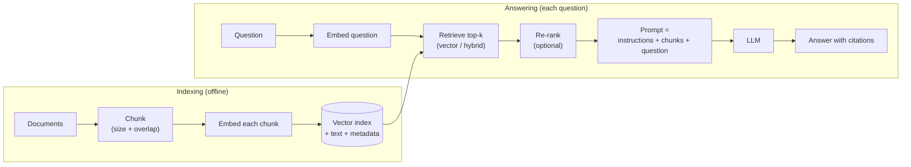

# Section 18 — Serving & RAG

> **In one line:** **serving** is the engineering of running an LLM for many users at once — fast, cheap and reliably (continuous batching, KV-cache management, streaming). **RAG** (retrieval-augmented generation) gives the model the right documents at question time, so it can answer from your own, up-to-date data and cite its sources.

---

## 1. Learning objectives

By the end of this section you should be able to:

1. **Describe** the path of a request through an LLM serving system and the metrics used to judge it (TTFT, time per output token, throughput, cost per million tokens).
2. **Explain** why continuous batching beats static batching, and compute GPU utilisation for both.
3. **Draw** the RAG pipeline — chunk, embed, index, retrieve, (re-rank), prompt, generate — and explain each step.
4. **Compute** chunk counts, cosine-similarity retrieval, and retrieval metrics (recall@k, MRR) by hand.
5. **Diagnose** common RAG failures and choose between RAG and fine-tuning.

---

## 2. Prerequisites

- **Sections 13–14:** prefill vs decode, TTFT, the KV cache, memory-bandwidth limits.
- **Section 9:** encoders produce sentence embeddings by mean pooling; bi-encoders vs cross-encoders.
- **Section 2:** cosine similarity.
- **Section 16:** fine-tuning teaches behaviour; this section shows how to supply knowledge.

**Quick refresher — percentiles.** The **p50** latency is the median: half of requests are faster. The **p99** latency is slower than 99% of requests — it describes the unlucky users. Serving systems care about p99, not just the average.

---

## 3. Motivation: two practical gaps

**Gap 1 — one model, many users.** A model that answers one question in 6 seconds on a GPU is not a product. A real service must handle thousands of users at once, keep the first token fast, stream the rest, and cost cents rather than dollars per conversation.

**Gap 2 — the model doesn't know your data.** A pre-trained LLM:
- has a **knowledge cutoff** — nothing after its training data,
- has never seen your **private documents** (college circulars, company policies, your codebase),
- can **hallucinate** — state plausible-sounding but wrong facts,
- can't easily **cite** where an answer came from.

Fine-tuning doesn't fix these well (Section 16): facts change, and the model still can't point to a source. **RAG** fixes them by looking up relevant text at question time and putting it in the prompt.

---

## 4. Intuition first

**Serving = a busy restaurant kitchen.** Orders (requests) arrive at random. A bad kitchen cooks in fixed rounds — nobody's new order starts until every dish in the current round is done (static batching). A good kitchen starts a new dish the moment a burner frees up (continuous batching). The fridge space (GPU memory for KV caches) limits how many dishes can be in progress at once.

**RAG = an open-book exam.** Instead of answering from memory, the student first looks up the relevant pages in the textbook, then writes an answer using them — and can say "see page 42". The quality depends on two things: finding the **right pages** (retrieval) and **writing a good answer** from them (generation).

**Where the analogies break:** a kitchen's burners are independent; on a GPU, all requests in a batch share each step, so one very long request still occupies a slot until it finishes. And unlike a student, the model only "reads" the pages you put in its context window — it can't flip to others.

---

## 5. The formal idea

### 5.1 Anatomy of a serving system

1. **API gateway:** authentication, rate limits, routing.
2. **Scheduler:** queues requests, decides which ones join the next batch.
3. **Inference engine** (e.g. vLLM, TGI, TensorRT-LLM, SGLang): runs prefill and decode on the GPUs, manages KV-cache memory (PagedAttention, prefix caching — Section 14).
4. **Streaming:** sends each token to the user as soon as it's generated.

**Key metrics:**

| Metric | Meaning | Mostly set by |
|---|---|---|
| **TTFT** (time to first token) | how long before the answer starts appearing | queueing + prefill |
| **TPOT** (time per output token) | speed of the streamed answer | decode (memory bandwidth, batch size) |
| **Throughput** | tokens per second across all users | batching, KV-cache capacity |
| **Cost per million tokens** | GPU price ÷ tokens produced | throughput |
| **p99 latency** | the slow tail of requests | load, long requests, queueing |

Total time for one answer of $n$ tokens ≈ $\text{TTFT} + n \times \text{TPOT}$.

### 5.2 Static vs continuous batching

- **Static batching:** collect $B$ requests, run them together until **all** finish. Short requests sit idle, padded, while the longest one finishes; new requests wait for the whole batch.
- **Continuous (in-flight) batching:** the batch is rebuilt **every decode step** — finished requests leave immediately and waiting requests take their slots.

GPU slot utilisation for static batching:

$$\text{utilisation} = \frac{\sum_i \text{length}_i}{B \times \max_i \text{length}_i}$$

Continuous batching keeps slots nearly full whenever there's a queue, typically giving several times the throughput.

### 5.3 The RAG pipeline

**Indexing (offline, done once and updated as documents change):**
1. **Load** documents (PDF, web pages, wiki, tickets…).
2. **Chunk** them into passages of a few hundred tokens, with some **overlap** so sentences cut at a boundary appear whole in one chunk.
3. **Embed** each chunk with an embedding model (an encoder, Section 9) → a vector.
4. **Store** vectors (plus the text and metadata like source and page) in a **vector index**.

**Answering (online, every question):**
1. **Embed the question** with the same embedding model.
2. **Retrieve** the top-$k$ chunks by similarity (usually cosine).
3. Optionally **re-rank** them with a cross-encoder (Section 9) that reads question and chunk together — slower but more accurate.
4. **Build the prompt:** instructions + retrieved chunks (numbered, with sources) + the question.
5. **Generate** an answer, asking the model to use only the provided context and to cite chunk numbers.

### 5.4 Retrieval details

- **Exact search** compares the query with every vector — fine for thousands of chunks, too slow for hundreds of millions.
- **Approximate nearest-neighbour (ANN)** indexes such as **HNSW** (a navigable graph) or **IVF** (clustering) find almost the same top results in milliseconds.
- **Keyword search (BM25)** matches exact words — great for names, codes and rare terms that embeddings can blur.
- **Hybrid search** runs both and merges the lists, often with **reciprocal rank fusion (RRF)**:

$$\text{RRF}(d) = \sum_{\text{lists}} \frac{1}{k + \text{rank}(d)}, \quad k \approx 60$$

### 5.5 Evaluating RAG

Evaluate the two halves separately:

| Part | Metric | Question it answers |
|---|---|---|
| Retrieval | **recall@k** | Is a relevant chunk in the top $k$? |
| Retrieval | **MRR** (mean reciprocal rank) | How high is the first relevant chunk? (average of $1/\text{rank}$) |
| Generation | **faithfulness** | Is every claim in the answer supported by the retrieved text? |
| Generation | **answer relevance / correctness** | Does it actually answer the question correctly? |

**Common failures:** the right chunk isn't retrieved (bad chunking, vocabulary mismatch → try hybrid search, better chunking, query rewriting); it's retrieved but buried among irrelevant chunks (→ re-ranking, smaller $k$); the model ignores or contradicts the context (→ clearer instructions, citations, a stronger model).

---

## 6. Worked examples

### 6.1 Static vs continuous batching

Four requests in one batch ($B = 4$) need **10, 50, 20 and 40** output tokens.

**Static:** the batch runs for 50 steps (the longest request). Slot-steps used: $10 + 50 + 20 + 40 = 120$ out of $4 \times 50 = 200$.

$$\text{utilisation} = 120 / 200 = \mathbf{60\%}$$

40% of the GPU's batch capacity is wasted on finished requests, and any new request waits all 50 steps.

**Continuous:** when the 10-token request finishes at step 10, a waiting request takes its slot at step 11, and so on. With a steady queue, slots stay close to 100% busy.

### 6.2 What does a token cost?

A GPU rented at \$2 per hour that sustains **2,000 output tokens per second** across all users:

$$\text{tokens per hour} = 2{,}000 \times 3{,}600 = 7.2 \text{ million} \qquad \text{cost} = \frac{\$2}{7.2\text{M}} \approx \mathbf{\$0.28 \text{ per million tokens}}$$

Doubling throughput (better batching, quantization) halves the cost.

**Latency for one user:** TTFT 0.2 s, TPOT 25 ms, a 300-token answer → $0.2 + 300 \times 0.025 = \mathbf{7.7}$ **s** — but streaming means they start reading after 0.2 s.

### 6.3 Chunking a document

A 10,000-token document, chunk size 500 tokens, overlap 50 tokens → each new chunk starts $500 - 50 = 450$ tokens after the previous one:

- Chunk starts: 0, 450, 900, …, 9,450 (22 chunks), plus one final chunk 9,900–10,000 to cover the end.
- Total: **23 chunks**.

Storage for the index: with 768-dimensional 32-bit embeddings, each chunk needs $768 \times 4 = 3{,}072$ bytes; one million chunks need about **3 GB** of vectors (plus the text).

### 6.4 Retrieval by cosine similarity

A tiny index of college notices (3-D toy embeddings):

| Chunk | Text | Embedding |
|---|---|---|
| c1 | "Library hours: 8 am to 10 pm on weekdays." | [0.9, 0.1, 0.2] |
| c2 | "The hostel mess serves dinner from 7 pm." | [0.2, 0.9, 0.1] |
| c3 | "On Sundays the library closes at 6 pm." | [0.6, 0.3, 0.6] |
| c4 | "The exam fee deadline is 15 March." | [0.1, 0.2, 0.9] |

Question: *"When is the library open?"* → embedding $q = [0.9, 0.2, 0.2]$, with $\lVert q \rVert = 0.943$.

| Chunk | $q \cdot c$ | $\lVert c \rVert$ | Cosine |
|---|---|---|---|
| c1 | $0.81 + 0.02 + 0.04 = 0.87$ | 0.927 | **0.994** |
| c3 | $0.54 + 0.06 + 0.12 = 0.72$ | 0.900 | **0.848** |
| c2 | $0.18 + 0.18 + 0.02 = 0.38$ | 0.927 | 0.434 |
| c4 | $0.09 + 0.04 + 0.18 = 0.31$ | 0.927 | 0.354 |

With $k = 2$, retrieval returns **c1 and c3** — both library notices. The prompt then becomes:

> Answer using only the context. Cite sources as [1], [2].
> [1] Library hours: 8 am to 10 pm on weekdays.
> [2] On Sundays the library closes at 6 pm.
> Question: When is the library open?

and a good answer is: *"8 am to 10 pm on weekdays [1]; on Sundays it closes at 6 pm [2]."*

### 6.5 Retrieval metrics

Three test questions; the first relevant chunk appears at rank **1**, rank **3**, and **not at all** in the top 5:

- recall@1 $= 1/3 = 0.33$; recall@3 $= 2/3 = 0.67$
- MRR $= \frac{1}{3}\left(\frac{1}{1} + \frac{1}{3} + 0\right) = \mathbf{0.44}$

### 6.6 Hybrid search with RRF ($k = 60$)

| Document | BM25 rank | Vector rank | RRF score |
|---|---|---|---|
| A | 1 | 3 | $1/61 + 1/63 = 0.03227$ |
| B | 2 | 1 | $1/62 + 1/61 = 0.03252$ |
| C | — | 2 | $1/62 = 0.01613$ |

Final order: **B, A, C**. B wins because it's near the top of *both* lists; C appears in only one.

### 6.7 Fitting it into the context window

A 4,096-token model: system instructions 200 + five chunks × 500 + question 50 + room for a 500-token answer = **3,250 tokens** — it fits, with about 850 to spare. Ten chunks would not. Retrieval quality matters more than stuffing in more chunks.

---

## 7. Diagram

---

## 8. In practice

**Serving stack choices:**

| Need | Typical tool |
|---|---|
| High-throughput GPU serving | vLLM, TGI, TensorRT-LLM, SGLang |
| Local / laptop | llama.cpp, Ollama (quantized GGUF models) |
| Managed | a cloud provider's hosted model API |

**RAG building blocks:**

| Component | Examples |
|---|---|
| Embedding models | sentence-transformers / E5 / BGE family, hosted embedding APIs |
| Vector stores | FAISS (library), pgvector (PostgreSQL), Qdrant, Weaviate, Milvus, Chroma |
| Keyword search | BM25 (e.g. in Elasticsearch / OpenSearch) |
| Re-rankers | cross-encoder models |

**Good practice:**
- Start simple: decent chunking + a good embedding model + top-5 retrieval + a clear prompt with citations. Add hybrid search and re-ranking when evaluation shows retrieval misses.
- **Build a small evaluation set** (questions with known answers and source chunks) before tuning anything.
- Keep **metadata** (source, date, page, access rights) with every chunk — for citations, filtering, and making sure users only retrieve documents they're allowed to see.
- **RAG vs fine-tuning:** RAG for *knowledge* (changing facts, private documents, citations); fine-tuning for *behaviour* (format, tone, a narrow skill). They combine well.
- **Long-context models** can sometimes take whole documents instead of chunks, but cost grows with every token (Section 14), and retrieval still helps when the collection is large.

---

## 9. Common mistakes and misconceptions

- **"Bigger batches always mean better service."** Bigger batches raise throughput but can raise each user's latency; serving balances the two, within KV-cache memory.
- **"RAG makes hallucinations impossible."** It reduces them, but the model can still misread, ignore or over-generalise the context — measure faithfulness.
- **"More retrieved chunks is always better."** Irrelevant chunks dilute the context and can mislead the model; quality over quantity.
- **"Vector search understands everything."** Embeddings can blur exact names, numbers and codes; hybrid search with keywords catches these.
- **"RAG and fine-tuning are alternatives."** They solve different problems (knowledge vs behaviour) and are often used together.

---

## 10. Summary

- **Serving** turns a model into a service: gateway → scheduler → inference engine → streaming. Judge it by **TTFT**, **TPOT**, **throughput**, **p99 latency** and **cost per million tokens**.
- **Continuous batching** refills slots every step; static batching wastes capacity (60% utilisation in our example).
- **RAG** = chunk → embed → index (offline) and embed question → retrieve top-$k$ → (re-rank) → prompt with sources → generate (online).
- Retrieval uses cosine similarity over embeddings, ANN indexes at scale, and **hybrid** keyword + vector search merged with **RRF**.
- Evaluate retrieval (**recall@k**, **MRR**) and generation (**faithfulness**, correctness) separately; use RAG for knowledge and fine-tuning for behaviour.

---

## 11. Check your understanding

1. A static batch of 4 requests needs 30, 30, 30 and 90 output tokens. What is the slot utilisation? What would help most?
2. A 6,000-token document is split with chunk size 400 and overlap 100. How many chunks are produced?
3. Using 6.4, which chunks are retrieved for the question *"What time is dinner?"* with embedding $q = [0.2, 0.9, 0.2]$ and $k = 1$? Compute the winning cosine.

Answers

1. $(30 + 30 + 30 + 90) / (4 \times 90) = 180/360 = \mathbf{50\%}$. **Continuous batching** — the three short requests' slots could serve new requests for 60 of the 90 steps.
2. Step $= 400 - 100 = 300$. Starts 0, 300, …, 5,400 (19 chunks; the one at 5,400 ends at 5,800), plus one final chunk from 5,700 to 6,000: **20 chunks**.
3. Dot products: c1 $0.18 + 0.09 + 0.04 = 0.31$; c2 $0.04 + 0.81 + 0.02 = 0.87$; c3 $0.12 + 0.27 + 0.12 = 0.51$; c4 $0.02 + 0.18 + 0.18 = 0.38$. $\lVert q \rVert = 0.943$, $\lVert c2 \rVert = 0.927$, so cos(q, c2) $= 0.87 / (0.943 \times 0.927) = 0.87 / 0.875 = \mathbf{0.994}$ → **c2** (the mess notice) is retrieved.

---

## 12. Further reading

1. Lewis, P. et al. (2020). **"Retrieval-Augmented Generation for Knowledge-Intensive NLP Tasks."** arXiv:2005.11401 — the original RAG paper.
2. Kwon, W. et al. (2023). **"Efficient Memory Management for Large Language Model Serving with PagedAttention."** arXiv:2309.06180 — vLLM and continuous batching.
3. Yu, G.-I. et al. (2022). **"Orca: A Distributed Serving System for Transformer-Based Generative Models."** *OSDI 2022* — iteration-level (continuous) batching.
4. Karpukhin, V. et al. (2020). **"Dense Passage Retrieval for Open-Domain Question Answering."** arXiv:2004.04906.
5. Malkov, Y. A., & Yashunin, D. A. (2016). **"Efficient and robust approximate nearest neighbor search using Hierarchical Navigable Small World graphs."** arXiv:1603.09320 — HNSW.
6. Cormack, G. V., Clarke, C. L. A., & Büttcher, S. (2009). **"Reciprocal Rank Fusion outperforms Condorcet and individual Rank Learning Methods."** *SIGIR 2009.*
